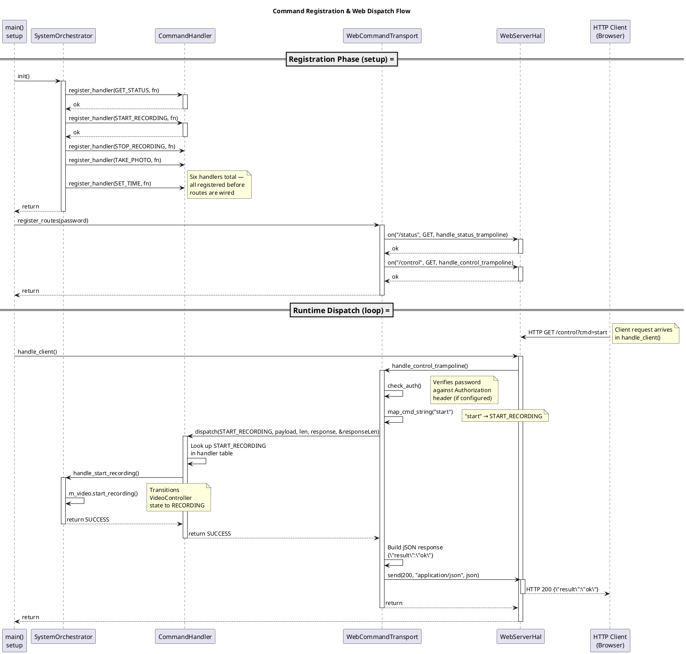

# System Design

This document describes the architecture and key components of the ESP32 Photo Camera project.

## Overview

This project is a still photo and video camera built on the **Seeed XIAO ESP32S3 Sense** platform, which includes an onboard OV2640 camera and MicroSD card slot. The firmware captures JPEG images at a configurable interval and records MJPEG video in AVI containers to the SD card, while an LED provides visual status feedback.

The design follows a layered architecture that separates hardware access from application logic, enabling thorough unit testing on a native host machine without any hardware dependencies.

## Architecture

```
┌─────────────────────────────────────────────────────────────┐
│                  Application  (main.cpp)                    │
│  setup() / loop() — wires components, runs the              │
│  photo capture cycle, video recording state machine,        │
│  and web server request handling                            │
└─────────────────────────────────────────────────────────────┘
                         │
                         ▼
┌─────────────────────────────────────────────────────────────┐
│              Orchestration / Command Layer                  │
│  SystemOrchestrator   (top-level coordinator)               │
│  CommandHandler       (protocol-agnostic dispatch)          │
│  WebCommandTransport  (HTTP → CommandHandler bridge)        │
│  SerialCommandTransport (UART → CommandHandler bridge)      │
└─────────────────────────────────────────────────────────────┘
                         │
                         ▼
┌─────────────────────────────────────────────────────────────┐
│                Service / Controller Layer                   │
│  CameraController    VideoController   LedStateMachine      │
│  SdController        AviWriter         PinArbitrator        │
│  SdWriteBuffer       TimeService       LoggingService       │
│  ConfigService       IniParser                              │
│  WifiService         WebServerService                       │
│  PeripheralManager  (facade / composition root)             │
└─────────────────────────────────────────────────────────────┘
                         │
                         ▼
┌─────────────────────────────────────────────────────────────┐
│                Hardware Abstraction Layer (HAL)             │
│  CameraHal       SdCardHal      LogBackend                  │
│  GpioHal         TimeHal        WifiHal    SerialHal        │
│  WebServerHal                                               │
└─────────────────────────────────────────────────────────────┘
                         │
                         ▼
┌─────────────────────────────────────────────────────────────┐
│              Arduino Libraries & ESP32 Hardware             │
│  esp_camera   SD_MMC.h   GPIO   Serial   WiFi   WebServer   │
└─────────────────────────────────────────────────────────────┘
```

### Key Design Principles

- **Dependency Injection**: All service-layer classes accept HAL interfaces through constructor parameters, making them decoupled from any specific hardware implementation.
- **Single Responsibility**: Each class owns exactly one concern — the LED state machine handles only LED timing, the SD write controller handles only the chip select (CS) protocol, etc.
- **Tick-Driven State Machines**: Service controls are implemented as non-blocking state machines advanced by periodic `tick()` calls from the main loop or higher level services.
- **Testability via Abstractions**: Abstract HAL interfaces allow full unit testing of service-layer logic on a native host (macOS/Linux) using mock implementations, with no ESP32 hardware required.

---

## Hardware Abstraction Layer (HAL)

The HAL provides abstract interfaces that wrap Arduino/ESP32 hardware calls. Each interface has a concrete implementation for the ESP32 target and a mock implementation for native tests.

### HAL Interfaces

| Interface | File | Responsibility |
|-----------|------|----------------|
| `CameraHal` | `include/hal/camera_hal.h` | Camera initialization, frame capture/release, capabilities query. Returns `CameraInitResult`, `CameraFrame`. |
| `SdCardHal` | `include/hal/sd_card_hal.h` | SD card initialization, file open/write/close. Returns `SdInitResult`. File operations contract: must only be called when CS is asserted. |
| `GpioHal` | `include/hal/gpio_hal.h` | Thin forwarding wrappers for `pinMode()` and `digitalWrite()`. No logic — pure indirection. |
| `TimeHal` | `include/hal/time_hal.h` | Forwarding functions for Arduino `millis()`, `delay()`, and microsecond delays. Defines the `millis_t` type alias. |
| `LogBackend` | `include/hal/log_backend.h` | Abstract interface for log output destinations. Receives fully formatted log lines from `LoggingService`. |
| `SerialHal` | `include/hal/serial_hal.h` | UART serial port abstraction. Wraps the Arduino `HardwareSerial` interface (`available`, `read`, `write`, `flush`) behind a mockable interface. |

### Concrete ESP32 Implementations

All concrete HAL implementations live in `src/hal/` and directly call Arduino/ESP32 library functions:

| Implementation | Wraps |
|---------------|-------|
| `CameraHalImpl` | `esp_camera_*` functions, `esp_camera_init()`, `esp_camera_fb_get()`/`esp_camera_fb_return()` |
| `SdCardHalImpl` | Arduino `SD` library (`SD.begin()`, `File` open/write/close) |
| `GpioHal` | Arduino `pinMode()`, `digitalWrite()` |
| `SerialHalImpl` | Arduino `HardwareSerial` (`Serial`) — wraps `available`, `read`, `write`, `flush` behind the `SerialHal` interface. Serial port is initialised in the constructor. |
| `SerialLogBackend` | Injected `SerialHal&` — writes formatted log lines via the shared serial HAL. Serial port lifecycle managed externally by the composition root. |
| `PlatformInitializer` | `esp_log_level_set()`, `esp_log_set_vprintf()` — ESP-IDF BSP-level init, not Arduino. Called once at the top of `setup()`. |

### WifiHal

**File**: `include/hal/wifi_hal.h`

Abstract interface for WiFi operations. Provides STA/AP mode selection, connection management, and status queries.

| Method | Purpose |
|--------|---------|
| `mode(sta, ap)` | Set WiFi mode (station, access point, or both) |
| `begin_sta(ssid, password)` | Connect to a WiFi network as a station |
| `begin_ap(ssid, password)` | Start an access point |
| `status()` | Return connection status as a `WifiStatus` enum (`CONNECTED`, `DISCONNECTED`, etc.) |
| `local_ip()` | Return the assigned IP address |
| `config_static(ip, gateway, subnet)` | Configure static IP addressing for STA before `begin_sta()`; returns `false` if addresses are invalid |
| `disconnect()` | Disconnect from the network |
| `is_connected()` | Return whether the device is connected |

**ESP32 Implementation**: `WifiHalImpl` (`src/hal/wifi_hal_impl.cpp`) wraps the Arduino `WiFi` library. Uses `IPAddress::fromString()` for address parsing and `WiFi.config()` to apply the static configuration.

**Mock**: `MockWifiHal` (`test/mocks/native_mocks/mock_wifi_hal.h`) provides configurable return values (`begin_sta_result`, `status_result` of type `WifiStatus`, `connected_result`, `ip_buffer`, `config_static_result`) and call tracking (`begin_sta_call_count`, `begin_ap_call_count`, `config_static_call_count`, etc.).

### WebServerHal

**File**: `include/hal/web_server_hal.h`

Abstract interface for HTTP server operations. Provides route registration, request inspection, and response sending.

| Method | Purpose |
|--------|---------|
| `begin(port)` | Start the HTTP server on the given port |
| `on(uri, method, handler)` | Register a route handler (plain function pointer) |
| `handle_client()` | Process pending HTTP requests |
| `stop()` | Stop the server |
| `uri()` | Get the current request URI |
| `method()` | Get the current request HTTP method |
| `arg(name)` | Get a query parameter value |
| `header(name)` | Get a request header value |
| `auth_header()` | Get the `Authorization` header |
| `send(code, type, content)` | Send a complete HTTP response |
| `send_header(code, type, length)` | Send a response header (chunked mode) |
| `send_content(data, len)` | Send response body content |

**ESP32 Implementation**: `WebServerHalImpl` (`src/hal/web_server_hal_impl.cpp`) wraps the Arduino `WebServer` library. Uses a raw pointer (`new`/`delete`) for the server instance.

**Mock**: `MockWebServerHal` (`test/mocks/native_mocks/mock_web_server_hal.h`) provides configurable return values and records registered routes and responses.

### SerialHal

**File**: `include/hal/serial_hal.h`

Abstract interface for UART serial port operations. Provides byte-level I/O and buffer management.

| Method | Purpose |
|--------|---------|
| `available()` | Return the number of bytes in the receive buffer |
| `read()` | Read a single byte, or -1 if none available |
| `write(data, len)` | Write a buffer of bytes |
| `flush()` | Wait for the transmit buffer to empty |

**ESP32 Implementation**: `SerialHalImpl` (`src/hal/serial_hal_impl.cpp`) wraps the Arduino `HardwareSerial` (`Serial`) object, forwarding each method directly.

**Mock**: `MockSerialHal` (`test/mocks/native_mocks/mock_serial_hal.h`) provides configurable return values, simulated input injection (`inject_input()`, `inject_bytes()`), captured output inspection (`output_as_string()`), and call tracking (`flush_call_count`).

### Mock Implementations (Native Tests)

Mock HAL classes live in `test/mocks/native_mocks/` and provide configurable return values plus call tracking:

| Mock | Tracks | Configurable |
|------|--------|-------------|
| `MockCameraHal` | `init_call_count`, `capture_call_count`, `release_call_count`, `deinit_call_count` | `init_result`, `capture_result`, `initialized_state`, `capabilities` |
| `MockSdCardHal` | `init_call_count`, `open_call_count`, `write_call_count`, `close_call_count` | `init_result`, `open_result`, `write_result` |
| `MockLogBackend` | `write_call_count`, `last_message`, `messages` (vector of all captured lines) | N/A — captures output for assertion |
| `MockSerialHal` | `flush_call_count`, `output_buffer` (captured writes) | `input_buffer` for simulated serial input |
| Mock Arduino | N/A | Stub `String`, `HardwareSerial`, `millis()`, `delay()` for native compilation |

---

## Service Layer Classes

### TimeService

**File**: `include/time_service.h`

Abstract interface for time acquisition. Provides `now()` (current milliseconds), `delay_ms()`, and `delay_us()`, plus a static `elapsed_ms()` utility that correctly handles 32-bit millisecond rollover using unsigned arithmetic.

`RealTimeService` delegates to the `TimeHal` functions (`hal::get_millis()`, `hal::delay_ms()`). A mock implementation returns a programmable value for deterministic testing.

### LedStateMachine

**File**: `include/led_state_machine.h`

A pure state machine with no hardware side effects. Operates in four modes:

- **OFF** — LED permanently off.
- **ON** — LED permanently on.
- **PULSE_ON** — LED on for a fixed duration, then off.
- **BLINK** — LED alternates on/off at configurable intervals.

The `tick()` method advances the state machine and returns the desired LED state (`true` = on, `false` = off). Callers are responsible for applying the result to a GPIO pin. Uses an injected `TimeService` for all timing, enabling deterministic testing with mock time.

### SdController

**File**: `include/sd_controller.h`

Manages the SD card I/O lifecycle with a chip-select (CS) timing protocol. Supports read, write, and directory creation operations. Owns a state machine that sequences CS assertion and de-assertion around file I/O:

```
IDLE → PRE_DEACTIVATE_CS → ACTIVATE_CS → IO_ACTIVE → END_IO → POST_DEACTIVATE_CS → IDLE
```

The `tick()` method returns an `SdSignal` (`IDLE`, `CS_ACTIVE`, or `CS_INACTIVE`) that describes what the shared pin should do. When `IDLE`, the LED's request wins. When `CS_ACTIVE` or `CS_INACTIVE`, the SD card overrides the LED. This arbitration between LED and SD card chip select is handled in the `PeripheralManager` (specifically via the `PinArbitrator`).

### Non-Blocking API

- `start_write(path, data, len)` — initiates a write operation.
- `start_read(path, buffer, buffer_size)` — initiates a read operation.
- `start_create_dir(path)` — initiates a directory creation.
- `is_idle()` — returns `true` when the state machine has returned to `IDLE`.
- `get_write_result()` / `get_read_result()` / `get_create_dir_result()` / `get_bytes_read()` — result accessors after the cycle completes.
- `init_card()` — delegates to `SdCardHal::init()`.

The `PeripheralManager` wraps these non-blocking primitives with a blocking convenience API (`write_file()`, `read_file()`, `create_dir()`) that loops `tick()` + `is_idle()` with a timeout. Hardware I/O is delegated to an injected `SdCardHal`.

### PinArbitrator

**File**: `include/pin_arbitrator.h`

A static utility class that resolves conflicts when the LED and SD chip-select share the same physical pin (GPIO 21 on the ESP32S3 Sense). Both LED-on and CS-active are active-LOW.

Arbitration rules:
- `SdSignal::IDLE` → LED's request is granted.
- `SdSignal::CS_ACTIVE` → Pin forced LOW (CS active).
- `SdSignal::CS_INACTIVE` → Pin forced HIGH (CS inactive).

### LoggingService

**File**: `include/logging_service.h`

Syslog-style structured logging with timestamp, subsystem name, and severity level. Output format:

```
[00001234] [CAMERA] [INFO ] Photo saved successfully
```

Provides convenience methods (`debug()`, `info()`, `warn()`, `error()`) with printf-style variadic formatting. Delegates output to a pluggable `LogBackend`.

---

## IniParser

**Files**: `include/ini_parser.h`, `src/ini_parser.cpp`

### Responsibility

A stateless, single-pass INI file parser. Parses a character buffer into a `ConfigData` struct containing all firmware configuration.

### INI Format

```ini
[wifi]
ssid=MyNetwork
password=secret123

[ap]
ssid=ESP32-Cam
password=admin

[web]
port=8080
password=webpass

[camera]
capture_interval_ms=15000

[video]
fps=10
resolution=VGA
clip_duration_s=60
max_file_size_mb=0
jpeg_quality=10
```

- Sections are denoted by `[name]`
- Key-value pairs use `key=value` syntax
- Lines starting with `#` or `;` are comments
- Blank lines are ignored
- Section and key matching is case-insensitive
- Whitespace around keys, values, and section headers is trimmed
- Unknown sections and keys are silently ignored
- Values are truncated to `CONFIG_FIELD_MAX_LENGTH - 1` (63) characters
- Integer values (`port`, `capture_interval_ms`, `fps`, `jpeg_quality`) are validated with range checking

### API

- `IniParser::defaults()` — returns a `ConfigData` populated with defaults (port 80, capture interval 20000 ms, empty strings).
- `IniParser::parse(const char* content, size_t length)` — parses the given buffer and returns a `ConfigData`. Malformed lines are skipped gracefully. Unknown fields retain their defaults.
- `IniParser::serialize(const ConfigData& data, char* buffer, size_t buffer_size)` — serializes a `ConfigData` into INI-format text written to `buffer`. Returns the number of bytes written (excluding null terminator). If the buffer is null or too small, returns the number of bytes that would have been needed. The output is round-trip compatible with `parse()` — serializing and re-parsing yields identical values. All fields are always written, including empty strings.

### ConfigData Structure

```c++
struct ConfigData
{
    struct WifiConfig   { char ssid[64]; char password[64];
                          char static_ip[64]; char gateway[64];
                          char subnet_mask[64]; };
    struct ApConfig     { char ssid[64]; char password[64]; };
    struct WebConfig    { uint16_t port; char password[64];
                          uint8_t max_streams{4}; };
    struct CameraConfig { uint32_t capture_interval_ms;
                          char resolution[64]{"VGA"};
                          uint8_t jpeg_quality{10};
                          uint8_t grab_mode{0xFF}; };
    struct VideoConfig  { uint16_t fps; char resolution[64];
                          uint16_t clip_duration_s;
                          uint16_t max_file_size_mb;
                          uint8_t jpeg_quality;
                          bool audio_enabled{false};
                          uint8_t mic_gain{2}; };

    WifiConfig wifi;
    ApConfig ap;
    WebConfig web;
    CameraConfig camera;
    VideoConfig video;
};
```

### Testability

Pure logic with no hardware dependencies. Testable natively with coverage for defaults, parsing, edge cases, comments, whitespace, malformed input, video config parsing, and serialization round-trips.

---

## ConfigService

**Files**: `include/config_service.h`, `src/config_service.cpp`

### Responsibility

High-level configuration service that owns the current `ConfigData` and provides a `load()` method to populate it from a raw byte buffer (typically read from an INI file on the SD card).

### Dependencies

- `LoggingService &` — for diagnostic output during config loading.

### Key Methods

- `load(const uint8_t* data, size_t length)` — parses the buffer via `IniParser::parse()`, logs the result (WiFi SSID, AP SSID, web port, capture interval), and stores the parsed config. Returns `true` on success, `false` if the buffer is null or empty (in which case defaults are retained with a warning log).
- `config()` — returns a `const ConfigData&` to the current configuration (read-only).
- `mutable_config()` — returns a `ConfigData&` for in-place modification. Callers can modify fields directly, then use `IniParser::serialize()` to produce an updated INI buffer for persistence.

### Constants

| Constant | Value | Description |
|----------|-------|-------------|
| `CONFIG_BUFFER_SIZE` | 512 | Maximum buffer size expected for config file reads |
| `DEFAULT_CONFIG_PATH` | `/config.ini` | Path on SD card where config file is looked up |
| `READ_TIMEOUT_MS` | 5000 | Timeout for SD card read operations |

### Integration

In `main.cpp`, after SD card initialization:
1. A stack-allocated buffer of `CONFIG_BUFFER_SIZE` bytes is created.
2. `PeripheralManager::read_file()` reads `/config.ini` from the SD card.
3. `ConfigService::load()` parses the buffer and logs the result.
4. `build_camera_config()` translates the user-facing `CameraImageConfig` (resolution + JPEG quality from config) into `ResolvedCameraParams`. The camera controller clamps these against HAL capabilities at init time.
5. `CameraController::init(ResolvedCameraParams)` initializes the camera with the validated config.
6. `VideoController::init(config, width, height)` stores the validated dimensions.
7. `camera_capture_interval_ms` is updated from the parsed config.
8. `WifiService::init()` connects to STA or falls back to AP.
9. `WebServerService::init()` starts the HTTP server.
10. `SystemOrchestrator::init()` registers command handlers.

### Write Pattern

ConfigService does not own file I/O or serialization. Callers that need to persist modified config follow this pattern:

```c++
// 1. Modify config in place
config_service.mutable_config().web.port = 9090;

// 2. Serialize to INI text
char buf[ConfigService::CONFIG_BUFFER_SIZE];
size_t len = IniParser::serialize(config_service.config(), buf, sizeof(buf));

// 3. Write to SD card via PeripheralManager
peripheral_manager.write_file(ConfigService::DEFAULT_CONFIG_PATH,
                              reinterpret_cast<const uint8_t*>(buf),
                              len, timeout_ms);
```

This keeps ConfigService thin (no PeripheralManager dependency) while enabling full round-trip config persistence.

### Testability

Testable natively using `MockLogBackend` for log verification and `RealTimeService` for time. Tests cover defaults, loading, mutable access, and reload behavior.

---

## Network & Command Layer

These components add WiFi connectivity, a web-based control interface, a protocol-agnostic command dispatch framework, and a top-level system coordinator.

### WifiService

**Files**: `include/wifi_service.h`, `src/wifi_service.cpp`

#### Responsibility

Encapsulates WiFi lifecycle — attempts STA (station) connection first, falls back to AP (access point) mode on timeout. Reconnection strategy is encapsulated here for future evolution.

#### Dependencies

- `WifiHal &` — abstract WiFi hardware interface (injected via constructor).
- `LoggingService &` — for diagnostic output.

#### Lifecycle

```
init(sta_config, ap_config, timeout_secs)
  → mode(STA)
  → if static_ip + gateway + subnet_mask all set:
       config_static(ip, gateway, subnet)  ← on failure, log warning and continue with DHCP
  → begin_sta(ssid, password)
  → poll status() every 1s until connected or timeout
  → if timeout: mode(AP), begin_ap(ssid, password)
```

If all three static IP fields (`static_ip`, `gateway`, `subnet_mask`) are present and non-empty in the config, `config_static()` is called before `begin_sta()`. If `config_static()` returns `false` (e.g. malformed address), a warning is logged and the system falls back to DHCP — `begin_sta()` is always called.

If any of the three fields is missing or empty, static IP configuration is skipped and DHCP is used.

Static IP applies only to STA mode. AP mode always uses its own addressing via `softAP()`.

#### Key Methods

- `init(sta, ap, timeout_secs)` — connects to the configured STA network. If not connected within `timeout_secs`, falls back to AP mode.
- `is_connected()` — returns `true` if connected as a station.
- `local_ip()` — returns the current IP address (STA or AP).

#### Testability

Fully testable on native via `MockWifiHal`. Tests cover STA success, timeout fallback, quick-connect, connection state reflection, static IP application, static IP failure fallback to DHCP, and missing-fields skipping static config.

### WebServerService

**Files**: `include/web_server_service.h`, `src/web_server_service.cpp`

#### Responsibility

Manages HTTP route registration, HTTP Basic authentication, and the main `handle_client()` loop. Routes are registered during `init()`.

#### Dependencies

- `WebServerHal &` — abstract HTTP server interface (injected via constructor).
- `LoggingService &` — for diagnostic output.
- `CommandHandler &` — optional; set via `set_command_handler()` for `/status` and `/control` routes.

#### Routes

| Method | Path | Handler | Auth | Description |
|--------|------|---------|------|-------------|
| GET | `/` | `handle_index()` | No | Returns a built-in HTML status page |
| GET | `/status` | `handle_status()` | Yes | Returns JSON status via CommandHandler |
| GET | `/control` | `handle_control()` | Yes | Dispatches commands via CommandHandler |

#### Authentication

If a web password is configured, the service checks the `Authorization` header against the expected `Basic base64(user:pass)` value. If no password is configured, authentication is skipped.

#### Static Trampolines

Because `WebServerHal::on()` takes a plain `void(*)()` function pointer (lambdas with captures cannot convert), the service uses a static instance pointer with static callback methods. This is a known pattern required by the Arduino `WebServer` API.

### CommandHandler

**Files**: `include/command_handler.h`, `src/command_handler.cpp`

#### Responsibility

Protocol-agnostic command dispatch framework. Transports (web, serial) feed requests in; handlers registered by the orchestrator process them. The handler is protocol-agnostic — changing from text to binary requires only a new transport.

#### Architecture

```
Transport (HTTP, Serial, etc.)
  → has_request() / read_request()
  → CommandHandler::tick()
    → dispatch(code, payload)
      → registered handler fn
    → send_response(result, data)
```

#### Command Codes

The full set of recognised commands, their hex codes, payloads, and transport mappings are documented in the **[Command Reference](#command-reference)** section below.

#### Key Design Points

- **Fixed-size arrays**: Handlers and transports use fixed-size arrays (`MAX_HANDLERS = 16`, `MAX_TRANSPORTS = 4`) rather than dynamic allocation.
- **Tick-driven**: `tick()` polls all registered transports, dispatches pending requests, and sends responses back through the transport.
- **Response buffer**: Each dispatch provides a `MAX_RESPONSE_SIZE` (256) byte buffer for the handler to write response data.

#### Testability

Fully testable on native via `MockCommandTransport`. Tests cover dispatch, registration, unrecognized codes, tick polling, multiple handlers, and response buffers.

### WebCommandTransport

**Files**: `include/web_command_transport.h`, `src/web_command_transport.cpp`

#### Responsibility

Bridges HTTP routes to `CommandHandler::dispatch()`. Each registered command becomes a thin HTTP endpoint.

#### Routes

| Method | Path | Query Param | Description |
|--------|------|-------------|-------------|
| GET | `/status` | `cmd` (optional) | Returns status or dispatches command |
| GET | `/control` | `cmd` | Dispatches command |

#### Command Mapping

See the **Web transport** table in the **[Command Reference](#command-reference)** for the mapping of query values to CommandCodes.

#### Static Trampolines

Like `WebServerService`, this class uses a static instance pointer with static callback methods because `WebServerHal::on()` requires plain function pointers.

### SerialCommandTransport

**Files**: `include/serial_command_transport.h`, `src/serial_command_transport.cpp`

#### Responsibility

Implements a text-based command protocol over UART using the `SerialHal` abstraction. Each line is parsed as a single command and dispatched through `CommandHandler::dispatch()`. Responses are returned as `OK` or `ERR` text lines.

#### Text Protocol

```
Request:  COMMAND [args]\n
Response: OK [data]\n   or   ERR <code>\n
```

Command parsing is case-sensitive. Arguments are separated from the command by a space. Lines are accumulated in an internal buffer until a newline character (`\n`) is received. Both `\n` and `\r` are treated as line terminators; carriage returns are consumed silently, and blank lines are ignored. Lines exceeding the internal buffer (128 bytes) are discarded.

#### Command Mapping

See the **Serial transport** table in the **[Command Reference](#command-reference)** for the mapping of text commands to CommandCodes.

#### Polling Model

Unlike `WebCommandTransport` (which is callback-driven), `SerialCommandTransport` uses a **poll** model. The transport accumulates bytes in `has_request()` and signals readiness when a complete line is received. The `CommandHandler::tick()` method polls `has_request()` on all registered transports, so no separate calls are needed.

#### Integration

The transport shares a single `SerialHal` instance with `SerialLogBackend`.

### SystemOrchestrator

**Files**: `include/system_orchestrator.h`, `src/system_orchestrator.cpp`

#### Responsibility

Top-level system coordinator and command router.

#### Dependencies

- `VideoController &` — for recording control.
- `CameraController &` — for photo capture.
- `CommandHandler &` — for command registration.
- `TimeService &` — for time operations.
- `ConfigService &` — for configuration access.
- `LoggingService &` — for diagnostic output.

#### Registered Commands

The orchestrator registers handlers for all commands listed in the **[Command Reference](#command-reference)**. The handler implementation for each command is documented in the `SystemOrchestrator` source files.

#### Lifecycle

```
init()
  → register_commands()  // registers all handlers with CommandHandler
  → log initialization

tick()
  → (empty — reserved for future use)
```

#### Testability

Fully testable on native via mock HALs and services. Tests cover command registration, status JSON, recording delegation, photo capture, time setting, and tick stability.

### Command Reference

This section documents every command recognised by the system, its payload format, and its response. Commands are dispatched via `CommandHandler::dispatch()` (binary/serial transports) or through HTTP query parameters (web transport). The same handler functions execute regardless of transport.

#### Result Codes

Every command returns a `CommandResult` enum value:

| Code | Name | Description |
|------|------|-------------|
| `0x00` | `SUCCESS` | Command completed successfully |
| `0x01` | `UNRECOGNIZED` | No handler registered for this command code |
| `0x02` | `INVALID_ARGS` | Payload was missing, too short, or malformed |
| `0x03` | `INVALID_STATE` | Command cannot be executed in the current system state |
| `0xFF` | `INTERNAL_ERROR` | Hardware or unexpected failure |

#### Command Details

| Code | Command | Payload | Response Data | Effect |
|------|---------|---------|---------------|--------|
| `0x01` | `GET_STATUS` | None | JSON string: `{"recording":bool,"state":int,"frames":uint32,"file_size":uint32}` | Returns current recording state, state machine value, frame count, and accumulated file size. No side effects. |
| `0x10` | `START_RECORDING` | None | None | Begins MJPEG video recording to SD. Returns `INVALID_STATE` if already recording, `INTERNAL_ERROR` if recording fails to start. |
| `0x11` | `STOP_RECORDING` | None | None | Requests a graceful stop of the current recording session. The clip close and AVI flush complete asynchronously on the next `tick()`. |
| `0x12` | `TAKE_PHOTO` | None | None | Captures a single JPEG frame from the camera and releases it (Slice 1 placeholder — no SD write). Returns `INTERNAL_ERROR` if frame capture fails. |
| `0x20` | `SET_CONFIG` | *(not yet specified)* | None | Update firmware configuration. **Not yet implemented** — returns `INVALID_STATE`. |
| `0x21` | `GET_CONFIG` | None | *(currently unmapped)* | Returns current configuration as serialised INI text. No handler is registered in the binary dispatch table; the web transport maps this to `GET_CONFIG` but the dispatch path is unresolved. |
| `0x22` | `GET_CONFIG_VALUE` | Null-terminated string: `"section.key"` | Value string | Returns a single configuration value identified by section and key (e.g. `"wifi.ssid"`). Returns `INVALID_ARGS` if the key is unknown. |
| `0x23` | `SET_CONFIG_VALUE` | Null-terminated string: `"section.key=value"` | None | Sets a single configuration value. The string contains both the key path and the new value separated by `=`. Returns `INVALID_ARGS` if the key is unknown. |
| `0x30` | `SET_TIME` | 4 bytes, raw `uint32_t` (little-endian Unix timestamp) | None | Sets the system Unix time offset. Payload must be exactly 4 bytes; returns `INVALID_ARGS` if too short. |

#### Transport Mappings

**Web transport** — query parameter `cmd` on `GET /control`:

| Query Value | Command | Notes |
|-------------|---------|-------|
| *(none)* | `GET_STATUS` | Default when `cmd` is omitted |
| `start` | `START_RECORDING` | |
| `stop` | `STOP_RECORDING` | |
| `photo` | `TAKE_PHOTO` | |
| `config` | `GET_CONFIG` | |

The web transport sends a JSON response body for all commands:

- Success: `{"result":"ok"}`
- Error: `{"result":"error","code":<uint>}`

The `/status` endpoint always dispatches `GET_STATUS` regardless of query parameters.

**Serial transport** — line-based text protocol over UART. Each command is a single line terminated by `\n`; responses are returned as `OK` or `ERR` lines.

| Text Command | Command | Payload | Response |
|-------------|---------|---------|----------|
| `STATUS` | `GET_STATUS` | None | Status JSON |
| `PHOTO` | `TAKE_PHOTO` | None | Empty |
| `RECORD_START` | `START_RECORDING` | None | Empty |
| `RECORD_STOP` | `STOP_RECORDING` | None | Empty |
| `TIME <unix_ts>` | `SET_TIME` | Decimal ASCII string (parsed as `uint32_t` by transport) | Empty |
| `GET <section>.<key>` | `GET_CONFIG_VALUE` | `"section.key"` string | The value string |
| `SET <section>.<key>=<val>` | `SET_CONFIG_VALUE` | `"section.key=value"` string | Empty |

Response format:
- **Success**: `OK [data]\n` (data is optional)
- **Error**: `ERR <code>\n` (code is the two-digit hex `CommandResult` value)

Line accumulation happens inside the transport's `has_request()` method. The transport uses the shared `SerialHal` instance.

---

## CameraController

**Files**: `include/camera_controller.h`, `src/camera_controller.cpp`

### Responsibility

Manages the camera lifecycle: initialization, frame capture, and resource release.

### Dependencies

- `CameraHal &` — abstract camera hardware interface (injected via constructor).
- `CameraConfig` — configuration parameters with single-valued defaults (frame size, JPEG quality, frame buffer count, grab mode).

### Lifecycle

```
init() → capture_frame() → get_frame() → release_frame()
```

The controller tracks state via `m_initialized` and `m_frame_acquired` flags. Calling `capture_frame()` without first releasing the previous frame is handled gracefully.

### Configuration

Two `init()` overloads are available:

1. `init()` — uses the `CameraConfig` provided at construction, then clamps values against `CameraHal::get_capabilities()` before passing to the HAL.
2. `init(const ResolvedCameraParams&)` — uses pre-resolved parameters from `build_camera_config()`, which translates user-facing `CameraImageConfig` (resolution string + JPEG quality) into HAL config. The controller then clamps against capabilities before initializing the hardware.

### Resolution Mapping

The free function `build_camera_config()` (`include/camera_controller.h`) provides the authoritative resolution mapping, replacing the former `VideoController::map_resolution()`:

| Config String | `framesize_t` | Resolution |
|--------------|---------------|------------|
| `QQVGA` | `FRAMESIZE_QQVGA` | 160×120 |
| `QVGA` | `FRAMESIZE_QVGA` | 320×240 |
| `VGA` | `FRAMESIZE_VGA` | 640×480 |
| `SVGA` | `FRAMESIZE_SVGA` | 800×600 |
| `XGA` | `FRAMESIZE_XGA` | 1024×768 |
| `HD` | `FRAMESIZE_HD` | 1280×720 |
| `UXGA` | `FRAMESIZE_UXGA` | 1600×1200 |

Capabilities-based clamping: `CameraController::init()` queries `CameraHal::get_capabilities()` and clamps the requested frame size, JPEG quality, and frame buffer count against the hardware's capabilities before calling HAL init. This keeps PSRAM-aware decision-making in the HAL layer.

### Testability

Fully testable on native via `MockCameraHal`, which provides configurable return values and call tracking for every HAL method.

---

## VideoController

**Files**: `include/video_controller.h`, `src/video_controller.cpp`

### Responsibility

Orchestrates MJPEG video recording to SD card. Coordinates camera frame capture, AVI container formatting, and buffered SD writing into a recording session. Operates as a cooperative-polling service driven by `tick()` from the main loop.

### Dependencies

- `CameraController &` — for frame capture (capture/get/release cycle).
- `PeripheralManager &` — for SD file I/O (all writes routed through pin arbitration).
- `TimeService &` — for frame pacing (elapsed time checks).
- `LoggingService &` — for diagnostic output.
- `AviWriter` — owned; formats AVI byte streams in memory.
- `SdWriteBuffer` — owned; accumulates and flushes data to SD.

### State Machine

*Ensure window is wide enough for this diagram to render properly*

```
                                   start_recording()              clip limit / stop_recording()
      ┌──────────┐ ──────────────────────────────────► ┌───────────┐ ────────────────────►  ┌───────────┐
      │   IDLE   │ ◄───────────────────────────────── ◆│ RECORDING │ ◄─────────────────── ◆ │  STOPPING │
      └──────────┘  explicit stop (via STOPPING)       └───────────┘  auto-rotate (new clip)└───────────┘
```

- **IDLE** — Not recording. Awaits `start_recording()`.
- **RECORDING** — Actively capturing and writing frames at the configured FPS. Clip auto-rotates when duration, file size, or max frame limit is reached.
- **STOPPING** — Closing current clip (flushing AVI to SD). Transitions to RECORDING (auto-rotate) or IDLE (explicit stop).

### AVI Write Strategy: Buffer-All-At-Close

The complete AVI (header + all frame chunks + index) is accumulated in RAM during recording, then written to SD in a single flush at clip end. This produces correct AVI files with the header at byte offset 0. Frame chunks are copied from `AviWriter::last_frame_chunk()` into an internal vector during recording so they can be replayed at close.

### RAM Budget

| Constant | Value | Description |
|----------|-------|-------------|
| `CLIP_BUFFER_RAM_SIZE` | 4 MB | RAM budget for frame accumulation |
| `avg_bytes_per_frame()` | Config-dependent | Estimated from resolution and JPEG quality |
| `max_frames()` | Derived | `CLIP_BUFFER_RAM_SIZE / avg_bytes_per_frame()` |

### File Naming

Files are written to the SD card with the pattern:
```
/YYYYMMDD/YYYYMMDD_HHMMSS_<WxH>_<FPS>fps.avi
```

Date and time are derived from `millis()` using a simplified calendar model (not a full RTC-based calendar).

### Clip Rotation

When a clip reaches `clip_duration_s`, `max_file_size_mb`, or `max_frames()`, the clip is closed and a new one is opened automatically (unless recording was explicitly stopped). This enables unattended recording without creating unbounded files or overloading buffers.

### Recording Sequence Diagram

The following diagram shows the continuous recording flow, including normal frame capture and the clip rotation path:

```plantuml
@startuml
title Continuous Video Recording Flow

participant "main.cpp" as main
participant "VideoController" as VC
participant "CameraController" as CAM
participant "AviWriter" as AVI
participant "SdWriteBuffer" as BUF
participant "PeripheralManager" as PM
participant "SdController" as SDC
database "SD Card" as SD

== Recording Start ==

main -> VC : start_recording()
VC -> VC : open_clip()
VC -> AVI : open(path, fps, w, h)
note right: Generates 224-byte\nAVI header template
VC -> BUF : open(path)
note right: Resets m_high_point = 0\nm_first_write = true
note right: m_frame_chunks.clear()\nm_frames_recorded = 0
VC -> VC : state = RECORDING
VC --> main : return true

== Normal Frame Capture (non-blocking) ==

main -> VC : tick()

alt frame interval NOT elapsed
    VC --> main : return (idle tick)
else frame interval elapsed
    VC -> CAM : capture_frame()
    CAM --> VC : SUCCESS
    VC -> CAM : get_frame()
    CAM --> VC : jpeg data
    VC -> AVI : write_frame(jpeg_data, len)
    note right: Wraps JPEG as 0x00dc\nAVI chunk with padding
    AVI --> VC : last_frame_chunk()
    VC -> VC : copy chunk to m_frame_chunks[]
    VC -> CAM : release_frame()
    VC -> VC : m_frames_recorded++\nm_file_size += chunk.len
    VC -> VC : check clip limits\n(duration, size, max_frames)
    alt clip limit reached
        VC -> VC : state = STOPPING
    end
end

VC --> main

== Clip Rotation (blocking flush to SD) ==

note over VC : clip limit reached\n(state = STOPPING)

main -> VC : tick()
VC -> VC : close_clip()
VC -> AVI : close()
note right: Patches header with\nfinal RIFF size,\nframe count, movie size\n+ builds idx1 index

== buffer patched header (224 B) ==

VC -> BUF : buffer_frame(header, 224)
note right: < RAMSIZE (8 KB)\n→ stays in RAM buffer\nm_first_write = true

== first frame chunk (oversized > 8 KB) ==

VC -> BUF : buffer_frame(chunk, ~89 KB)
note right #FFAAAA: Exceeds RAMSIZE\npending header in buffer:\ntrigger flush_buffer()

BUF -> BUF : flush_buffer()\nm_first_write = true → WRITE
note right #AAFFAA: First write to file →\nhal::FileOpenMode::WRITE\n(truncates if exists)
BUF -> PM : write_file(path, 224 B, 5000, WRITE)

PM -> SDC : start_write(path, data, 224, WRITE)

note right of SDC : Blocking tick() loop:\nSdController state machine\nPRE_DEACTIVATE_CS →\nACTIVATE_CS → IO_ACTIVE\n→ END_IO → POST_\nDEACTIVATE_CS → IDLE\n(CS timing protocol)

loop until SDC.is_idle()
    PM -> PM : tick() → SDC.tick()\n+ PinArbitrator.resolve()
    PM -> SDC : tick()
end

SDC -> SD : open(path, FILE_WRITE)\nwrite(header, 224)\nclose()
SD --> SDC
SDC --> PM : is_idle()\nget_write_result()
PM --> BUF : SUCCESS\nm_first_write = false

== first frame chunk (direct write) ==

BUF -> PM : write_file(path, chunk, ~89 KB, 5000, APPEND)
note right #AAFFAA: m_first_write = false →\nhal::FileOpenMode::APPEND\n(appends to existing data)

PM -> SDC : start_write(path, data, len, APPEND)
loop until SDC.is_idle()
    PM -> SDC : tick()
end
SDC -> SD : open(path, FILE_APPEND)\nwrite(frame_chunk)\nclose()
SD --> SDC
SDC --> PM
PM --> BUF : SUCCESS

== remaining frame chunks 2..68 (all oversized) ==

note over BUF : m_high_point = 0 →\nno flush needed\n→ direct write_file(APPEND)

loop for each of frames 2..68
    VC -> BUF : buffer_frame(chunk, ~89 KB)
    BUF -> PM : write_file(path, chunk, ~89 KB, 5000, APPEND)
    note right #AAFFAA: hal::FileOpenMode::APPEND

    PM -> SDC : start_write(path, data, len, APPEND)
    loop until SDC.is_idle()
        PM -> SDC : tick()
    end
    SDC -> SD : open(FILE_APPEND)\nwrite(chunk) + close()
    SD --> SDC
    PM --> BUF : SUCCESS
end

== buffer + flush frame index ==

VC -> BUF : buffer_frame(index, ~1088 B)
note right: < RAMSIZE →\nstays in RAM buffer

BUF -> BUF : flush() → flush_buffer()
BUF -> PM : write_file(path, index, ~1088, 5000, APPEND)
note right #AAFFAA: hal::FileOpenMode::APPEND

PM -> SDC : start_write() + tick() cycle
SDC -> SD : open(FILE_APPEND)\nwrite(index) + close()

note right of SD #FFDDDD : BLOCKING ~17 s per clip\n(70 SD transactions:\n1× WRITE + 69× APPEND\nat ~250 ms each)

SD --> SDC
PM --> BUF : SUCCESS

== auto-rotate: open next clip ==

VC -> BUF : reset()
note right: m_first_write reset\nfor next clip

VC -> VC : open_clip() [auto-rotate]
VC -> AVI : open(new path, fps, w, h)
VC -> BUF : open(new path)
note right: m_first_write = true
VC -> VC : state = RECORDING
VC --> main

@enduml
```



**Recording is blocked during clip close.** The `close_clip()` method runs synchronously inside `tick()`, buffering the patched header, all accumulated frame chunks, and the index to `SdWriteBuffer`, then flushing everything to the SD card in one shot. No camera frames are captured during this window.

**Write mode protocol:** `SdWriteBuffer` tracks a `m_first_write` flag. On the first call to `flush_buffer()` after `open()`, the flag is `true` and `hal::FileOpenMode::WRITE` is used (truncates/overwrites the file). All subsequent writes use `hal::FileOpenMode::APPEND` to append data to the existing file. This ensures a freshly-written AVI file starts with the `RIFF` header at byte offset 0, even if a file from a previous run with the same name exists on the SD card.

**Oversized chunk bypass:** Frame chunks (~89 KB at VGA) exceed the `SdWriteBuffer::RAMSIZE` (8 KB). For each such chunk, `buffer_frame()` flushes any pending RAM data first, then writes the large chunk directly to SD via `PeripheralManager::write_file()`, bypassing the ring buffer. This means each frame triggers its own SD transaction rather than batching. At ~68 frames per clip (VGA / quality 10), this results in approximately 70 SD transactions per clip close (1× WRITE for the patched header, 68× APPEND for frame chunks, 1× APPEND for the index).

The blocking duration is bounded by `CLIP_BUFFER_RAM_SIZE` (4 MB) and the per-transaction overhead. At the default VGA / 10 fps / quality 10 configuration, each frame averages ~60 KB, yielding ~68 frames per clip (~6.8 s). Each SD transaction takes ~200–300 ms (open/write/close + CS timing protocol), so closing a clip takes approximately **15–20 seconds**. This is a known limitation of the buffer-all-at-close strategy with oversized chunks.

For applications requiring gapless recording, future work could adopt a double-buffering strategy (write the next clip's frames while the current clip flushes) or stream frames directly to SD during recording.

### Init Signature

The `init()` method accepts validated pixel dimensions directly:

```c++
bool init(const ConfigData::VideoConfig& config,
          uint16_t width, uint16_t height);
```

Width and height come from `build_camera_config()` (called in `main.cpp` before `VideoController::init()`). This decouples `VideoController` from resolution string parsing and makes it compatible with future mode switching.

### Testability

Fully testable on native via `MockCameraHal`, `MockSdCardHal`, and `MockLogBackend`. Tests cover state transitions, frame pacing, clip rotation, error handling, and `build_camera_config()` resolution mapping.

---

## AviWriter

**Files**: `include/avi_writer.h`, `src/avi_writer.cpp`

### Responsibility

A format-only utility class that builds AVI file structures in memory. Does not perform any I/O — callers extract the formatted bytes through accessor methods and handle file writing through their own I/O layer.

### AVI File Layout

```
RIFF header
└─ LIST hdrl
   ├─ avih (main AVI header)
   └─ LIST strl
      ├─ strh (video stream header: MJPEG, FPS)
      └─ strf (BITMAPINFOHEADER)
└─ LIST movi
   └─ Frame chunks (0x00dc + size + JPEG data + DWORD padding)
└─ idx1 (frame index: chunk ID, flags, offset, size per frame)
```

### Lifecycle

```
open() → write_frame() × N → close()
```

- `open(path, fps, width, height)` — generates a 224-byte AVI header template.
- `write_frame(jpeg_data, jpeg_len)` — formats a JPEG frame as an AVI chunk with DWORD-aligned padding.
- `close()` — patches the header with final frame count and file size, builds the frame index.

### Key Design Points

- The AVI header is generated once at `open()` and patched at `close()` with final statistics (RIFF size, frame count, movi list size).
- Each frame chunk includes an 8-byte header (0x00dc marker + data size), the JPEG data, and 0-3 bytes of zero-padding for DWORD alignment.
- The frame index (`idx1`) accumulates 16-byte entries in RAM (one per frame).

### Testability

Pure format logic with no hardware or I/O dependencies. Tests verify every byte of the AVI header, chunk format, DWORD alignment, index structure, and edge cases.

---

## SdWriteBuffer

**Files**: `include/sd_write_buffer.h`, `src/sd_write_buffer.cpp`

### Responsibility

Accumulates small byte chunks into a RAM buffer and flushes them to the SD card in larger, sector-aligned blocks. Reduces the number of individual SD write transactions (each of which incurs the full CS assertion/deassertion timing overhead) by batching multiple frames into a single write.

### Dependencies

- `PeripheralManager &` — all SD card I/O routes through PeripheralManager to ensure proper pin arbitration between the LED and SD chip-select on the shared GPIO21.

### Buffer Design

- Internal buffer size is `RAMSIZE` (default 8 KB, a multiple of the SD sector size).
- When the buffer reaches `RAMSIZE`, it is flushed synchronously to the SD card.
- Chunks larger than `RAMSIZE` are written directly to SD, bypassing the buffer.
- The Arduino SD library opens files in append mode (`FILE_WRITE`), so multiple flushes to the same path correctly append data.

### Lifecycle

```
open(path) → buffer_frame() × N → flush() → reset()
```

### Testability

Testable on native via `PeripheralManager` backed by `MockSdCardHal`. Tests cover buffering, auto-flush thresholds, oversized chunks, flush behavior, data integrity, and failure handling.

---

## PeripheralManager

**Files**: `include/peripheral_manager.h`, `src/peripheral_manager.cpp`

### Responsibility

Acts as the **composition root and facade** for all peripheral sub-components. Wires together the LED, SD card, and pin arbitration logic. Contains no state machine logic of its own — all behavior is delegated.

### Owned Components

- `RealTimeService` — time source for all sub-components.
- `LedStateMachine` — pure LED state machine logic.
- `SdCardHalImpl` — SD card HAL implementation (CS on GPIO 21).
- `SdController` — SD card I/O controller with CS timing protocol (read, write, directory creation).

### Key Methods

- **`init()`** — Configures GPIO, initializes the LED state machine to OFF.
- **`init_sd_card()`** — Initializes SD card hardware via the SdController.
- **`tick()`** — The central method, called periodically (~5 ms) from the main loop:
  1. Ticks the `LedStateMachine` → gets desired LED state.
  2. Ticks the `SdController` → gets the `SdSignal`.
  3. Feeds both into `PinArbitrator::resolve()` → gets the final pin state.
  4. Applies the result to GPIO 21 via `GpioHal`.
- **LED convenience**: `turn_led_on()`, `turn_led_off()`, `pulse_led(ms)`, `blink(on_ms, off_ms)` — delegate to `LedStateMachine::set_mode()`.
- **SD convenience**: `write_file(path, data, len, timeout_ms)` — starts a non-blocking write via `SdController::start_write()`, then loops `tick()` until idle or timeout.
- **SD read**: `read_file(path, buffer, max_len, bytes_read, timeout_ms)` — starts a non-blocking read via `SdController::start_read()`, then loops `tick()` until idle or timeout.
- **SD directory**: `create_dir(path, timeout_ms)` — starts a non-blocking directory creation via `SdController::start_create_dir()`, then loops `tick()` until idle or timeout.

### Shared Pin Protocol

GPIO 21 is shared between the LED (active LOW) and the SD card chip-select (active LOW). The `tick()` method resolves conflicts through the `PinArbitrator` every cycle, ensuring correct behavior whether the SD card is idle or actively sequencing a transaction.

---

## Application Layer

**File**: `src/main.cpp`

The `setup()` function composes all system components in a layered initialization sequence. Global instances are declared at file scope, organized into two groups:

1. **Core services** — always present: `RealTimeService`, `SerialHalImpl`, `LoggingService`, `ConfigService`, `PeripheralManager`, `CameraController`, `VideoController`, `PlatformInitializer`.
2. **Network & command services** — WiFi, web, commands, orchestrator: `WifiService`, `WebServerService`, `CommandHandler`, `WebCommandTransport`, `SerialCommandTransport`, `SystemOrchestrator`.

### Initialization Sequence

1. **Platform init** — `PlatformInitializer::init()` configures ESP-IDF and basic hardware.
2. **Peripheral init** — `PeripheralManager::init()` sets up GPIO, LED, and pin arbitration. A 3-second LED blink provides visual startup feedback.
3. **SD card init** — `PeripheralManager::init_sd_card()` mounts the SD card. If this fails, `setup()` returns early.
4. **Config load** — Reads `/config.ini` from SD into a stack buffer, then calls `ConfigService::load()`. Missing or empty files result in sensible defaults.
5. **Camera init** — Builds a `ResolvedCameraParams` from `CameraImageConfig` (resolution + JPEG quality from config) via `build_camera_config()`, which maps the resolution string to framesize/dimensions. The camera controller then clamps the config against `CameraHal::get_capabilities()` at init time.
6. **Video init** — `VideoController::init()` receives the `[video]` config section plus the validated width/height from the camera config step.
7. **WiFi init** — `WifiService::init()` attempts STA connection with a timeout, falling back to AP mode.
8. **Web server init** — `WebServerService::init()` registers HTTP routes (`/`, `/status`, `/control`). The `WebCommandTransport` is added to the `CommandHandler`, and the web server's command handler reference is set.
9. **Serial transport init** — `SerialCommandTransport::init(115200)` initialises the UART command interface. The transport is registered with `CommandHandler` via `add_transport()`.
10. **Orchestrator init** — `SystemOrchestrator::init()` registers all command handlers.

### Main Loop

The `loop()` function runs on regular intervals to tick the major services to handle commands and events.

---

## Behavioral Workflows

This section captures end-to-end interaction sequences between major system components. Each diagram focuses on a specific runtime scenario and shows how the layered architecture (HAL → Service → Orchestration) collaborates to fulfill the request.

### Command Handling via Web Transport

This workflow covers two phases: **registration** (one-time wiring at startup) and **runtime dispatch** (an HTTP request arrives and triggers a command).

**Registration phase** — `SystemOrchestrator` registers command handler callbacks with `CommandHandler`, then `WebCommandTransport` wires the HTTP routes for `/status` and `/control` on `WebServerHal`. The web server's `handle_client()` loop will invoke these route callbacks when matching requests arrive.

**Runtime dispatch** — A client sends `GET /control?cmd=start` to the ESP32. The main loop calls `web_server_service.handle_client()`, which delegates to the `WebServerHal`. The HAL invokes the registered trampoline, which routes through `WebCommandTransport` for auth checking and command mapping, then calls `CommandHandler::dispatch()`. The dispatcher finds the `START_RECORDING` handler (registered by `SystemOrchestrator`), executes it, and the response flows back through the same chain as a JSON HTTP response.



The diagram illustrates the complete round-trip:

1. **Registration** — `SystemOrchestrator` registers handler lambdas with `CommandHandler` for each `CommandCode`. Only then does `WebCommandTransport::register_routes()` wire the HTTP endpoints. This ordering ensures that by the time a request arrives, every handler is in the dispatch table.
2. **Request arrival** — The main loop calls `WebServerService::handle_client()` (which delegates to `WebServerHal::handle_client()`). This is a blocking poll that processes one pending HTTP request.
3. **Trampoline dispatch** — The `WebServerHal` invokes the static trampoline function registered for `/control`, which routes to `WebCommandTransport::handle_control()`.
4. **Authentication** — If a web password is configured, `check_auth()` validates the `Authorization` header against it. Unauthenticated requests receive a `401` response immediately.
5. **Command mapping & dispatch** — `map_cmd_string()` translates the `cmd` query parameter (e.g., `"start"`) into the corresponding `CommandCode` (`START_RECORDING`). `dispatch_and_respond()` calls `CommandHandler::dispatch()`, which scans its handler table and invokes the matching `CommandHandlerFn` lambda.
6. **Handler execution** — The lambda (capturing the `SystemOrchestrator`) calls the appropriate domain method (e.g., `handle_start_recording()` → `m_video.start_recording()`).
7. **Response** — The `CommandResult` is serialised into a JSON response and sent back through the HTTP chain.

**Note on transport models:** `WebCommandTransport` uses a **push** model — the dispatch happens inline within the HTTP route callback, not through the `CommandHandler::tick()` polling loop. `SerialCommandTransport` uses a **poll** model — line accumulation happens inside `has_request()`, and `CommandHandler::tick()` drives the poll-response-dispatch cycle for all registered poll-based transports.

---

## Testing Strategy

### Environments

| Environment | Platform | Purpose | Test Filter |
|------------|----------|---------|-------------|
| `native` | Host (macOS/Linux) | Unit tests for all pure logic | `native/*` |
| `seeed_xiao_esp32s3_test` | ESP32 | Hardware integration tests | `hardware_tests` |

### Test Structure

Tests live under `test/` in environment-specific subfolders:

```
test/
  native/                           ← Native unit tests (Unity framework)
    test_avi_writer/                ← AVI container format tests
    test_camera_controller/         ← Camera lifecycle tests
    test_command_handler/           ← Command dispatch framework
    test_config_service/            ← ConfigService loading & defaults
    test_ini_parser/                ← INI parser including video config
    test_led_state_machine/         ← LED state machine tests
    test_logging_service/           ← Logging output tests
    test_peripheral_manager/        ← Peripheral manager facade tests
    test_pin_arbitrator/            ← Pin conflict resolution tests
    test_sd_controller/             ← SD write controller tests
    test_sd_write_buffer/           ← SD write buffering tests
    test_system_orchestrator/       ← System orchestrator commands
    test_time_service/              ← Time service tests
    test_video_controller/          ← Video recording orchestration
    test_wifi_service/              ← WiFi lifecycle tests
  hardware/                         ← ESP32 integration tests
  mocks/
    native_mocks/                   ← Mock HAL classes + mock Arduino
    embedded_mocks/                 ← Mocks for ESP32 test env
    test_utils/                     ← Shared test utilities
```

Each test suite is a subfolder with a `test_` prefix containing one or more implementation files, but always a single `main()` function that gathers and runs all tests. Tests use the Unity framework.

### Running Tests

```bash
source ~/.platformio/penv/bin/activate

# Run all native unit tests
pio test -e native

# Run a specific test suite
pio test -e native -f native/test_camera_controller

# Run hardware integration tests (requires board connected)
pio test -e seeed_xiao_esp32s3_test
```

### Testing Guidelines

- **Logical/control-level components** (state machines, arbitrators, time calculations) → test in the `native` environment with mock HALs.
- **Components that interface directly with hardware** → test in the `seeed_xiao_esp32s3_test` environment.
- **Mocks and shared test utilities** → place in the appropriate subfolder under `test/mocks/`.

---

## PlatformIO Environments

| Environment | Platform | Purpose | Key Flags |
|------------|----------|---------|-----------|
| `seeed_xiao_esp32s3` | espressif32 | Production firmware build & flash | `-DCAMERA_MODEL_XIAO_ESP32S3` |
| `seeed_xiao_esp32s3_debug` | espressif32 | Debug build with USB-JTAG | Adds `-DARDUINO_USB_MODE=1 -DARDUINO_USB_CDC_ON_BOOT=1 -DDEBUG_MODE` |
| `seeed_xiao_esp32s3_test` | espressif32 | Hardware integration tests | Extends target env; `lib_extra_dirs = test/mocks` |
| `native` | native | Host unit tests | `-DUNIT_TESTING -I include -I test` |
