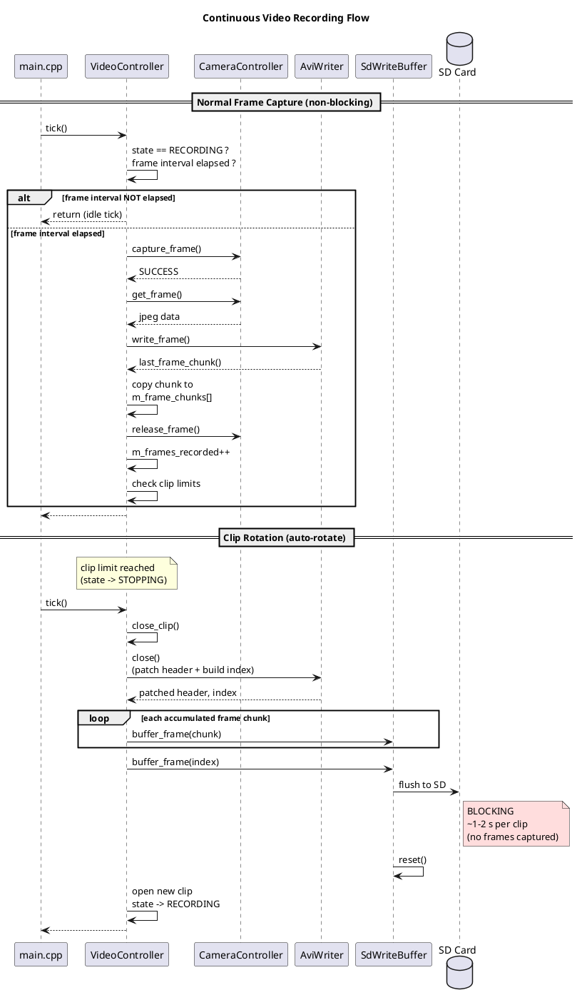

# System Design

This document describes the architecture and key components of the ESP32 Photo Camera project.

## Overview

This project is a still photo and video camera built on the **Seeed XIAO ESP32S3 Sense** platform, which includes an onboard OV2640 camera and MicroSD card slot. The firmware captures JPEG images at a configurable interval and records MJPEG video in AVI containers to the SD card, while an LED provides visual status feedback.

The design follows a layered architecture that separates hardware access from application logic, enabling thorough unit testing on a native host machine without any hardware dependencies.

## Architecture

```
┌─────────────────────────────────────────────────────────────┐
│                  Application  (main.cpp)                    │
│  setup() / loop() — wires components, runs the              │
│  photo capture cycle and video recording state machine      │
└─────────────────────────────────────────────────────────────┘
                         │
                         ▼
┌─────────────────────────────────────────────────────────────┐
│                Service / Controller Layer                   │
│  CameraController    VideoController   LedStateMachine      │
│  SdController        AviWriter         PinArbitrator        │
│  SdWriteBuffer       TimeService       LoggingService       │
│  ConfigService       IniParser                              │
│  PeripheralManager  (facade / composition root)             │
└─────────────────────────────────────────────────────────────┘
                         │
                         ▼
┌─────────────────────────────────────────────────────────────┐
│                Hardware Abstraction Layer (HAL)             │
│  CameraHal       SdCardHal      LogBackend                  │
│  GpioHal         TimeHal                                    │
└─────────────────────────────────────────────────────────────┘
                         │
                         ▼
┌─────────────────────────────────────────────────────────────┐
│              Arduino Libraries & ESP32 Hardware             │
│  esp_camera   SD_MMC.h   GPIO   Serial                      │
└─────────────────────────────────────────────────────────────┘
```

### Key Design Principles

- **Dependency Injection**: All service-layer classes accept HAL interfaces through constructor parameters, making them decoupled from any specific hardware implementation.
- **Single Responsibility**: Each class owns exactly one concern — the LED state machine handles only LED timing, the SD write controller handles only the chip select (CS) protocol, etc.
- **Tick-Driven State Machines**: Service controls are implemented as non-blocking state machines advanced by periodic `tick()` calls from the main loop or higher level services.
- **Testability via Abstractions**: Abstract HAL interfaces allow full unit testing of service-layer logic on a native host (macOS/Linux) using mock implementations, with no ESP32 hardware required.

---

## Hardware Abstraction Layer (HAL)

The HAL provides abstract interfaces that wrap Arduino/ESP32 hardware calls. Each interface has a concrete implementation for the ESP32 target and a mock implementation for native tests.

### HAL Interfaces

| Interface | File | Responsibility |
|-----------|------|----------------|
| `CameraHal` | `include/hal/camera_hal.h` | Camera initialization, frame capture/release, PSRAM detection. Returns `CameraInitResult`, `CameraFrame`. |
| `SdCardHal` | `include/hal/sd_card_hal.h` | SD card initialization, file open/write/close. Returns `SdInitResult`. File operations contract: must only be called when CS is asserted. |
| `GpioHal` | `include/hal/gpio_hal.h` | Thin forwarding wrappers for `pinMode()` and `digitalWrite()`. No logic — pure indirection. |
| `TimeHal` | `include/hal/time_hal.h` | Forwarding functions for Arduino `millis()`, `delay()`, and microsecond delays. Defines the `millis_t` type alias. |
| `LogBackend` | `include/hal/log_backend.h` | Abstract interface for log output destinations. Receives fully formatted log lines from `LoggingService`. |

### Concrete ESP32 Implementations

All concrete HAL implementations live in `src/hal/` and directly call Arduino/ESP32 library functions:

| Implementation | Wraps |
|---------------|-------|
| `CameraHalImpl` | `esp_camera_*` functions, `esp_camera_init()`, `esp_camera_fb_get()`/`esp_camera_fb_return()` |
| `SdCardHalImpl` | Arduino `SD` library (`SD.begin()`, `File` open/write/close) |
| `GpioHal` | Arduino `pinMode()`, `digitalWrite()` |
| `SerialLogBackend` | Arduino `Serial.println()` |

### Mock Implementations (Native Tests)

Mock HAL classes live in `test/mocks/native_mocks/` and provide configurable return values plus call tracking:

| Mock | Tracks | Configurable |
|------|--------|-------------|
| `MockCameraHal` | `init_call_count`, `capture_call_count`, `release_call_count`, `deinit_call_count` | `init_result`, `capture_result`, `initialized_state`, `psram_available` |
| `MockSdCardHal` | `init_call_count`, `open_call_count`, `write_call_count`, `close_call_count` | `init_result`, `open_result`, `write_result` |
| `MockLogBackend` | `write_call_count`, `last_message`, `messages` (vector of all captured lines) | N/A — captures output for assertion |
| Mock Arduino | N/A | Stub `String`, `HardwareSerial`, `millis()`, `delay()` for native compilation |

---

## Service Layer Classes

### TimeService

**File**: `include/time_service.h`

Abstract interface for time acquisition. Provides `now()` (current milliseconds), `delay_ms()`, and `delay_us()`, plus a static `elapsed_ms()` utility that correctly handles 32-bit millisecond rollover using unsigned arithmetic.

`RealTimeService` delegates to the `TimeHal` functions (`hal::get_millis()`, `hal::delay_ms()`). A mock implementation returns a programmable value for deterministic testing.

### LedStateMachine

**File**: `include/led_state_machine.h`

A pure state machine with no hardware side effects. Operates in four modes:

- **OFF** — LED permanently off.
- **ON** — LED permanently on.
- **PULSE_ON** — LED on for a fixed duration, then off.
- **BLINK** — LED alternates on/off at configurable intervals.

The `tick()` method advances the state machine and returns the desired LED state (`true` = on, `false` = off). Callers are responsible for applying the result to a GPIO pin. Uses an injected `TimeService` for all timing, enabling deterministic testing with mock time.

### SdController

**File**: `include/sd_controller.h`

Manages the SD card I/O lifecycle with a chip-select (CS) timing protocol. Supports read, write, and directory creation operations. Owns a state machine that sequences CS assertion and de-assertion around file I/O:

```
IDLE → PRE_DEACTIVATE_CS → ACTIVATE_CS → IO_ACTIVE → END_IO → POST_DEACTIVATE_CS → IDLE
```

The `tick()` method returns an `SdSignal` (`IDLE`, `CS_ACTIVE`, or `CS_INACTIVE`) that describes what the shared pin should do. When `IDLE`, the LED's request wins. When `CS_ACTIVE` or `CS_INACTIVE`, the SD card overrides the LED. This arbitration between LED and SD card chip select is handled in the `PeripheralManager` (specifically via the `PinArbitrator`).

### Non-Blocking API

- `start_write(path, data, len)` — initiates a write operation.
- `start_read(path, buffer, buffer_size)` — initiates a read operation.
- `start_create_dir(path)` — initiates a directory creation.
- `is_idle()` — returns `true` when the state machine has returned to `IDLE`.
- `get_write_result()` / `get_read_result()` / `get_create_dir_result()` / `get_bytes_read()` — result accessors after the cycle completes.
- `init_card()` — delegates to `SdCardHal::init()`.

The `PeripheralManager` wraps these non-blocking primitives with a blocking convenience API (`write_file()`, `read_file()`, `create_dir()`) that loops `tick()` + `is_idle()` with a timeout. Hardware I/O is delegated to an injected `SdCardHal`.

### PinArbitrator

**File**: `include/pin_arbitrator.h`

A static utility class that resolves conflicts when the LED and SD chip-select share the same physical pin (GPIO 21 on the ESP32S3 Sense). Both LED-on and CS-active are active-LOW.

Arbitration rules:
- `SdSignal::IDLE` → LED's request is granted.
- `SdSignal::CS_ACTIVE` → Pin forced LOW (CS active).
- `SdSignal::CS_INACTIVE` → Pin forced HIGH (CS inactive).

### LoggingService

**File**: `include/logging_service.h`

Syslog-style structured logging with timestamp, subsystem name, and severity level. Output format:

```
[00001234] [CAMERA] [INFO ] Photo saved successfully
```

Provides convenience methods (`debug()`, `info()`, `warn()`, `error()`) with printf-style variadic formatting. Delegates output to a pluggable `LogBackend`.

---

## IniParser

**Files**: `include/ini_parser.h`, `src/ini_parser.cpp`

### Responsibility

A stateless, single-pass INI file parser. Parses a character buffer into a `ConfigData` struct containing all firmware configuration.

### INI Format

```ini
[wifi]
ssid=MyNetwork
password=secret123

[ap]
ssid=ESP32-Cam
password=admin

[web]
port=8080
password=webpass

[camera]
capture_interval_ms=15000

[video]
fps=10
resolution=VGA
clip_duration_s=60
max_file_size_mb=0
jpeg_quality=10
```

- Sections are denoted by `[name]`
- Key-value pairs use `key=value` syntax
- Lines starting with `#` or `;` are comments
- Blank lines are ignored
- Section and key matching is case-insensitive
- Whitespace around keys, values, and section headers is trimmed
- Unknown sections and keys are silently ignored
- Values are truncated to `CONFIG_FIELD_MAX_LENGTH - 1` (63) characters
- Integer values (`port`, `capture_interval_ms`, `fps`, `jpeg_quality`) are validated with range checking

### API

- `IniParser::defaults()` — returns a `ConfigData` populated with defaults (port 80, capture interval 20000 ms, empty strings).
- `IniParser::parse(const char* content, size_t length)` — parses the given buffer and returns a `ConfigData`. Malformed lines are skipped gracefully. Unknown fields retain their defaults.
- `IniParser::serialize(const ConfigData& data, char* buffer, size_t buffer_size)` — serializes a `ConfigData` into INI-format text written to `buffer`. Returns the number of bytes written (excluding null terminator). If the buffer is null or too small, returns the number of bytes that would have been needed. The output is round-trip compatible with `parse()` — serializing and re-parsing yields identical values. All fields are always written, including empty strings.

### ConfigData Structure

```c++
struct ConfigData
{
    struct WifiConfig   { char ssid[64]; char password[64]; };
    struct ApConfig     { char ssid[64]; char password[64]; };
    struct WebConfig    { uint16_t port; char password[64]; };
    struct CameraConfig { uint32_t capture_interval_ms; };
    struct VideoConfig  { uint16_t fps; char resolution[64];
                          uint16_t clip_duration_s;
                          uint16_t max_file_size_mb;
                          uint8_t jpeg_quality; };

    WifiConfig wifi;
    ApConfig ap;
    WebConfig web;
    CameraConfig camera;
    VideoConfig video;
};
```

### Testability

Pure logic with no hardware dependencies. Testable natively with 48 unit tests covering defaults, parsing, edge cases, comments, whitespace, malformed input, video config parsing, and serialization round-trips.

---

## ConfigService

**Files**: `include/config_service.h`, `src/config_service.cpp`

### Responsibility

High-level configuration service that owns the current `ConfigData` and provides a `load()` method to populate it from a raw byte buffer (typically read from an INI file on the SD card).

### Dependencies

- `LoggingService &` — for diagnostic output during config loading.

### Key Methods

- `load(const uint8_t* data, size_t length)` — parses the buffer via `IniParser::parse()`, logs the result (WiFi SSID, AP SSID, web port, capture interval), and stores the parsed config. Returns `true` on success, `false` if the buffer is null or empty (in which case defaults are retained with a warning log).
- `config()` — returns a `const ConfigData&` to the current configuration (read-only).
- `mutable_config()` — returns a `ConfigData&` for in-place modification. Callers can modify fields directly, then use `IniParser::serialize()` to produce an updated INI buffer for persistence.

### Constants

| Constant | Value | Description |
|----------|-------|-------------|
| `CONFIG_BUFFER_SIZE` | 512 | Maximum buffer size expected for config file reads |
| `DEFAULT_CONFIG_PATH` | `/config.ini` | Path on SD card where config file is looked up |
| `READ_TIMEOUT_MS` | 5000 | Timeout for SD card read operations |

### Integration

In `main.cpp`, after SD card initialization:
1. A stack-allocated buffer of `CONFIG_BUFFER_SIZE` bytes is created.
2. `PeripheralManager::read_file()` reads `/config.ini` from the SD card.
3. `ConfigService::load()` parses the buffer and logs the result.
4. `camera_capture_interval_ms` is updated from the parsed config.

### Write Pattern

ConfigService does not own file I/O or serialization. Callers that need to persist modified config follow this pattern:

```c++
// 1. Modify config in place
config_service.mutable_config().web.port = 9090;

// 2. Serialize to INI text
char buf[ConfigService::CONFIG_BUFFER_SIZE];
size_t len = IniParser::serialize(config_service.config(), buf, sizeof(buf));

// 3. Write to SD card via PeripheralManager
peripheral_manager.write_file(ConfigService::DEFAULT_CONFIG_PATH,
                              reinterpret_cast<const uint8_t*>(buf),
                              len, timeout_ms);
```

This keeps ConfigService thin (no PeripheralManager dependency) while enabling full round-trip config persistence.

### Testability

Testable natively with 15 unit tests using `MockLogBackend` for log verification and `RealTimeService` for time. Tests cover defaults, loading, mutable access, and reload behavior.

---

## CameraController

**Files**: `include/camera_controller.h`, `src/camera_controller.cpp`

### Responsibility

Manages the camera lifecycle: initialization, frame capture, and resource release.

### Dependencies

- `CameraHal &` — abstract camera hardware interface (injected via constructor).
- `CameraConfig` — configuration parameters with defaults tuned for the XIAO ESP32S3 (PSRAM-aware quality and frame buffer settings).

### Lifecycle

```
init() → capture_frame() → get_frame() → release_frame()
```

The controller tracks state via `m_initialized` and `m_frame_acquired` flags. Calling `capture_frame()` without first releasing the previous frame is handled gracefully.

### Configuration

During `init()`, the controller queries PSRAM availability via the HAL and selects appropriate quality and frame buffer settings from the `CameraConfig`. Two constructors allow either default or custom configuration.

### Testability

Fully testable on native via `MockCameraHal`, which provides configurable return values and call tracking for every HAL method.

---

## VideoController

**Files**: `include/video_controller.h`, `src/video_controller.cpp`

### Responsibility

Orchestrates MJPEG video recording to SD card. Coordinates camera frame capture, AVI container formatting, and buffered SD writing into a recording session. Operates as a cooperative-polling service driven by `tick()` from the main loop.

### Dependencies

- `CameraController &` — for frame capture (capture/get/release cycle).
- `PeripheralManager &` — for SD file I/O (all writes routed through pin arbitration).
- `TimeService &` — for frame pacing (elapsed time checks).
- `LoggingService &` — for diagnostic output.
- `AviWriter` — owned; formats AVI byte streams in memory.
- `SdWriteBuffer` — owned; accumulates and flushes data to SD.

### State Machine

*Ensure window is wide enough for this diagram to render properly*

```
                                   start_recording()              clip limit / stop_recording()
      ┌──────────┐ ──────────────────────────────────► ┌───────────┐ ────────────────────►  ┌───────────┐
      │   IDLE   │ ◄───────────────────────────────── ◆│ RECORDING │ ◄─────────────────── ◆ │  STOPPING │
      └──────────┘  explicit stop (via STOPPING)       └───────────┘  auto-rotate (new clip)└───────────┘
```

- **IDLE** — Not recording. Awaits `start_recording()`.
- **RECORDING** — Actively capturing and writing frames at the configured FPS. Clip auto-rotates when duration, file size, or max frame limit is reached.
- **STOPPING** — Closing current clip (flushing AVI to SD). Transitions to RECORDING (auto-rotate) or IDLE (explicit stop).

### AVI Write Strategy: Buffer-All-At-Close

The complete AVI (header + all frame chunks + index) is accumulated in RAM during recording, then written to SD in a single flush at clip end. This produces correct AVI files with the header at byte offset 0. Frame chunks are copied from `AviWriter::last_frame_chunk()` into an internal vector during recording so they can be replayed at close.

### RAM Budget

| Constant | Value | Description |
|----------|-------|-------------|
| `CLIP_BUFFER_RAM_SIZE` | 4 MB | RAM budget for frame accumulation |
| `avg_bytes_per_frame()` | Config-dependent | Estimated from resolution and JPEG quality |
| `max_frames()` | Derived | `CLIP_BUFFER_RAM_SIZE / avg_bytes_per_frame()` |

### File Naming

Files are written to the SD card with the pattern:
```
/YYYYMMDD/YYYYMMDD_HHMMSS_<WxH>_<FPS>fps.avi
```

Date and time are derived from `millis()` using a simplified calendar model (not a full RTC-based calendar).

### Clip Rotation

When a clip reaches `clip_duration_s`, `max_file_size_mb`, or `max_frames()`, the clip is closed and a new one is opened automatically (unless recording was explicitly stopped). This enables unattended recording without creating unbounded files or overloading buffers.

### Recording Sequence Diagram

The following diagram shows the continuous recording flow, including normal frame capture and the clip rotation path:



**Recording is blocked during clip close.** The `close_clip()` method runs synchronously inside `tick()`, buffering the patched header, all accumulated frame chunks, and the index to `SdWriteBuffer`, then flushing everything to the SD card in one shot. No camera frames are captured during this window.

The blocking duration is bounded by `CLIP_BUFFER_RAM_SIZE` (4 MB). At the default VGA / 10 fps / quality 10 configuration, each frame averages ~60 KB, yielding ~68 frames per clip (~6.8 s). Flushing ~4 MB to a typical Class 10 SD card (2–5 MB/s) takes approximately **1–2 seconds** per clip boundary.

This means there is a brief recording gap at each clip transition. For applications requiring gapless recording, future work could adopt a double-buffering strategy (write the next clip's frames while the current clip flushes) or stream frames directly to SD during recording.

### Testability

Fully testable on native via `MockCameraHal`, `MockSdCardHal`, and `MockLogBackend`. 26 unit tests cover state transitions, frame pacing, clip rotation, error handling, and resolution mapping.

---

## AviWriter

**Files**: `include/avi_writer.h`, `src/avi_writer.cpp`

### Responsibility

A format-only utility class that builds AVI file structures in memory. Does not perform any I/O — callers extract the formatted bytes through accessor methods and handle file writing through their own I/O layer.

### AVI File Layout

```
RIFF header
└─ LIST hdrl
   ├─ avih (main AVI header)
   └─ LIST strl
      ├─ strh (video stream header: MJPEG, FPS)
      └─ strf (BITMAPINFOHEADER)
└─ LIST movi
   └─ Frame chunks (0x00dc + size + JPEG data + DWORD padding)
└─ idx1 (frame index: chunk ID, flags, offset, size per frame)
```

### Lifecycle

```
open() → write_frame() × N → close()
```

- `open(path, fps, width, height)` — generates a 224-byte AVI header template.
- `write_frame(jpeg_data, jpeg_len)` — formats a JPEG frame as an AVI chunk with DWORD-aligned padding.
- `close()` — patches the header with final frame count and file size, builds the frame index.

### Key Design Points

- The AVI header is generated once at `open()` and patched at `close()` with final statistics (RIFF size, frame count, movi list size).
- Each frame chunk includes an 8-byte header (0x00dc marker + data size), the JPEG data, and 0-3 bytes of zero-padding for DWORD alignment.
- The frame index (`idx1`) accumulates 16-byte entries in RAM (one per frame).

### Testability

Pure format logic with no hardware or I/O dependencies. 62 unit tests verify every byte of the AVI header, chunk format, DWORD alignment, index structure, and edge cases.

---

## SdWriteBuffer

**Files**: `include/sd_write_buffer.h`, `src/sd_write_buffer.cpp`

### Responsibility

Accumulates small byte chunks into a RAM buffer and flushes them to the SD card in larger, sector-aligned blocks. Reduces the number of individual SD write transactions (each of which incurs the full CS assertion/deassertion timing overhead) by batching multiple frames into a single write.

### Dependencies

- `PeripheralManager &` — all SD card I/O routes through PeripheralManager to ensure proper pin arbitration between the LED and SD chip-select on the shared GPIO21.

### Buffer Design

- Internal buffer size is `RAMSIZE` (default 8 KB, a multiple of the SD sector size).
- When the buffer reaches `RAMSIZE`, it is flushed synchronously to the SD card.
- Chunks larger than `RAMSIZE` are written directly to SD, bypassing the buffer.
- The Arduino SD library opens files in append mode (`FILE_WRITE`), so multiple flushes to the same path correctly append data.

### Lifecycle

```
open(path) → buffer_frame() × N → flush() → reset()
```

### Testability

Testable on native via `PeripheralManager` backed by `MockSdCardHal`. 28 unit tests cover buffering, auto-flush thresholds, oversized chunks, flush behavior, data integrity, and failure handling.

---

## PeripheralManager

**Files**: `include/peripheral_manager.h`, `src/peripheral_manager.cpp`

### Responsibility

Acts as the **composition root and facade** for all peripheral sub-components. Wires together the LED, SD card, and pin arbitration logic. Contains no state machine logic of its own — all behavior is delegated.

### Owned Components

- `RealTimeService` — time source for all sub-components.
- `LedStateMachine` — pure LED state machine logic.
- `SdCardHalImpl` — SD card HAL implementation (CS on GPIO 21).
- `SdController` — SD card I/O controller with CS timing protocol (read, write, directory creation).

### Key Methods

- **`init()`** — Configures GPIO, initializes the LED state machine to OFF.
- **`init_sd_card()`** — Initializes SD card hardware via the SdController.
- **`tick()`** — The central method, called periodically (~5 ms) from the main loop:
  1. Ticks the `LedStateMachine` → gets desired LED state.
  2. Ticks the `SdController` → gets the `SdSignal`.
  3. Feeds both into `PinArbitrator::resolve()` → gets the final pin state.
  4. Applies the result to GPIO 21 via `GpioHal`.
- **LED convenience**: `turn_led_on()`, `turn_led_off()`, `pulse_led(ms)`, `blink(on_ms, off_ms)` — delegate to `LedStateMachine::set_mode()`.
- **SD convenience**: `write_file(path, data, len, timeout_ms)` — starts a non-blocking write via `SdController::start_write()`, then loops `tick()` until idle or timeout.
- **SD read**: `read_file(path, buffer, max_len, bytes_read, timeout_ms)` — starts a non-blocking read via `SdController::start_read()`, then loops `tick()` until idle or timeout.
- **SD directory**: `create_dir(path, timeout_ms)` — starts a non-blocking directory creation via `SdController::start_create_dir()`, then loops `tick()` until idle or timeout.

### Shared Pin Protocol

GPIO 21 is shared between the LED (active LOW) and the SD card chip-select (active LOW). The `tick()` method resolves conflicts through the `PinArbitrator` every cycle, ensuring correct behavior whether the SD card is idle or actively sequencing a transaction.

---

## Application Layer

**File**: `src/main.cpp`

The `setup()` function initializes Serial, the PeripheralManager, camera, SD card, and config service in sequence. The camera initialization is PSRAM-aware. An LED blink pattern provides visual feedback during startup.

After SD card initialization, the firmware reads `/config.ini` from the SD card into a stack-allocated buffer and passes it to `ConfigService::load()` for parsing. If the file is missing or empty, sensible defaults are used.

The `VideoController` is initialized with the `[video]` configuration and starts recording automatically.

The `loop()` function runs on a 5 ms tick for the PeripheralManager, advances the `VideoController` state machine, and runs a configurable interval for still photo captures (default 20 seconds, overridable via the `[camera]` section of the config file). Each photo capture cycle:

1. `camera_ctrl.capture_frame()` — acquire a frame from the camera.
2. `camera_ctrl.get_frame()` — access the JPEG data.
3. `peripheral_manager.write_file()` — write to SD with a 1-second timeout.
4. `camera_ctrl.release_frame()` — release the buffer back to the camera.

### LED Feedback During Recording

LED behavior during video recording is controlled in `main.cpp` based on `VideoController::state()`:

- **RECORDING** — Fast blink (200ms on / 200ms off).
- **STOPPING** — Pulse (500ms) at clip boundaries.
- **IDLE** — LED controlled by other logic (e.g. photo capture pulse).

---

## Testing Strategy

### Environments

| Environment | Platform | Purpose | Test Filter |
|------------|----------|---------|-------------|
| `native` | Host (macOS/Linux) | Unit tests for all pure logic | `native/*` |
| `seeed_xiao_esp32s3_test` | ESP32 | Hardware integration tests | `hardware_tests` |

### Test Structure

Tests live under `test/` in environment-specific subfolders:

```
test/
  native/                           ← Native unit tests (Unity framework)
    test_avi_writer/                ← AVI container format tests (62 tests)
    test_camera_controller/         ← Camera lifecycle tests
    test_config_service/            ← ConfigService loading & defaults
    test_ini_parser/                ← INI parser including video config
    test_led_state_machine/         ← LED state machine tests
    test_logging_service/           ← Logging output tests
    test_peripheral_manager/        ← Peripheral manager facade tests
    test_pin_arbitrator/            ← Pin conflict resolution tests
    test_sd_controller/             ← SD write controller tests
    test_sd_write_buffer/           ← SD write buffering tests (28 tests)
    test_time_service/              ← Time service tests
    test_video_controller/          ← Video recording orchestration (26 tests)
  hardware/                         ← ESP32 integration tests
  mocks/
    native_mocks/                   ← Mock HAL classes + mock Arduino
    embedded_mocks/                 ← Mocks for ESP32 test env
    test_utils/                     ← Shared test utilities
```

Each test suite is a subfolder with a `test_` prefix containing one or more implementation files, but always a single `main()` function that gathers and runs all tests. Tests use the Unity framework.

### Running Tests

```bash
source ~/.platformio/penv/bin/activate

# Run all native unit tests
pio test -e native

# Run a specific test suite
pio test -e native -f native/test_camera_controller

# Run hardware integration tests (requires board connected)
pio test -e seeed_xiao_esp32s3_test
```

### Testing Guidelines

- **Logical/control-level components** (state machines, arbitrators, time calculations) → test in the `native` environment with mock HALs.
- **Components that interface directly with hardware** → test in the `seeed_xiao_esp32s3_test` environment.
- **Mocks and shared test utilities** → place in the appropriate subfolder under `test/mocks/`.

---

## PlatformIO Environments

| Environment | Platform | Purpose | Key Flags |
|------------|----------|---------|-----------|
| `seeed_xiao_esp32s3` | espressif32 | Production firmware build & flash | `-DCAMERA_MODEL_XIAO_ESP32S3` |
| `seeed_xiao_esp32s3_debug` | espressif32 | Debug build with USB-JTAG | Adds `-DARDUINO_USB_MODE=1 -DARDUINO_USB_CDC_ON_BOOT=1 -DDEBUG_MODE` |
| `seeed_xiao_esp32s3_test` | espressif32 | Hardware integration tests | Extends target env; `lib_extra_dirs = test/mocks` |
| `native` | native | Host unit tests | `-DUNIT_TESTING -I include -I test` |
