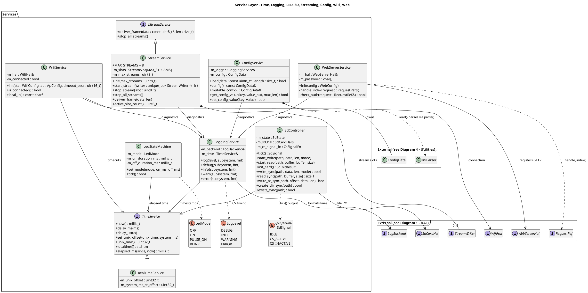
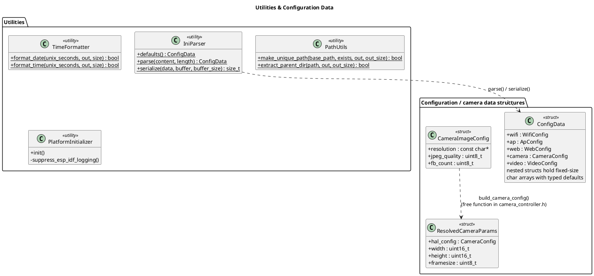
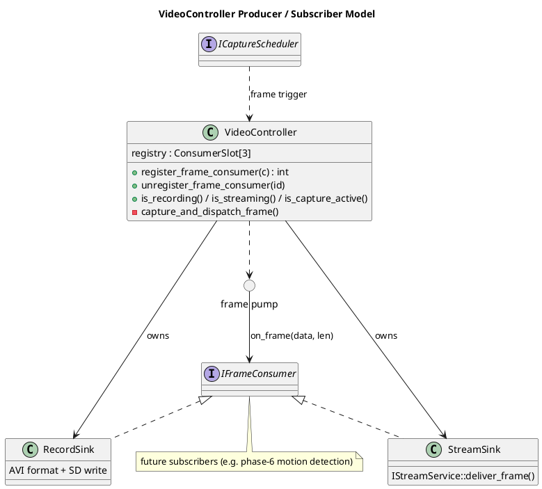
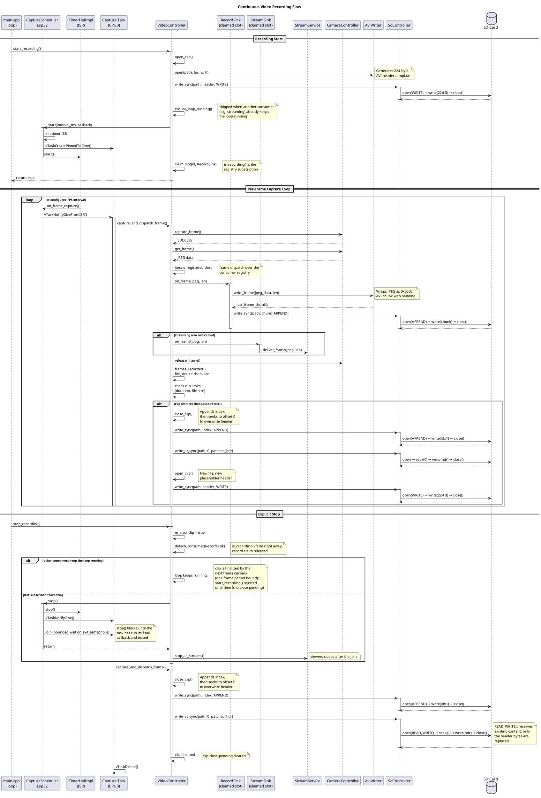
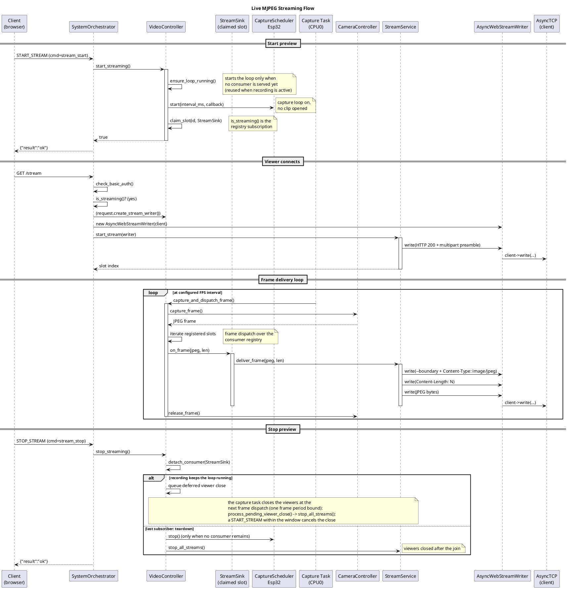
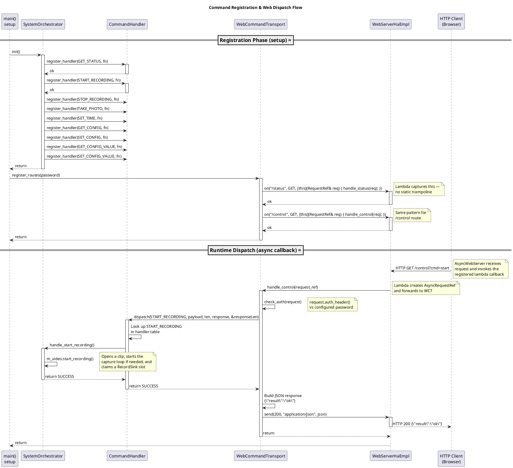

# System Design

This document describes the architecture and key components of the ESP32 Photo Camera project.

## Overview

This project is a still photo and video camera built on the **Seeed XIAO ESP32S3 Sense** platform, which includes an onboard OV2640 camera and MicroSD card slot. The firmware captures JPEG images at a configurable interval and records MJPEG video in AVI containers to the SD card, while an LED provides visual status feedback.

The design follows a layered architecture that separates hardware access from application logic, enabling thorough unit testing on a native host machine without any hardware dependencies.

## Architecture

```
┌─────────────────────────────────────────────────────────────┐
│                  Application  (main.cpp)                    │
│  setup() / loop() — wires components, runs the              │
│  photo capture cycle, video capture pipeline,               │
│  and system orchestration tick                              │
└─────────────────────────────────────────────────────────────┘
                         │
                         ▼
┌─────────────────────────────────────────────────────────────┐
│              Orchestration / Command Layer                  │
│  SystemOrchestrator   (top-level coordinator)               │
│  CommandHandler       (protocol-agnostic dispatch)          │
│  WebCommandTransport  (HTTP → CommandHandler bridge)        │
│  SerialCommandTransport (UART → CommandHandler bridge)      │
└─────────────────────────────────────────────────────────────┘
                         │
                         ▼
┌─────────────────────────────────────────────────────────────┐
│                Service / Controller Layer                   │
│  CameraController    VideoController   LedStateMachine      │
│  SdController        AviWriter         StreamService        │
│  TimeService         LoggingService                         │
│  ConfigService       IniParser                              │
│  WifiService         WebServerService                       │
└─────────────────────────────────────────────────────────────┘
                         │
                         ▼
┌─────────────────────────────────────────────────────────────┐
│                Hardware Abstraction Layer (HAL)             │
│  CameraHal       SdCardHal      LogBackend                  │
│  GpioHal         TimeHal        WifiHal    SerialHal        │
│  WebServerHal    StreamWriter                               │
└─────────────────────────────────────────────────────────────┘
                         │
                         ▼
┌─────────────────────────────────────────────────────────────┐
│              Arduino Libraries & ESP32 Hardware             │
│  esp_camera   SD_MMC.h   GPIO   Serial   WiFi   WebServer   │
└─────────────────────────────────────────────────────────────┘
```

### FreeRTOS Tasks

The ESP32-S3 is a dual-core device (PRO_CPU = core 0, APP_CPU = core 1). The firmware runs several FreeRTOS tasks, each pinned to a specific core. Arduino's `setup()`/`loop()` run on core 1; the capture task is pinned to core 0 to keep core 1 free for WiFi, the web server, and LED management.

| Task | Created By | Layer | Core | Stack (bytes) | Priority | Scope / Responsibility |
|------|-----------|-------|------|---------------|----------|------------------------|
| `loopTask` | Arduino framework | Arduino framework | 1 | framework-managed | framework-managed | Runs `setup()` then `loop()`. `loop()` ticks the `CommandHandler` (polls serial/web transports), the `SystemOrchestrator`, and the `LedStateMachine`, and emits the periodic heartbeat log. |
| `capture` | `CaptureSchedulerEsp32::start()` | Application | 0 | 4096 | `configMAX_PRIORITIES - 1` | FreeRTOS capture task. Blocks on a task notification from the timer ISR, then invokes `VideoController::capture_and_dispatch_frame()` to capture a frame and dispatch it to registered consumers. Exits (and signals an exit semaphore) when `stop()` is requested. |
| `async_tcp` | `AsyncTCP` library | Arduino framework | 1 | library-managed | library-managed | AsyncTCP event loop task that services TCP connections for the `ESPAsyncWebServer`. |
| `wifi` | ESP-IDF | ESP-IDF framework | 0 | ESP-IDF-managed | ESP-IDF-managed | ESP-IDF WiFi driver task handling the WiFi MAC/PHY event loop. |
| `ipc0` / `ipc1` | ESP-IDF | ESP-IDF framework | 0 / 1 | ESP-IDF-managed | ESP-IDF-managed | ESP-IDF inter-processor call tasks used for cross-core function calls (e.g. cache flush, flash operations). |
| `Tmr Svc` | FreeRTOS | ESP-IDF framework | 1 | ESP-IDF-managed | ESP-IDF-managed | FreeRTOS software timer service task. |
| `esp_timer` | ESP-IDF | ESP-IDF framework | 0 | ESP-IDF-managed | ESP-IDF-managed | ESP-IDF high-resolution timer task that dispatches software timer callbacks. |

### Key Design Principles

- **Dependency Injection**: All service-layer classes accept HAL interfaces through constructor parameters, making them decoupled from any specific hardware implementation.
- **Single Responsibility**: Each class owns exactly one concern — the LED state machine handles only LED timing, the SD write controller handles only the chip select (CS) protocol, etc.
- **Tick-Driven State Machines**: Most service controls are implemented as non-blocking state machines advanced by periodic `tick()` calls from the main loop or higher level services. `VideoController` is an exception — it uses a FreeRTOS task driven by a hardware timer ISR for frame capture, decoupling it from the main loop tick.
- **Testability via Abstractions**: Abstract HAL interfaces allow full unit testing of service-layer logic on a native host (macOS/Linux) using mock implementations, with no ESP32 hardware required.

### Class Diagrams

The firmware is split into four class diagrams, one per architectural layer. Classes that a layer depends on but does not own (e.g. HAL interfaces used by services) appear in the dependent layer's diagram as reduced "external" stubs, marked with their home diagram. A few modules are intentionally **not** modeled as classes because they are not class-based: `hal/gpio_hal.h` and `hal/time_hal.h` expose free functions in namespace `hal` (`set_pin_as_output()`, `digital_write()`, `get_millis()`, `delay_ms()`/`delay_us()` plus the `millis_t` alias), `web_auth_util.h` provides the free function `check_basic_auth()` used by both `WebServerService` and `WebCommandTransport`, and `main.cpp` is a composition root wiring all components via global instances and free functions (`setup()`, `loop()`, `cs_signal()`, `update_led()`). The `lib/` directory currently contains only a `README` and no production code.

#### 1. Hardware Abstraction Layer (`include/hal/`, `src/hal/`)

```plantuml
@startuml
title HAL - Interfaces & ESP32 Implementations

hide empty members
skinparam classAttributeIconSize 0

package "HAL interfaces" as HAL_IF {

    interface CameraHal {
        +init(config : CameraConfig) : CameraInitResult
        +deinit()
        +capture() : CameraFrame
        +release()
        +is_initialized() : bool
        +get_capabilities() : CameraCapabilities
    }

    interface SdCardHal {
        +init() : SdInitResult
        +open(path : const char*, mode : FileOpenMode) : bool
        +write(data : const uint8_t*, len : size_t) : bool
        +read(buffer : uint8_t*, len : size_t) : size_t
        +seek(pos : uint32_t) : bool
        +create_dir(path : const char*) : bool
        +exists(path : const char*) : bool
        +close()
        +is_initialized() : bool
    }

    interface SerialHal {
        +available() : int
        +read() : int
        +write(data : const uint8_t*, len : size_t) : size_t
        +flush()
    }

    interface TimerHal {
        +init(interval_us : uint32_t, isr)
        +set_frequency(interval_us : uint32_t)
        +start()
        +stop()
    }

    interface WifiHal {
        +mode(sta : bool, ap : bool)
        +begin_sta(ssid, password)
        +begin_ap(ssid, password)
        +status() : WifiStatus
        +local_ip() : const char*
        +config_static(ip, gateway, subnet) : bool
        +disconnect()
        +is_connected() : bool
    }

    interface WebServerHal {
        +init(port : uint16_t) : bool
        +on(uri, method, handler)
        +stop()
    }

    interface RequestRef {
        +uri() : const char*
        +method() : HttpMethod
        +arg(name) : const char*
        +header(name) : const char*
        +auth_header() : const char*
        +send(code, content_type, content)
        +create_stream_writer() : StreamWriter*
    }

    interface StreamWriter {
        +write(data : const uint8_t*, len : size_t) : size_t
        +close()
        +on_disconnect(cb)
    }

    interface LogBackend {
        +write(line : const char*)
    }
}

package "ESP32 implementations" as HAL_IMPL {

    class CameraHalImpl {
        -m_initialized : bool
        -m_frame_acquired : bool
        -m_fb : camera_fb_t*
    }

    class SdCardHalImpl {
        -m_cs_pin : uint8_t
        -m_file_open : bool
    }

    class SerialHalImpl {
        -m_write_mutex : SemaphoreHandle_t
        write() serialised via mutex
    }

    class TimerHalImpl {
        ESP-IDF timer_group ISR timer
    }

    class WifiHalImpl {
        -m_connected : bool
        -m_ip_buffer : char[16]
    }

    class WebServerHalImpl {
        -m_server : AsyncWebServer*
    }

    class AsyncRequestRef {
        -m_request : AsyncWebServerRequest*
    }

    class AsyncWebStreamWriter {
        -m_client : AsyncClient*
    }

    class SerialLogBackend {
        -m_serial : SerialHal&
    }
}

package "HAL value types" {

    class CameraFrame <<struct>> {
        +data : const uint8_t*
        +len : size_t
    }

    class CameraCapabilities <<struct>> {
        +max_framesize : uint8_t
        +min_jpeg_quality : uint8_t
        +max_fb_count : uint8_t
        +max_width : uint16_t
        +max_height : uint16_t
    }

    class CameraConfig <<struct>> {
        +jpeg_quality : uint8_t
        +frame_size : uint8_t
        +fb_count : uint8_t
        +grab_mode : uint8_t
    }
}

' Inheritance arrows point up (-up-|>) so interfaces sit above their
' implementations, and a hidden package-to-package edge forces the
' "ESP32 implementations" package to stack below "HAL interfaces".
HAL_IF -down[hidden]- HAL_IMPL

CameraHalImpl -up-|> CameraHal
SdCardHalImpl -up-|> SdCardHal
SerialHalImpl -up-|> SerialHal
TimerHalImpl -up-|> TimerHal
WifiHalImpl -up-|> WifiHal
WebServerHalImpl -up-|> WebServerHal
AsyncRequestRef .up.|> RequestRef
AsyncWebStreamWriter -up-|> StreamWriter
SerialLogBackend -up-|> LogBackend

SerialLogBackend -up-> SerialHal : writes log lines
WebServerHalImpl .right.> AsyncRequestRef : creates per request
RequestRef .down.> StreamWriter : create_stream_writer()

@enduml
```



Note: `hal/gpio_hal.h` and `hal/time_hal.h` are free-function modules within namespace `hal` (`set_pin_as_output()`, `digital_write()`, `get_millis()`, `delay_ms()`/`delay_us()`) and are therefore not shown as classes.

#### 2. Service Layer



#### 3. Orchestration & Command Layer

```plantuml
@startuml
title Orchestration & Command Layer - Orchestrator, Controllers, Dispatch

hide empty members
skinparam classAttributeIconSize 0

package "Command dispatch framework" {

    enum CommandCode {
        GET_STATUS = 0x01
        START_RECORDING = 0x10
        STOP_RECORDING = 0x11
        TAKE_PHOTO = 0x12
        START_STREAM = 0x13
        STOP_STREAM = 0x14
        LIST_STREAMS = 0x15
        SET_CONFIG = 0x20
        GET_CONFIG = 0x21
        GET_CONFIG_VALUE = 0x22
        SET_CONFIG_VALUE = 0x23
        SET_TIME = 0x30
    }

    enum CommandResult {
        SUCCESS = 0x00
        UNRECOGNIZED = 0x01
        INVALID_ARGS = 0x02
        INVALID_STATE = 0x03
        INTERNAL_ERROR = 0xFF
    }

    interface CommandTransport {
        +has_request() : bool
        +read_request(code, payload, payload_len)
        +send_response(result, data, len)
    }

    class WebCommandTransport {
        -m_web : WebServerHal&
        -m_handler : CommandHandler&
        -m_password : char[]
        +register_routes(password : const char*)
        -check_auth(request : RequestRef&) : bool
        -map_cmd_string(cmd : const char*) : CommandCode
        -dispatch_and_respond(request, code)
        -handle_status(request : RequestRef&)
        -handle_control(request : RequestRef&)
    }

    class SerialCommandTransport {
        +LINE_BUFFER_SIZE = 128
        -m_serial : SerialHal&
        -m_line_buffer : char[128]
        -m_request_ready : bool
        -m_echo_enabled : bool
        +set_echo_enabled(enabled : bool)
        -echo_line()
        -parse_command(cmd, args, code, payload, payload_len) : bool
    }

    class CommandHandler {
        +MAX_RESPONSE_SIZE = 256
        -m_log : LoggingService&
        -m_handlers : HandlerEntry[16]
        -m_transports : CommandTransport*[4]
        +register_handler(code, handler)
        +add_transport(transport : CommandTransport&)
        +tick()
        +dispatch(code, payload, len, response, responseLen) : CommandResult
    }
}

package "Controllers" {

    class CameraController {
        -m_hal : CameraHal&
        -m_config : CameraConfig
        -m_initialized : bool
        -m_frame_acquired : bool
        -m_current_frame : CameraFrame
        -m_actual_params : ResolvedCameraParams
        +init() : CameraInitResult
        +init(params : ResolvedCameraParams) : CameraInitResult
        +deinit()
        +capture_frame() : CameraCaptureResult
        +get_frame() : CameraFrame
        +release_frame()
        +get_params() : const ResolvedCameraParams&
    }

    class VideoController {
        -m_slots : ConsumerSlot[3]
        -m_record_sink : RecordSink
        -m_stream_sink : StreamSink
        -m_stop_clip : atomic<bool>
        -m_clip_close_pending : atomic<bool>
        -m_avi_writer : AviWriter
        -m_stream_service : IStreamService*
        -m_config : VideoConfig
        -m_width : uint16_t
        -m_height : uint16_t
        +init(config : VideoConfig, width, height) : bool
        +start_recording() : bool
        +stop_recording()
        +capture_photo(path : const char*) : bool
        +make_unique_path(base_path, out, out_size) : bool
        +start_streaming() : bool
        +stop_streaming()
        +set_stream_service(stream_service)
        +register_frame_consumer(consumer) : int
        +unregister_frame_consumer(id)
        +is_recording() : bool
        +is_streaming() : bool
        +is_capture_active() : bool
        -capture_and_dispatch_frame()
        -write_avi_frame(data, len)
        -handle_clip_closure()
        -teardown_capture_pipeline()
        -ensure_loop_running() : bool
        -open_clip()
        -close_clip()
    }

    class AviWriter {
        -m_header : vector<uint8_t>
        -m_frame_chunk : vector<uint8_t>
        -m_index_entries : vector<IndexEntry>
        +open(path, fps, width, height) : bool
        +write_frame(jpeg_data, jpeg_len) : bool
        +close() : bool
        +header() : AviBytes
        +last_frame_chunk() : AviBytes
        +patched_header() : AviBytes
        +index() : AviBytes
    }

    interface ICaptureScheduler {
        +start(interval_ms, frame_callback) : bool
        +stop()
        +on_frame_capture()
    }

    class CaptureSchedulerEsp32 {
        -m_timer : TimerHal&
        -m_task : atomic<TaskHandle_t>
        -m_stop_requested : atomic<bool>
        -m_exit_sem : SemaphoreHandle_t
    }
}

class SystemOrchestrator {
    -m_video : VideoController&
    -m_camera : CameraController&
    -m_cmd_handler : CommandHandler&
    -m_streams : StreamService&
    +init()
    +tick()
    -register_commands()
    -register_stream_route()
    -handle_get_status()
    -handle_start_recording()
    -handle_stop_recording()
    -handle_take_photo()
    -handle_set_time()
    -handle_get_config_value()
    -handle_set_config_value()
    -handle_start_stream()
    -handle_stop_stream()
    -handle_list_streams()
    -handle_stream_request(request : RequestRef&)
}

package "External (see Diagram 1 - HAL)" <<Frame>> {
    interface CameraHal_ext as "CameraHal"
    interface SerialHal_ext as "SerialHal"
    interface TimerHal_ext as "TimerHal"
    interface WebServerHal_ext as "WebServerHal"
}

package "External (see Diagram 2 - Services)" <<Frame>> {
    interface IStreamService_ext as "IStreamService"
    class ConfigService_ext as "ConfigService"
    class LoggingService_ext as "LoggingService"
    class SdController_ext as "SdController"
    class StreamService_ext as "StreamService"
    interface TimeService_ext as "TimeService"
}

package "External (see Diagram 4 - Utilities)" <<Frame>> {
    class ResolvedCameraParams_ext as "ResolvedCameraParams"
}

WebCommandTransport -up-|> CommandTransport
SerialCommandTransport -up-|> CommandTransport
CaptureSchedulerEsp32 -up-|> ICaptureScheduler

CommandHandler o--> "0..4" CommandTransport : polled in tick()
CommandHandler --> LoggingService_ext : diagnostics
CommandHandler ..> CommandCode
CommandHandler ..> CommandResult
WebCommandTransport --> WebServerHal_ext : registers /status, /control
WebCommandTransport --> CommandHandler : dispatch()
SerialCommandTransport --> SerialHal_ext : line protocol
SerialCommandTransport --> TimeService_ext : echo timestamps

SystemOrchestrator --> VideoController : record control
SystemOrchestrator --> CameraController : photo capture
SystemOrchestrator --> CommandHandler : register handlers
SystemOrchestrator --> ConfigService_ext : config access
SystemOrchestrator --> LoggingService_ext : diagnostics
SystemOrchestrator --> StreamService_ext : stream control
SystemOrchestrator --> TimeService_ext : time ops
SystemOrchestrator --> WebServerHal_ext : /stream route

CameraController --> CameraHal_ext : clamps against capabilities
VideoController *-- "1" AviWriter : owns
VideoController --> CameraController : capture cycle
VideoController --> SdController_ext : sync writes
VideoController --> LoggingService_ext : diagnostics
VideoController --> TimeService_ext : clip duration
VideoController --> ICaptureScheduler : frame pacing
VideoController --> "0..1" IStreamService_ext : optional frame sink + viewer teardown
VideoController --> StreamService_ext : set_stream_service() wiring
VideoController o-right-> "0..3" IFrameConsumer : consumer registry
CaptureSchedulerEsp32 --> TimerHal_ext : periodic ISR

@enduml
```



Note: `VideoController` owns its `AviWriter` instance (composition); `AviWriter` performs no I/O — formatted bytes flow through `SdController`.

#### 4. Utilities & Configuration Data



Notes: all four utility classes are static-only (no instance state). The free function `check_basic_auth(auth_header, password)` (`web_auth_util.h`) is shared by `WebServerService` and `WebCommandTransport` for HTTP Basic validation and is likewise not a class. `PlatformInitializer` is instantiated once by the composition root and called at the top of `setup()`.

---

## Hardware Abstraction Layer (HAL)

The HAL provides abstract interfaces that wrap Arduino/ESP32 hardware calls. Each interface has a concrete implementation for the ESP32 target and a mock implementation for native tests.

### HAL Interfaces

| Interface | File | Responsibility |
|-----------|------|----------------|
| `CameraHal` | `include/hal/camera_hal.h` | Camera initialization, frame capture/release, capabilities query. Returns `CameraInitResult`, `CameraFrame`. |
| `SdCardHal` | `include/hal/sd_card_hal.h` | SD card initialization, file open/write/read/close/seek. Returns `SdInitResult`. File operations contract: must only be called when CS is asserted. |
| `TimerHal` | `include/hal/timer_hal.h` | Hardware timer abstraction for periodic ISR callbacks. Provides `init(interval_us, isr)`, `set_frequency()`, `start()`, `stop()`. |
| `StreamWriter` | `include/hal/stream_writer.h` | Abstract write sink for streaming bytes to a client connection. Provides `write(data, len)`, `close()`, and `on_disconnect(cb)` (invoked when the connection drops). Implemented by `AsyncWebStreamWriter` (ESP32/AsyncTCP) and `MockStreamWriter` (native). |

**`hal::FileOpenMode`** — file open modes supported by `SdCardHal::open()`:

| Mode | Semantics |
|------|-----------|
| `READ` | Open for reading; file must exist |
| `WRITE` | Open for writing; truncates existing content |
| `APPEND` | Open for writing; preserves existing content, writes at end |
| `READ_WRITE` | Open for reading/writing; preserves existing content, writes at seek position (maps to `"r+"` in `SdCardHalImpl`) |
| `GpioHal` | `include/hal/gpio_hal.h` | Thin forwarding wrappers for `pinMode()` and `digitalWrite()`. No logic — pure indirection. |
| `TimeHal` | `include/hal/time_hal.h` | Forwarding functions for Arduino `millis()`, `delay()`, and microsecond delays. Defines the `millis_t` type alias. |
| `LogBackend` | `include/hal/log_backend.h` | Abstract interface for log output destinations. Receives fully formatted log lines from `LoggingService`. |
| `SerialHal` | `include/hal/serial_hal.h` | UART serial port abstraction. Wraps the Arduino `HardwareSerial` interface (`available`, `read`, `write`, `flush`) behind a mockable interface. |

### Concrete ESP32 Implementations

All concrete HAL implementations live in `src/hal/` and directly call Arduino/ESP32 library functions:

| Implementation | Wraps |
|---------------|-------|
| `CameraHalImpl` | `esp_camera_*` functions, `esp_camera_init()`, `esp_camera_fb_get()`/`esp_camera_fb_return()` |
| `SdCardHalImpl` | Arduino `SD` library (`SD.begin()`, `File` open/write/read/close/seek) |
| `TimerHalImpl` | ESP-IDF `timer_group` APIs — 1 MHz clock, ISR-based periodic callbacks |
| `GpioHal` | Arduino `pinMode()`, `digitalWrite()` |
| `SerialHalImpl` | Arduino `HardwareSerial` (`Serial`) — wraps `available`, `read`, `write`, `flush` behind the `SerialHal` interface. Serial port is initialised in the constructor. |
| `SerialLogBackend` | Injected `SerialHal&` — writes formatted log lines via the shared serial HAL. Serial port lifecycle managed externally by the composition root. |
| `PlatformInitializer` | `esp_log_level_set()`, `esp_log_set_vprintf()` — ESP-IDF BSP-level init, not Arduino. Called once at the top of `setup()`. |

### WifiHal

**File**: `include/hal/wifi_hal.h`

Abstract interface for WiFi operations. Provides STA/AP mode selection, connection management, and status queries.

| Method | Purpose |
|--------|---------|
| `mode(sta, ap)` | Set WiFi mode (station, access point, or both) |
| `begin_sta(ssid, password)` | Connect to a WiFi network as a station |
| `begin_ap(ssid, password)` | Start an access point |
| `status()` | Return connection status as a `WifiStatus` enum (`CONNECTED`, `DISCONNECTED`, etc.) |
| `local_ip()` | Return the assigned IP address |
| `config_static(ip, gateway, subnet)` | Configure static IP addressing for STA before `begin_sta()`; returns `false` if addresses are invalid |
| `disconnect()` | Disconnect from the network |
| `is_connected()` | Return whether the device is connected |

**ESP32 Implementation**: `WifiHalImpl` (`src/hal/wifi_hal_impl.cpp`) wraps the Arduino `WiFi` library. Uses `IPAddress::fromString()` for address parsing and `WiFi.config()` to apply the static configuration.

**Mock**: `MockWifiHal` (`test/mocks/native_mocks/mock_wifi_hal.h`) provides configurable return values (`begin_sta_result`, `status_result` of type `WifiStatus`, `connected_result`, `ip_buffer`, `config_static_result`) and call tracking (`begin_sta_call_count`, `begin_ap_call_count`, `config_static_call_count`, etc.).

### WebServerHal

**File**: `include/hal/web_server_hal.h`

Abstract interface for HTTP server operations. Uses an **async, callback-driven** model: route handlers are registered as `std::function` closures, and the underlying server calls them when a matching request arrives. 

Each request is represented by a per-request `RequestRef` object that provides accessors for URI, method, query args, headers, and an `auth_header()` convenience accessor. Responses are sent through the `RequestRef` object using `send()`.

| Method | Purpose |
|--------|---------|
| `init(port)` | Start the HTTP server on the given port |
| `on(uri, method, handler)` | Register a route handler (`std::function<void(RequestRef&)>`) |
| `stop()` | Stop the server |

**`RequestRef`** per-request object:

| Method | Purpose |
|--------|---------|
| `uri()` | Get the request URI |
| `method()` | Get the request HTTP method |
| `arg(name)` | Get a query parameter value |
| `header(name)` | Get a request header value |
| `auth_header()` | Get the `Authorization` header |
| `send(code, type, content)` | Send a complete response (string body) |
| `send(code, type, data, len)` | Send a complete response (binary body) |
| `create_stream_writer()` | Create a `hal::StreamWriter*` bound to the request's client connection (used by the `/stream` MJPEG endpoint) |

**ESP32 Implementation**: `WebServerHalImpl` (`src/hal/web_server_hal_impl.cpp`) wraps `ESPAsyncWebServer` (`AsyncWebServer` library), instantiating the server via `new`. Routes are registered with lambdas that construct a temporary `AsyncRequestRef` (wrapping `AsyncWebServerRequest*`) and forward it to the registered `std::function` handler.

**Mock**: `MockWebServerHal` (`test/mocks/native_mocks/mock_web_server_hal.h`) captures route registrations with their `std::function` handlers and provides `simulate_request(uri, method)` to invoke handlers with a configurable `MockRequestRef`.

### SerialHal

**File**: `include/hal/serial_hal.h`

Abstract interface for UART serial port operations. Provides byte-level I/O and buffer management.

| Method | Purpose |
|--------|---------|
| `available()` | Return the number of bytes in the receive buffer |
| `read()` | Read a single byte, or -1 if none available |
| `write(data, len)` | Write a buffer of bytes |
| `flush()` | Wait for the transmit buffer to empty |

**ESP32 Implementation**: `SerialHalImpl` (`src/hal/serial_hal_impl.cpp`) wraps the Arduino `HardwareSerial` (`Serial`) object, forwarding each method directly.

**Mock**: `MockSerialHal` (`test/mocks/native_mocks/mock_serial_hal.h`) provides configurable return values, simulated input injection (`inject_input()`, `inject_bytes()`), captured output inspection (`output_as_string()`), and call tracking (`flush_call_count`).

### Mock Implementations (Native Tests)

Mock HAL classes live in `test/mocks/native_mocks/` and provide configurable return values plus call tracking:

| Mock | Tracks | Configurable |
|------|--------|-------------|
| `MockCameraHal` | `init_call_count`, `capture_call_count`, `release_call_count`, `deinit_call_count` | `init_result`, `capture_result`, `initialized_state`, `capabilities` |
| `MockSdCardHal` | `init_call_count`, `open_call_count`, `write_call_count`, `close_call_count`, `seek_call_count`, `exists_call_count` | `init_result`, `open_result`, `write_result`, `seek_result`, `files` (in-memory file store with real open-mode semantics), `file_content` (seed content) |
| `MockLogBackend` | `write_call_count`, `last_message`, `messages` (vector of all captured lines) | N/A — captures output for assertion |
| `MockSerialHal` | `flush_call_count`, `output_buffer` (captured writes) | `input_buffer` for simulated serial input |
| `MockStreamWriter` | `write_call_count`, `close_call_count`, `captured` (accumulated bytes) | `accept_writes` (to simulate a blocked/closed sink), `close_counter` (external counter observed after the writer is deleted); `simulate_disconnect()` fires the registered disconnect callback |
| Mock Arduino | N/A | Stub `String`, `HardwareSerial`, `millis()`, `delay()` for native compilation |

---

## Service Layer Classes

### TimeService

**File**: `include/time_service.h`

Abstract interface for time acquisition. Provides `now()` (current milliseconds), `delay_ms()`, and `delay_us()`, plus a static `elapsed_ms()` utility that correctly handles 32-bit millisecond rollover using unsigned arithmetic.

`RealTimeService` delegates to the `TimeHal` functions (`hal::get_millis()`, `hal::delay_ms()`). A mock implementation returns a programmable value for deterministic testing.

### LedStateMachine

**File**: `include/led_state_machine.h`

A pure state machine with no hardware side effects. Operates in four modes:

- **OFF** — LED permanently off.
- **ON** — LED permanently on.
- **PULSE_ON** — LED on for a fixed duration, then off.
- **BLINK** — LED alternates on/off at configurable intervals.

The `tick()` method advances the state machine and returns the desired LED state (`true` = on, `false` = off). Callers are responsible for applying the result to a GPIO pin. Uses an injected `TimeService` for all timing, enabling deterministic testing with mock time.

### SdController

**File**: `include/sd_controller.h`

Manages the SD card I/O lifecycle with a chip-select (CS) timing protocol. Supports read, write, write-at-offset, file-existence checks, and directory creation operations. Owns a state machine that sequences CS assertion and de-assertion around file I/O:

```
IDLE → PRE_DEACTIVATE_CS → ACTIVATE_CS → IO_ACTIVE → END_IO → POST_DEACTIVATE_CS → IDLE
```

The `tick()` method returns an `SdSignal` (`IDLE`, `CS_ACTIVE`, or `CS_INACTIVE`) that describes what the shared pin should do. When `IDLE`, the caller may apply the LED's request. When `CS_ACTIVE` or `CS_INACTIVE`, the SD card's signal takes precedence.

The constructor accepts an optional `CsSignalFn` callback that drives the CS pin directly during synchronous I/O operations. When provided, the synchronous methods bypass the state machine and use the callback to assert/deassert CS.

### Non-Blocking API

- `start_write(path, data, len)` — initiates a write operation.
- `start_read(path, buffer, buffer_size)` — initiates a read operation.
- `start_create_dir(path)` — initiates a directory creation.
- `is_idle()` — returns `true` when the state machine has returned to `IDLE`.
- `get_write_result()` / `get_read_result()` / `get_create_dir_result()` / `get_bytes_read()` — result accessors after the cycle completes.
- `init_card()` — delegates to `SdCardHal::init()`.

### Synchronous API

The synchronous methods are intended for use from FreeRTOS task context where blocking is acceptable:

- `write_sync(path, data, len, mode)` — asserts CS, opens file, writes, closes, deasserts CS.
- `read_sync(path, buffer, buffer_size)` — asserts CS, opens file, reads, closes, deasserts CS.
- `create_dir_sync(path)` — asserts CS, creates directory, deasserts CS.
- `exists_sync(path)` — asserts CS, checks whether the file exists, deasserts CS. All SD I/O goes through this controller so the shared CS/LED pin remains properly arbitrated.
- `write_at_sync(path, offset, data, len)` — asserts CS, opens file in `READ_WRITE` mode (preserves existing content), seeks to offset, writes, closes, deasserts CS. Used for overwriting the AVI header at position 0 after recording.

### TimeFormatter

**Files**: `include/time_formatter.h`, `src/time_formatter.cpp`

Static UTC date/time formatting helpers used by file-naming code (AVI clip paths, photo paths). Uses `gmtime_r()` so dates account for leap years and month lengths, with no timezone dependency (all times are UTC).

| Method | Purpose |
|--------|---------|
| `format_date(unix_seconds, out, size)` | Formats a Unix timestamp as `YYYYMMDD` (UTC) |
| `format_time(unix_seconds, out, size)` | Formats a Unix timestamp as `HHMMSS` (UTC) |

Safe to call from task context; not safe from ISR context (uses `gmtime_r`, which may take a lock in newlib).

### PathUtils

**Files**: `include/path_utils.h`, `src/path_utils.cpp`

Generates non-colliding file paths by appending serial suffixes (`_1`, `_2`, ...) before the file extension until a non-existent path is found, e.g. `photo.jpg` → `photo_1.jpg`. Decoupled from any specific storage layer via an injected `ExistsFn` callback.

| Method | Purpose |
|--------|---------|
| `make_unique_path(base_path, exists, out, out_size)` | Finds a non-existent path by appending serial suffixes; capped at `MAX_SUFFIX_ATTEMPTS` (100) |
| `extract_parent_dir(path, out, out_size)` | Copies everything up to (but not including) the last `/` into `out`; returns `false` for root-level or bare paths |

`VideoController::make_unique_path()` wraps this with an `exists_sync()` callback so photo paths never overwrite an existing file. `VideoController::capture_photo()` uses `extract_parent_dir()` to create the photo's parent directory before writing.

### StreamService

**Files**: `include/stream_service.h`, `src/stream_service.cpp`

#### Responsibility

Distributes captured JPEG frames to connected viewers as a `multipart/x-mixed-replace` MJPEG stream. Synchronous and platform-agnostic: `deliver_frame()` writes the multipart framing plus frame bytes directly to each active `hal::StreamWriter`. There are no per-slot frame buffers or FreeRTOS tasks — backpressure is handled by the underlying transport's send queue (AsyncTCP).

#### Interfaces

- `IStreamService` — minimal frame-sink interface consumed by `VideoController`. Declares `deliver_frame(data, len)` and `stop_all_streams()`, mirroring the `ICaptureScheduler` abstraction pattern so `VideoController` stays decoupled and natively testable.
- `hal::StreamWriter` — abstract write sink (`write()`, `close()`, `on_disconnect()`). Implemented by `AsyncWebStreamWriter` (ESP32/AsyncTCP) and `MockStreamWriter` (native).

#### API

| Method | Purpose |
|--------|---------|
| `init(max_streams)` | Sets the maximum concurrent stream slots (clamped to `MAX_STREAMS = 8`). |
| `start_stream(writer)` | Takes ownership of the writer (`std::unique_ptr<hal::StreamWriter>`), registers its disconnect callback, writes the HTTP 200 + multipart preamble, and returns the slot index (`-1` if full). |
| `stop_stream(slot)` | Writes the closing boundary, closes and deletes the writer, and frees the slot. |
| `stop_all_streams()` | Stops every active stream via `stop_stream()`. Invoked by `VideoController` whenever streaming mode turns off and when the capture pipeline is torn down, so viewers never outlive frame delivery. During recording, the close is executed by the capture task at the next dispatch boundary so it cannot interleave with an in-flight `deliver_frame()`. |
| `deliver_frame(data, len)` | Writes a multipart JPEG part (`Content-Type: image/jpeg`, `Content-Length`, frame bytes) to every active slot. |
| `active_slot_count()` | Returns the number of active viewers. |

#### Ownership & Disconnect Handling

Each slot owns its writer via `std::unique_ptr`, so the writer is deleted exactly once regardless of how the stream ends. `start_stream()` wires the writer's `on_disconnect()` callback to `free_slot(slot)`, which reclaims the slot (and deletes the writer) when the client drops — without calling `close()`, since the connection is already gone. `stop_stream()` moves the writer out of the slot and deactivates it **before** calling `close()`, so the synchronous `onDisconnect` fired by `AsyncClient::close()` is a no-op and does not re-enter the slot. A `nullptr` writer is rejected; when no slot is free the passed writer is deleted by the `unique_ptr`.

#### Streaming Model

Streaming leverages the single capture loop owned by `VideoController`, where recording and streaming are independent frame-consumer subscriptions over one producer; see the [Consumer Registry](#consumer-registry-activity-model) section for the canonical model.

- **capture loop off (IDLE)** — no frames produced.
- **streaming only** — capture loop on at `[video]` FPS; frames delivered to streams only.
- **recording** — capture loop on; frames written to SD, **and** delivered to streams when streaming mode is active (`is_streaming()`).

The `/stream` endpoint requires streaming mode to be explicitly active (an explicit `START_STREAM`) before a viewer can connect. Viewers therefore exist only while streaming mode is active, which means they are closed whenever streaming turns off (`STOP_STREAM`), not only when the capture pipeline tears down. While recording keeps the capture loop running, the close is deferred to the next frame dispatch so it never races an in-flight delivery; it completes within one frame period.

### LoggingService

**File**: `include/logging_service.h`

Syslog-style structured logging with timestamp, subsystem name, and severity level. Output format:

```
[00001234] [CAMERA] [INFO ] Photo saved successfully
```

Provides convenience methods (`debug()`, `info()`, `warn()`, `error()`) with printf-style variadic formatting. Delegates output to a pluggable `LogBackend`.

---

## IniParser

**Files**: `include/ini_parser.h`, `src/ini_parser.cpp`

### Responsibility

A stateless, single-pass INI file parser. Parses a character buffer into a `ConfigData` struct containing all firmware configuration.

### INI Format

```ini
[wifi]
ssid=MyNetwork
password=secret123

[ap]
ssid=ESP32-Cam
password=admin

[web]
port=8080
password=webpass

[camera]
resolution=VGA

[video]
fps=10
resolution=VGA
clip_duration_s=60
max_file_size_mb=0
jpeg_quality=10
```

- Sections are denoted by `[name]`
- Key-value pairs use `key=value` syntax
- Lines starting with `#` or `;` are comments
- Blank lines are ignored
- Section and key matching is case-insensitive
- Whitespace around keys, values, and section headers is trimmed
- Unknown sections and keys are silently ignored
- Values are truncated to `CONFIG_FIELD_MAX_LENGTH - 1` (63) characters
- Integer values (`port`, `fps`, `jpeg_quality`) are validated with range checking

### API

- `IniParser::defaults()` — returns a `ConfigData` populated with defaults (port 80, empty strings).
- `IniParser::parse(const char* content, size_t length)` — parses the given buffer and returns a `ConfigData`. Malformed lines are skipped gracefully. Unknown fields retain their defaults.
- `IniParser::serialize(const ConfigData& data, char* buffer, size_t buffer_size)` — serializes a `ConfigData` into INI-format text written to `buffer`. Returns the number of bytes written (excluding null terminator). If the buffer is null or too small, returns the number of bytes that would have been needed. The output is round-trip compatible with `parse()` — serializing and re-parsing yields identical values. All fields are always written, including empty strings.

### ConfigData Structure

```c++
struct ConfigData
{
    struct WifiConfig   { char ssid[64]; char password[64];
                          char static_ip[64]; char gateway[64];
                          char subnet_mask[64]; };
    struct ApConfig     { char ssid[64]; char password[64]; };
    struct WebConfig    { uint16_t port; char password[64];
                          uint8_t max_streams{4}; };
    struct CameraConfig { char resolution[64]{"VGA"};
                          uint8_t jpeg_quality{10};
                          uint8_t grab_mode{0xFF}; };
    struct VideoConfig  { uint16_t fps; char resolution[64];
                          uint16_t clip_duration_s;
                          uint16_t max_file_size_mb;
                          uint8_t jpeg_quality;
                          bool audio_enabled{false};
                          uint8_t mic_gain{2}; };

    WifiConfig wifi;
    ApConfig ap;
    WebConfig web;
    CameraConfig camera;
    VideoConfig video;
};
```

### Testability

Pure logic with no hardware dependencies. Testable natively with coverage for defaults, parsing, edge cases, comments, whitespace, malformed input, video config parsing, and serialization round-trips.

---

## ConfigService

**Files**: `include/config_service.h`, `src/config_service.cpp`

### Responsibility

High-level configuration service that owns the current `ConfigData` and provides a `load()` method to populate it from a raw byte buffer (typically read from an INI file on the SD card).

### Dependencies

- `LoggingService &` — for diagnostic output during config loading.

### Key Methods

- `load(const uint8_t* data, size_t length)` — parses the buffer via `IniParser::parse()`, logs the result (WiFi SSID, AP SSID, web port, capture interval), and stores the parsed config. Returns `true` on success, `false` if the buffer is null or empty (in which case defaults are retained with a warning log).
- `config()` — returns a `const ConfigData&` to the current configuration (read-only).
- `mutable_config()` — returns a `ConfigData&` for in-place modification. Callers can modify fields directly, then use `IniParser::serialize()` to produce an updated INI buffer for persistence.

### Constants

| Constant | Value | Description |
|----------|-------|-------------|
| `CONFIG_BUFFER_SIZE` | 512 | Maximum buffer size expected for config file reads |
| `DEFAULT_CONFIG_PATH` | `/config.ini` | Path on SD card where config file is looked up |
| `READ_TIMEOUT_MS` | 5000 | Timeout for SD card read operations |

### Integration

In `main.cpp`, after SD card initialization:
1. A stack-allocated buffer of `CONFIG_BUFFER_SIZE` bytes is created.
2. `SdController::read_sync()` reads `/config.ini` from the SD card.
3. `ConfigService::load()` parses the buffer and logs the result.
4. `build_camera_config()` translates the user-facing `CameraImageConfig` (resolution + JPEG quality from config) into `ResolvedCameraParams`. The camera controller clamps these against HAL capabilities at init time.
5. `CameraController::init(ResolvedCameraParams)` initializes the camera with the validated config.
6. `VideoController::init(config, width, height)` stores the validated dimensions.
7. `WifiService::init()` connects to STA or falls back to AP.
8. `WebServerService::init()` starts the HTTP server.
9. `SystemOrchestrator::init()` registers command handlers.

### Write Pattern

ConfigService does not own file I/O or serialization. Callers that need to persist modified config follow this pattern:

```c++
// 1. Modify config in place
config_service.mutable_config().web.port = 9090;

// 2. Serialize to INI text
char buf[ConfigService::CONFIG_BUFFER_SIZE];
size_t len = IniParser::serialize(config_service.config(), buf, sizeof(buf));

// 3. Write to SD card via SdController (blocking sync API)
sd_controller.write_sync(ConfigService::DEFAULT_CONFIG_PATH,
                        reinterpret_cast<const uint8_t*>(buf), len,
                        hal::FileOpenMode::WRITE);
```

This keeps ConfigService thin while enabling full round-trip config persistence.

### Testability

Testable natively using `MockLogBackend` for log verification and `RealTimeService` for time. Tests cover defaults, loading, mutable access, and reload behavior.

---

## Network & Command Layer

These components add WiFi connectivity, a web-based control interface, a protocol-agnostic command dispatch framework, and a top-level system coordinator.

### HTTP Routes

Complete list of HTTP endpoints exposed by the system, showing which class registers each route and how a request flows through it:

| Method | Path | Registered By | Routing | Auth |
|--------|------|---------------|---------|------|
| GET | `/` | `WebServerService::init()` | `handle_index()` — serves the built-in HTML status page | Conditional¹ |
| GET | `/status` | `WebCommandTransport::register_routes()` | `handle_status()` → `dispatch_and_respond(GET_STATUS)` → `CommandHandler::dispatch()` | Conditional¹ |
| GET | `/control` | `WebCommandTransport::register_routes()` | `handle_control()` → `map_cmd_string(cmd)` → `dispatch_and_respond(code[, payload])` → `CommandHandler::dispatch()` | Conditional¹ |
| GET | `/stream` | `SystemOrchestrator::init()` | `handle_stream_request()` → `check_basic_auth()` → `create_stream_writer()` → `StreamService::start_stream()` | Conditional¹ |

¹ Authentication is enforced only when a web password is configured; with no password configured, `check_basic_auth()` allows all requests. Unauthenticated requests receive a `401` response. **Streaming auth limitation**: HTTP Basic auth works for direct navigation to `/stream`, but browsers do not send Basic credentials for embedded subresources (``/`<video>`), so an embedded viewer requires a different (token-based) mechanism — which is not yet implemented.

The `cmd` query parameter on `/control` selects the command to dispatch — see the **Web transport** table in the [Command Reference](#command-reference) for the mapping. `set_time` additionally requires a `ts` timestamp parameter, which the transport packs as a little-endian `uint32_t` payload.

### WifiService

**Files**: `include/wifi_service.h`, `src/wifi_service.cpp`

#### Responsibility

Encapsulates WiFi lifecycle — attempts STA (station) connection first, falls back to AP (access point) mode on timeout. Reconnection strategy is encapsulated here for future evolution.

#### Dependencies

- `WifiHal &` — abstract WiFi hardware interface (injected via constructor).
- `LoggingService &` — for diagnostic output.

#### Lifecycle

```
init(sta_config, ap_config, timeout_secs)
  → mode(STA)
  → if static_ip + gateway + subnet_mask all set:
       config_static(ip, gateway, subnet)  ← on failure, log warning and continue with DHCP
  → begin_sta(ssid, password)
  → poll status() every 1s until connected or timeout
  → if timeout: mode(AP), begin_ap(ssid, password)
```

If all three static IP fields (`static_ip`, `gateway`, `subnet_mask`) are present and non-empty in the config, `config_static()` is called before `begin_sta()`. If `config_static()` returns `false` (e.g. malformed address), a warning is logged and the system falls back to DHCP — `begin_sta()` is always called.

If any of the three fields is missing or empty, static IP configuration is skipped and DHCP is used.

Static IP applies only to STA mode. AP mode always uses its own addressing via `softAP()`.

#### Key Methods

- `init(sta, ap, timeout_secs)` — connects to the configured STA network. If not connected within `timeout_secs`, falls back to AP mode.
- `is_connected()` — returns `true` if connected as a station.
- `local_ip()` — returns the current IP address (STA or AP).

#### Testability

Fully testable on native via `MockWifiHal`. Tests cover STA success, timeout fallback, quick-connect, connection state reflection, static IP application, static IP failure fallback to DHCP, and missing-fields skipping static config.

### WebServerService

**Files**: `include/web_server_service.h`, `src/web_server_service.cpp`

#### Responsibility

Manages HTTP route registration and HTTP Basic authentication. Routes are registered during `init()`.

#### Dependencies

- `WebServerHal &` — abstract HTTP server interface (injected via constructor).
- `LoggingService &` — for diagnostic output.

#### Routes

`WebServerService` registers only the landing page. See [HTTP Routes](#http-routes) for the complete route table; the command endpoints `/status` and `/control` are registered by `WebCommandTransport::register_routes()`.

#### Authentication

If a web password is configured, `handle_index()` checks the `Authorization` header via `request.auth_header()` against the expected `Basic base64(user:pass)` value. If no password is configured, authentication is skipped. The `/status` and `/control` routes are registered by `WebCommandTransport::register_routes()`, which has its own auth checks.

### CommandHandler

**Files**: `include/command_handler.h`, `src/command_handler.cpp`

#### Responsibility

Protocol-agnostic command dispatch framework. Transports (web, serial) feed requests in; handlers registered by the orchestrator process them. The handler is protocol-agnostic — changing from text to binary requires only a new transport.

#### Architecture

```
Transport (HTTP, Serial, etc.)
  → has_request() / read_request()
  → CommandHandler::tick()
    → dispatch(code, payload)
      → registered handler fn
    → send_response(result, data)
```

#### Command Codes

The full set of recognised commands, their hex codes, payloads, and transport mappings are documented in the **[Command Reference](#command-reference)** section below.

#### Key Design Points

- **Fixed-size arrays**: Handlers and transports use fixed-size arrays (`MAX_HANDLERS = 16`, `MAX_TRANSPORTS = 4`) rather than dynamic allocation.
- **Tick-driven**: `tick()` polls all registered transports, dispatches pending requests, and sends responses back through the transport.
- **Response buffer**: Each dispatch provides a `MAX_RESPONSE_SIZE` (256) byte buffer for the handler to write response data.

#### Testability

Fully testable on native via `MockCommandTransport`. Tests cover dispatch, registration, unrecognized codes, tick polling, multiple handlers, and response buffers.

### WebCommandTransport

**Files**: `include/web_command_transport.h`, `src/web_command_transport.cpp`

#### Responsibility

Bridges HTTP routes to `CommandHandler::dispatch()`. Each registered command becomes a thin HTTP endpoint.

#### Routes

Registers the command endpoints `/status` and `/control` (see [HTTP Routes](#http-routes)).

#### Command Mapping

See the **Web transport** table in the **[Command Reference](#command-reference)** for the mapping of query values to CommandCodes.

### SerialCommandTransport

**Files**: `include/serial_command_transport.h`, `src/serial_command_transport.cpp`

#### Responsibility

Implements a text-based command protocol over UART using the `SerialHal` abstraction. Each line is parsed as a single command and dispatched through `CommandHandler::dispatch()`. Responses are returned as `OK` or `ERR` text lines. Received command lines are echoed back in the standard log-line format so they can be identified and filtered (via the `[ECHO]` tag).

#### Text Protocol

```
Request:  COMMAND [args]\n
Echo:     [timestamp] [ECHO] [INFO ] COMMAND [args]\r\n
Response: OK [data]\n   or   ERR <code>\n
```

Command parsing is case-sensitive. Arguments are separated from the command by a space. Lines are accumulated in an internal buffer until a newline character (`\n`) is received. Both `\n` and `\r` are treated as line terminators; carriage returns are consumed silently, and blank lines are ignored. Lines exceeding the internal buffer (128 bytes) are discarded.

#### Echoing

When a complete line is received, the transport echoes the entire accumulated line back to the serial port as a single atomic write, formatted like a log line: `[timestamp] [ECHO] [INFO ] <line>\r\n`. This allows a parser to filter echoed input from genuine log output via the `[ECHO]` subsystem tag. Echoing is enabled by default and can be toggled at runtime with `set_echo_enabled()`. The echo is emitted before the command response, and because it is a single write through the shared `SerialHal` (which serialises writes with a mutex), it cannot interleave with concurrent log output.

#### Command Mapping

See the **Serial transport** table in the **[Command Reference](#command-reference)** for the mapping of text commands to CommandCodes.

#### Polling Model

Unlike `WebCommandTransport` (which is callback-driven), `SerialCommandTransport` uses a **poll** model. The transport accumulates bytes in `has_request()` and signals readiness when a complete line is received. The `CommandHandler::tick()` method polls `has_request()` on all registered transports, so no separate calls are needed.

#### Integration

The transport shares a single `SerialHal` instance with `SerialLogBackend`.

### SystemOrchestrator

**Files**: `include/system_orchestrator.h`, `src/system_orchestrator.cpp`

#### Responsibility

Top-level system coordinator and command router.

#### Dependencies

- `VideoController &` — for recording control.
- `CameraController &` — for photo capture.
- `CommandHandler &` — for command registration.
- `TimeService &` — for time operations.
- `ConfigService &` — for configuration access.
- `LoggingService &` — for diagnostic output.
- `StreamService &` — for MJPEG stream control.
- `WebServerHal &` — for `/stream` route registration.

#### Registered Commands

The orchestrator registers handlers for all commands listed in the **[Command Reference](#command-reference)**. The handler implementation for each command is documented in the `SystemOrchestrator` source files.

#### Lifecycle

```
init()
  → register_commands()  // registers all handlers with CommandHandler
  → log initialization

tick()
  → (empty — reserved for future use)
```

#### Testability

Fully testable on native via mock HALs and services. Tests cover command registration, status JSON, recording delegation, photo capture, time setting, and tick stability.

### Command Reference

This section documents every command recognised by the system, its payload format, and its response. Commands are dispatched via `CommandHandler::dispatch()` (binary/serial transports) or through HTTP query parameters (web transport). The same handler functions execute regardless of transport.

#### Result Codes

Every command returns a `CommandResult` enum value:

| Code | Name | Description |
|------|------|-------------|
| `0x00` | `SUCCESS` | Command completed successfully |
| `0x01` | `UNRECOGNIZED` | No handler registered for this command code |
| `0x02` | `INVALID_ARGS` | Payload was missing, too short, or malformed |
| `0x03` | `INVALID_STATE` | Command cannot be executed in the current system state |
| `0xFF` | `INTERNAL_ERROR` | Hardware or unexpected failure |

#### Command Details

| Code | Command | Payload | Response Data | Effect |
|------|---------|---------|---------------|--------|
| `0x01` | `GET_STATUS` | None | JSON string: `{"recording":bool,"streaming":bool,"frames":uint32,"file_size":uint32}` | Returns current recording and streaming subscription state, frame count, and accumulated file size. No side effects. |
| `0x10` | `START_RECORDING` | None | None | Begins MJPEG video recording to SD. Reuses the running capture loop when streaming is active. Returns `INVALID_STATE` if already recording or if a previously stopped clip has not finished closing, `INTERNAL_ERROR` if recording fails to start. |
| `0x11` | `STOP_RECORDING` | None | None | Stops the current recording session. Recording state clears immediately; when streaming mode remains active the clip is finalized by the next frame callback, otherwise the capture pipeline is torn down synchronously (bounded) and all connected viewers are closed. Idempotent no-op if not recording. |
| `0x12` | `TAKE_PHOTO` | None | None | Captures a single JPEG frame from the camera, writes it to the SD card as a standalone JPEG file, and returns the file path. Returns `INVALID_STATE` while the capture loop is running (either activity), `INTERNAL_ERROR` if capture or write fails. |
| `0x13` | `START_STREAM` | None | None | Begins live preview: marks streaming active and starts the capture loop if not already running (reused during recording). No-op success if already active. |
| `0x14` | `STOP_STREAM` | None | None | Clears streaming mode; all connected viewers are closed (within one frame period when recording continues), and when no other consumer remains the capture pipeline is torn down as well. Idempotent no-op if not active. |
| `0x15` | `LIST_STREAMS` | None | JSON string: `{"active_streams":uint8}` | Returns the number of currently connected stream viewers. |
| `0x20` | `SET_CONFIG` | *(not yet specified)* | None | Update firmware configuration. **Not yet implemented** — returns `INVALID_STATE`. |
| `0x21` | `GET_CONFIG` | None | *(currently unmapped)* | Returns current configuration as serialised INI text. No handler is registered in the binary dispatch table; the web transport maps this to `GET_CONFIG` but the dispatch path is unresolved. |
| `0x22` | `GET_CONFIG_VALUE` | Null-terminated string: `"section.key"` | Value string | Returns a single configuration value identified by section and key (e.g. `"wifi.ssid"`). Returns `INVALID_ARGS` if the key is unknown. |
| `0x23` | `SET_CONFIG_VALUE` | Null-terminated string: `"section.key=value"` | None | Sets a single configuration value. The string contains both the key path and the new value separated by `=`. Returns `INVALID_ARGS` if the key is unknown. |
| `0x30` | `SET_TIME` | 4 bytes, raw `uint32_t` (little-endian Unix timestamp) | None | Sets the system Unix time offset. Payload must be exactly 4 bytes; returns `INVALID_ARGS` if too short. |

#### Transport Mappings

**Web transport** — query parameter `cmd` on `GET /control`:

| Query Value | Command | Notes |
|-------------|---------|-------|
| *(none)* or empty | — | Returns `400` — the `cmd` parameter is required |
| `start` | `START_RECORDING` | |
| `stop` | `STOP_RECORDING` | |
| `photo` | `TAKE_PHOTO` | |
| `stream_start` | `START_STREAM` | |
| `stream_stop` | `STOP_STREAM` | |
| `stream_list` | `LIST_STREAMS` | |
| `config` | `GET_CONFIG` | |
| `set_time` | `SET_TIME` | Requires a `ts` timestamp query parameter (Unix seconds) |

The web transport sends a JSON response body for all commands:

- Success: `{"result":"ok"}`
- Error: `{"result":"error","code":<uint>}`

The `/status` endpoint always dispatches `GET_STATUS` regardless of query parameters.

**Serial transport** — line-based text protocol over UART. Each command is a single line terminated by `\n`; responses are returned as `OK` or `ERR` lines.

| Text Command | Command | Payload | Response |
|-------------|---------|---------|----------|
| `STATUS` | `GET_STATUS` | None | Status JSON |
| `PHOTO` | `TAKE_PHOTO` | None | Empty |
| `RECORD_START` | `START_RECORDING` | None | Empty |
| `RECORD_STOP` | `STOP_RECORDING` | None | Empty |
| `STREAM_START` | `START_STREAM` | None | Empty |
| `STREAM_STOP` | `STOP_STREAM` | None | Empty |
| `STREAM_LIST` | `LIST_STREAMS` | None | JSON `{"active_streams":uint8}` |
| `TIME <unix_ts>` | `SET_TIME` | Decimal ASCII string (parsed as `uint32_t` by transport) | Empty |
| `GET <section>.<key>` | `GET_CONFIG_VALUE` | `"section.key"` string | The value string |
| `SET <section>.<key>=<val>` | `SET_CONFIG_VALUE` | `"section.key=value"` string | Empty |

Response format:
- **Success**: `OK [data]\n` (data is optional)
- **Error**: `ERR <code>\n` (code is the two-digit hex `CommandResult` value)

Line accumulation happens inside the transport's `has_request()` method. The transport uses the shared `SerialHal` instance. Each received command line is echoed back in log-line format (`[timestamp] [ECHO] [INFO ] <line>\r\n`) before its response; see [SerialCommandTransport](#serialcommandtransport).

---

## CameraController

**Files**: `include/camera_controller.h`, `src/camera_controller.cpp`

### Responsibility

Manages the camera lifecycle: initialization, frame capture, and resource release.

### Dependencies

- `CameraHal &` — abstract camera hardware interface (injected via constructor).
- `CameraConfig` — configuration parameters with single-valued defaults (frame size, JPEG quality, frame buffer count, grab mode).

### Lifecycle

```
init() → capture_frame() → get_frame() → release_frame()
```

The controller tracks state via `m_initialized` and `m_frame_acquired` flags. Calling `capture_frame()` without first releasing the previous frame is handled gracefully.

### Configuration

Two `init()` overloads are available:

1. `init()` — uses the `CameraConfig` provided at construction, then clamps values against `CameraHal::get_capabilities()` before passing to the HAL.
2. `init(const ResolvedCameraParams&)` — uses pre-resolved parameters from `build_camera_config()`, which translates user-facing `CameraImageConfig` (resolution string + JPEG quality) into HAL config. The controller then clamps against capabilities before initializing the hardware.

### Resolution Mapping

The free function `build_camera_config()` (`include/camera_controller.h`) provides the authoritative resolution mapping, replacing the former `VideoController::map_resolution()`:

| Config String | `framesize_t` | Resolution |
|--------------|---------------|------------|
| `QQVGA` | `FRAMESIZE_QQVGA` | 160×120 |
| `QVGA` | `FRAMESIZE_QVGA` | 320×240 |
| `VGA` | `FRAMESIZE_VGA` | 640×480 |
| `SVGA` | `FRAMESIZE_SVGA` | 800×600 |
| `XGA` | `FRAMESIZE_XGA` | 1024×768 |
| `HD` | `FRAMESIZE_HD` | 1280×720 |
| `UXGA` | `FRAMESIZE_UXGA` | 1600×1200 |

Capabilities-based clamping: `CameraController::init()` queries `CameraHal::get_capabilities()` and clamps the requested frame size, JPEG quality, and frame buffer count against the hardware's capabilities before calling HAL init. This keeps PSRAM-aware decision-making in the HAL layer.

### Testability

Fully testable on native via `MockCameraHal`, which provides configurable return values and call tracking for every HAL method.

---

## VideoController

**Files**: `include/video_controller.h`, `src/video_controller.cpp`, `include/capture_scheduler.h`, `include/capture_scheduler_esp32.h`, `src/capture_scheduler_esp32.cpp`

### Responsibility

Orchestrates MJPEG video recording to SD card. Coordinates camera frame capture, AVI container formatting, and per-frame SD writing into a recording session. Delegates all capture scheduling to an injected `ICaptureScheduler`, keeping this class free of platform-specific code. The `ICaptureScheduler` interface has two implementations: `CaptureSchedulerEsp32` (FreeRTOS task + hardware timer) and `MockCaptureScheduler` (synchronous callback for native tests).

### Dependencies

- `CameraController &` — for frame capture (capture/get/release cycle).
- `SdController &` — for SD file I/O via synchronous API (write, seek, create directory).
- `TimeService &` — for clip duration tracking (elapsed time checks).
- `LoggingService &` — for diagnostic output.
- `ICaptureScheduler &` — for platform-agnostic capture scheduling. The scheduler invokes `capture_and_dispatch_frame()` at the configured FPS interval. On ESP32, `CaptureSchedulerEsp32` handles FreeRTOS task creation, timer ISR, and task notifications. On native, `MockCaptureScheduler` invokes the callback synchronously.
- `AviWriter` — owned; formats AVI byte streams in memory.

### Consumer Registry (Activity Model)

The capture loop is the sole frame **producer**; activities interested in
frames are **subscribers**. `VideoController` hosts a fixed-size registry
of `IFrameConsumer` implementations (`include/frame_consumer.h`); the loop
runs while at least one consumer is registered and is torn down — closing
all connected stream viewers — when the last one detaches. There is no
enumerated mode: which activities are live is exactly "which consumers are
registered". Recording and streaming are independent subscribers sharing
the single loop; `is_recording()` / `is_streaming()` report each
subscription directly, and `is_capture_active()` reports whether the loop
is running for any consumer.



Built-in consumers:

- **RecordSink** — recording's built-in sink, owned by `VideoController`. `start_recording()` claims a registry slot for it internally via `claim_slot()` after opening the clip — it is never registered through the public API. Formats each frame as an AVI chunk and writes it to SD; requests clip closure via the rotation limit or explicit stop.
- **StreamSink** — streaming's built-in sink, owned by `VideoController`. `start_streaming()` claims a slot for it internally via `claim_slot()`; forwards every frame to the `IStreamService` for delivery to connected viewers.
- **External consumers** — registered through the public `register_frame_consumer()` / `unregister_frame_consumer()` API. The production firmware registers none today; the API is the extension point for additional consumers such as the planned phase-6 motion-detection consumer, which may call `start_recording()` from its frame callback (no controller special-casing required). Only native tests exercise it at present.

This split matters when reading the code: `start_recording()` and `start_streaming()` claim slots for their built-in sinks themselves (see `claim_slot()` in `src/video_controller.cpp`), so a search for production calls to `register_frame_consumer()` finds none — that is by design, not a missing call site. The public registration API exists solely for external, out-of-tree consumers.

Lifecycle rules:

- `start_recording()` / `start_streaming()` subscribe their consumer and start the loop if it is not already running (reused, never duplicated).
- `stop_recording()` unsubscribes immediately so status queries observe the stop right away and requests clip closure. When other consumers keep the loop running the clip is finalized by the next frame callback (bounded by one frame period); `start_recording()` is rejected until finalization completes (`clip close pending`). When it was the last subscriber the pipeline is torn down synchronously (bounded), whose final callback closes the clip and closes all connected stream viewers.
- `stop_streaming()` unsubscribes and closes all connected stream viewers even when recording continues (viewers exist only while streaming mode is active); during recording the close runs in the capture task at the next frame dispatch (bounded by one frame period) so it cannot race an in-flight delivery, otherwise the last-subscriber teardown runs and closes them after the join. A `START_STREAM` within that window cancels the pending close since streaming mode is active again.
- Clip rotation reopens a fresh clip while recording remains subscribed.
- `capture_photo()` is rejected with `INVALID_STATE` whenever `is_capture_active()` is true and performed directly when fully idle.
- Start/stop commands may arrive from multiple task contexts (the web transport dispatches in the AsyncTCP task, serial commands in the main-loop task). All lifecycle mutation sections — activity starts/stops, consumer registration/unregistration, and the `capture_photo()` gate check — are mutually exclusive under a single lifecycle mutex, so concurrent commands can fail cleanly with an error response but can never interleave: registrations cannot be silently lost or duplicated, a start cannot bind into a loop that is being torn down, and a deferred viewer-close decision cannot be reordered behind a concurrent streaming restart. The frame pump stays lock-free over the registry slots; consumers invoking `start_recording()` from their frame callback only ever block on short critical sections. Stop paths release the lifecycle mutex around the bounded scheduler join inside the teardown: after the join they recheck the registry, honoring a concurrent registration by restarting the loop and deferring the teardown to a later stop (under pathological start/stop churn a teardown attempt may therefore be deferred, but it can never complete under a live registry). This keeps the capture task from ever blocking behind a joining stop path.

Known limitations:

- Clip open/close state (`clip open`, finalization, rotation reopen) is currently mutated from both command-task contexts and the capture task without mutual exclusion. A `STOP_RECORDING` immediately followed by `START_RECORDING` landing inside the capture task's rotation window can in principle abandon a clip with an unpatched AVI header; hardening this lifecycle (single-owner clip operations in the capture task) is scheduled as a dedicated follow-up.
- `StreamService` has no internal synchronization across task contexts: viewer close runs `stop_all_streams()` from two contexts — the deferred close via `process_pending_viewer_close()` inside the capture task's frame dispatch, and the teardown-path close inside `teardown_capture_pipeline()` in the command-task context of the stop/unregister caller — while `start_stream()` binding and `free_slot()` (viewer disconnect) run in the AsyncTCP task. These are unsynchronized, so a timed viewer connect/stop interleaving can leave a viewer hanging on a silent multipart response or cause a use-after-free on a stream writer (reliability/remote-crash class). `deliver_frame()` vs `free_slot()` shares the same family. The fix is planned as part of the upcoming `VideoController`/`StreamService` synchronization refactor.

### Capture Scheduling

`VideoController` delegates all capture scheduling to an injected `ICaptureScheduler`. This keeps platform-specific concerns (FreeRTOS tasks, timer ISRs) entirely outside the controller. `start_recording()` calls `m_scheduler.start(interval_ms, callback)` and `stop_recording()` calls `m_scheduler.stop()`.

On ESP32, `CaptureSchedulerEsp32` implements the scheduler using a hardware timer (`TimerHalImpl`) and a FreeRTOS capture task pinned to CPU0 (APP_CPU). The timer ISR sends a task notification to wake the capture task, which invokes the frame callback. This keeps the main loop (CPU1) free for WiFi, web server, and LED management.

`start()` returns `false` if the scheduler is already running (no second task is created), and `stop()` is synchronous: it sets a stop flag, stops the timer, wakes the task, and joins it with a bounded wait (`STOP_JOIN_TIMEOUT_MS`). The task runs one final callback (to process any pending clip closure) before exiting. Cross-task state (`TaskHandle_t`, stop flag) is `std::atomic` so the ISR and task never act on a dangling handle.

### Recording Sequence Diagram

The following diagram shows the continuous recording flow, including normal frame capture and the clip rotation path:



**Clip close blocks frame capture.** While `close_clip()` runs — appending the index and overwriting the placeholder header — no new frames are captured. The next frame is processed after the clip is fully written and (for auto-rotation) the new clip is opened.

### Streaming Sequence Diagram

The following diagram shows the live MJPEG streaming flow: an explicit `START_STREAM` starts the capture loop, a browser connects to `/stream`, and each captured frame is delivered to the connected viewer.



The `/stream` handler does **not** call `request->send()` — that would close the response. Instead it obtains a `hal::StreamWriter` via `request.create_stream_writer()` and hands it to `StreamService`, which writes the multipart framing and frame bytes directly to the `AsyncClient`.

### Per-Frame SD Write Strategy

Frames are written to SD incrementally during recording:

1. Each frame's JPEG data is written immediately via `SdController::write_sync()`.
2. `AviWriter::last_frame_chunk()` provides the formatted AVI chunk for each frame.
3. At clip close, the AVI header is patched via `SdController::write_at_sync()` (seek to offset 0, overwrite with patched header). `write_at_sync()` opens the file in `READ_WRITE` mode so existing content is preserved and only the header bytes are replaced — the clip is never truncated.
4. The frame index is appended via `SdController::write_sync()`.

This approach avoids large RAM buffers and enables reasonable clip-close times (~1 SD transaction per frame).

### File Naming

Files are written to the SD card with the pattern:
```
/YYYYMMDD/YYYYMMDD_HHMMSS_<WxH>_<FPS>fps.avi
```

Date and time are derived from the Unix timestamp via `TimeFormatter` (`gmtime_r`-based UTC formatting). If a generated path already exists on the SD card, a serial suffix (`_1`, `_2`, ...) is inserted before the extension via `PathUtils` (through `VideoController::make_unique_path()`), so clips and photos never overwrite an existing file.

### Clip Rotation

When a clip reaches `clip_duration_s` or `max_file_size_mb`, the clip is closed and a new one is opened automatically (unless recording was explicitly stopped). This enables unattended recording without creating unbounded files. When `clip_duration_s` is 0, duration-based rotation is disabled. When `max_file_size_mb` is 0, file-size-based rotation is disabled. If all limits are 0, clips rotate only on explicit stop.

### Photo Capture

`capture_photo()` captures a single JPEG frame from the camera, writes it to the SD card as a standalone JPEG file with the path pattern:
```
/YYYYMMDD/YYYYMMDD_HHMMSS_photo.jpg
```
Returns the file path on success. Returns `INVALID_STATE` if currently recording. The caller (e.g. `SystemOrchestrator::handle_take_photo()`) builds the base path from the Unix timestamp via `TimeFormatter` and resolves collisions via `VideoController::make_unique_path()` before calling `capture_photo()`.

Before writing, `capture_photo()` extracts the parent directory from the path via `PathUtils::extract_parent_dir()` and creates it on the SD card (mirroring `open_clip()`). This ensures the first photo of a new day succeeds even when its `/YYYYMMDD` directory does not yet exist.

### Init Signature

The `init()` method accepts validated pixel dimensions directly:

```c++
bool init(const ConfigData::VideoConfig& config,
          uint16_t width, uint16_t height);
```

Width and height come from `build_camera_config()` (called in `main.cpp` before `VideoController::init()`). This decouples `VideoController` from resolution string parsing and makes it compatible with future mode switching.

### Testability

Fully testable on native via `MockCameraHal`, `MockSdCardHal`, `MockCaptureScheduler`, and `MockLogBackend`. Tests cover state transitions, frame capture, clip rotation, error handling, streaming preview (frame delivery to a mock `IStreamService` without SD writes), and `build_camera_config()` resolution mapping. In native tests, `MockCaptureScheduler::on_frame_capture()` invokes the frame callback synchronously, replacing the FreeRTOS task + timer ISR used on ESP32.

---

## AviWriter

**Files**: `include/avi_writer.h`, `src/avi_writer.cpp`

### Responsibility

A format-only utility class that builds AVI file structures in memory. Does not perform any I/O — callers extract the formatted bytes through accessor methods and handle file writing through their own I/O layer.

### AVI File Layout

```
RIFF header
└─ LIST hdrl
   ├─ avih (main AVI header)
   └─ LIST strl
      ├─ strh (video stream header: MJPEG, FPS)
      └─ strf (BITMAPINFOHEADER)
└─ LIST movi
   └─ Frame chunks (0x00dc + size + JPEG data + DWORD padding)
└─ idx1 (frame index: chunk ID, flags, offset, size per frame)
```

### Lifecycle

```
open() → write_frame() × N → close()
```

- `open(path, fps, width, height)` — generates a 224-byte AVI header template.
- `write_frame(jpeg_data, jpeg_len)` — formats a JPEG frame as an AVI chunk with DWORD-aligned padding.
- `close()` — patches the header with final frame count and file size, builds the frame index.

### Key Design Points

- The AVI header is generated once at `open()` and patched at `close()` with final statistics (RIFF size, frame count, movi list size).
- Each frame chunk includes an 8-byte header (0x00dc marker + data size), the JPEG data, and 0-3 bytes of zero-padding for DWORD alignment.
- The frame index (`idx1`) accumulates 16-byte entries in RAM (one per frame).

### Testability

Pure format logic with no hardware or I/O dependencies. Tests verify every byte of the AVI header, chunk format, DWORD alignment, index structure, and edge cases.

---

## Application Layer

**File**: `src/main.cpp`

The `setup()` function composes all system components in a layered initialization sequence. Global instances are declared at file scope, organized into two groups:

1. **Core services** — always present: `RealTimeService`, `SerialHalImpl`, `LoggingService`, `ConfigService`, `CameraController`, `VideoController`, `SdController`, `PlatformInitializer`.
2. **Network & command services** — WiFi, web, commands, orchestrator: `WifiService`, `WebServerService`, `CommandHandler`, `WebCommandTransport`, `SerialCommandTransport`, `StreamService`, `SystemOrchestrator`.

### Shared Pin Protocol

On the ESP32S3 Sense platform, GPIO 21 is shared between the LED (active LOW) and the SD card chip-select (active LOW). A FreeRTOS mutex (`sd_active_mutex`) protects concurrent access. The `SdController` is constructed with a `CsSignalFn` callback that acquires/releases the mutex around CS transitions.

### Initialization Sequence

1. **Platform init** — `PlatformInitializer::init()` configures ESP-IDF and basic hardware.
2. **LED init** — GPIO 21 configured as output, LED set to OFF via `LedStateMachine`.
3. **SD card init** — `SdController::init_card()` mounts the SD card. If this fails, `setup()` returns early.
4. **Config load** — Reads `/config.ini` from SD into a stack buffer via `SdController::read_sync()`, then calls `ConfigService::load()`. Missing or empty files result in sensible defaults.
5. **Camera init** — Builds a `ResolvedCameraParams` from `CameraImageConfig` (resolution + JPEG quality from config) via `build_camera_config()`, which maps the resolution string to framesize/dimensions. The camera controller then clamps the config against `CameraHal::get_capabilities()` at init time.
6. **Video init** — `VideoController::init()` receives the `[video]` config section plus the validated width/height from the camera config step. On ESP32, the capture task is created and pinned to CPU0.
7. **Stream init** — `StreamService::init(max_streams)` configures the concurrent stream slot count; `VideoController::set_stream_service(&stream_service)` wires frame delivery.
8. **WiFi init** — `WifiService::init()` attempts STA connection with a timeout, falling back to AP mode.
9. **Web server init** — `WebServerService::init()` registers the `/` landing page route and starts the HTTP server. `WebCommandTransport::register_routes()` wires the `/status` and `/control` endpoints. The `WebCommandTransport` is added to the `CommandHandler`.
10. **Serial transport init** — `SerialCommandTransport::init(115200)` initialises the UART command interface. The transport is registered with `CommandHandler` via `add_transport()`.
11. **Orchestrator init** — `SystemOrchestrator::init()` registers all command handlers and the `/stream` route.

### Main Loop

The `loop()` function runs on regular intervals to tick the major services to handle commands, LED state, and web requests. `VideoController` frame capture is driven by a hardware timer ISR and a dedicated FreeRTOS task.

```
loop():
  1. Tick CommandHandler (polls command transports, dispatches commands)
  2. Tick LedStateMachine → apply LED state via GpioHal
  3. Tick WebServerHal (implicit via AsyncWebServer)
```

---

## Behavioral Workflows

This section captures end-to-end interaction sequences between major system components. Each diagram focuses on a specific runtime scenario and shows how the layered architecture (HAL → Service → Orchestration) collaborates to fulfill the request.

### Command Handling via Web Transport

This workflow covers two phases: **registration** (one-time wiring at startup) and **runtime dispatch** (an HTTP request arrives and triggers a command).

**Registration phase** — `SystemOrchestrator` registers command handler callbacks with `CommandHandler`, then `WebCommandTransport` wires the HTTP routes for `/status` and `/control` on `WebServerHal`. The async server calls these route callbacks when matching requests arrive — no polling needed.

**Runtime dispatch** — A client sends `GET /control?cmd=start` to the ESP32. The `AsyncWebServer` (inside `WebServerHalImpl`) receives the request and invokes the registered lambda, which forwards to `WebCommandTransport` for auth checking and command mapping, then calls `CommandHandler::dispatch()`. The dispatcher finds the `START_RECORDING` handler (registered by `SystemOrchestrator`), executes it, and the response flows back through the same chain as a JSON HTTP response.



The diagram illustrates the complete round-trip:

1. **Registration** — `SystemOrchestrator` registers handler lambdas with `CommandHandler` for each `CommandCode`. Only then does `WebCommandTransport::register_routes()` wire the HTTP endpoints. This ordering ensures that by the time a request arrives, every handler is in the dispatch table.
2. **Request arrival** — The `AsyncWebServer` (inside `WebServerHalImpl`) receives the HTTP request and invokes the registered lambda for `/control`, which forwards to `WebCommandTransport::handle_control(request)`.
3. **Lambda dispatch** — The lambda creates an `AsyncRequestRef` wrapping the `AsyncWebServerRequest` and passes it to `WebCommandTransport::handle_control()`.
4. **Authentication** — If a web password is configured, `check_auth()` validates the `Authorization` header against it. Unauthenticated requests receive a `401` response immediately.
5. **Command mapping & dispatch** — `map_cmd_string()` translates the `cmd` query parameter (e.g., `"start"`) into the corresponding `CommandCode` (`START_RECORDING`). `dispatch_and_respond()` calls `CommandHandler::dispatch()`, which scans its handler table and invokes the matching `CommandHandlerFn` lambda.
6. **Handler execution** — The lambda (capturing the `SystemOrchestrator`) calls the appropriate domain method (e.g., `handle_start_recording()` → `m_video.start_recording()`).
7. **Response** — The `CommandResult` is serialised into a JSON response and sent back through the HTTP chain.

**Note on transport models:** `WebCommandTransport` uses a **push** model — the dispatch happens inline within the HTTP route callback, not through the `CommandHandler::tick()` polling loop. `SerialCommandTransport` uses a **poll** model — line accumulation happens inside `has_request()`, and `CommandHandler::tick()` drives the poll-response-dispatch cycle for all registered poll-based transports.

---

## Testing Strategy

### Environments

| Environment | Platform | Purpose | Test Filter |
|------------|----------|---------|-------------|
| `native` | Host (macOS/Linux) | Unit tests for all pure logic | `native/*` |
| `seeed_xiao_esp32s3_test` | ESP32 | Hardware integration tests | `hardware/*` |

### Test Structure

Tests live under `test/` in environment-specific subfolders:

```
test/
  native/                           ← Native unit tests (Unity framework)
    test_avi_writer/                ← AVI container format tests
    test_camera_controller/         ← Camera lifecycle tests
    test_command_handler/           ← Command dispatch framework
    test_config_service/            ← ConfigService loading & defaults
    test_ini_parser/                ← INI parser including video config
    test_led_state_machine/         ← LED state machine tests
    test_logging_service/           ← Logging output tests
    test_sd_controller/             ← SD write controller tests
    test_stream_service/            ← StreamService slot/delivery tests
    test_system_orchestrator/       ← System orchestrator commands
    test_time_service/              ← Time service tests
    test_video_controller/          ← Video recording orchestration
    test_wifi_service/              ← WiFi lifecycle tests
    test_time_formatter/            ← TimeFormatter UTC formatting
    test_path_utils/                ← PathUtils collision avoidance
  hardware/                         ← ESP32 integration tests
    test_timer_hal_impl/            ← TimerHalImpl periodic ISR behavior
    test_capture_scheduler_esp32/   ← CaptureSchedulerEsp32 task/timer lifecycle
    test_sd_card_hal_impl/          ← Real SD card open-mode semantics
    test_video_controller_esp32/    ← End-to-end AVI clip recording
  mocks/
    native_mocks/                   ← Mock HAL classes + mock Arduino
    embedded_mocks/                 ← Mocks for ESP32 test env
    test_utils/                     ← Shared test utilities
```

Each test suite is a subfolder with a `test_` prefix containing one or more implementation files, but always a single `main()` function that gathers and runs all tests. Tests use the Unity framework.

### Running Tests

```bash
source ~/.platformio/penv/bin/activate

# Run all native unit tests
pio test -e native

# Run a specific test suite
pio test -e native -f native/test_camera_controller

# Run hardware integration tests (requires board connected)
pio test -e seeed_xiao_esp32s3_test
```

### Testing Guidelines

- **Logical/control-level components** (state machines, arbitrators, time calculations) → test in the `native` environment with mock HALs.
- **Components that interface directly with hardware** → test in the `seeed_xiao_esp32s3_test` environment.
- **Mocks and shared test utilities** → place in the appropriate subfolder under `test/mocks/`.

---

## PlatformIO Environments

| Environment | Platform | Purpose | Key Flags |
|------------|----------|---------|-----------|
| `seeed_xiao_esp32s3` | espressif32 | Production firmware build & flash | `-DCAMERA_MODEL_XIAO_ESP32S3` |
| `seeed_xiao_esp32s3_debug` | espressif32 | Debug build with USB-JTAG | Adds `-DARDUINO_USB_MODE=1 -DARDUINO_USB_CDC_ON_BOOT=1 -DDEBUG_MODE` |
| `seeed_xiao_esp32s3_test` | espressif32 | Hardware integration tests | Extends target env; `lib_extra_dirs = test/mocks`; `test_build_src = yes`; `build_src_filter = +<*> -<main.cpp>` |
| `native` | native | Host unit tests | `-DUNIT_TESTING -I include -I test` |
