# System Orchestration Plan

Unified plan for full-featured capabilities (network, streaming, audio, motion trigger, timelapse) and system orchestration (command handling, mode switching, scheduling). This document lays out the system architecture, composition, data flows, and interfaces. Many detailed design decisions are left for implementation; some are explicitly called out in the detailed description of the plan slices. Each slice is meant to be self-contained, leaving the system in a runnable state with updated tests, all tests passing, and system documentation (`README.md`, `SYSTEM_DESIGN.md`) updated accordingly. When implementing the components of this plan, ensure that style guidelines in `AGENTS.md` are followed explicitly. Any major deviations from this plan should be documented here - when doing so, do not record a history of what changed or why, just update the plan and record design rationale as appropriate.

## Table of Contents

- [Overview](#overview)
- [Design Principles](#design-principles)
- [Slice Overview](#slice-overview)
- [Composition Tree Evolution](#composition-tree-evolution)
- [System Architecture Diagram](#system-architecture-diagram)
- [Slice 1 — WiFi + Web + Commands + Orchestrator](#slice-1--wifi--web--commands--orchestrator)
- [Slice 2 — Serial Command Interface](#slice-2--serial-command-interface)
- [Slice 3 — FreeRTOS + Live MJPEG Streaming](#slice-3--freertos--live-mjpeg-streaming)
- [Slice 4 — Audio Recording](#slice-4--audio-recording)
- [Slice 5 — Full Web UI + File Browser](#slice-5--full-web-ui--file-browser)
- [Slice 6 — Motion Detection + Timelapse](#slice-6--motion-detection--timelapse)
- [Slice 7 — Mode Switching + Scheduling](#slice-7--mode-switching--scheduling)
- [Component Reference](#component-reference)
- [PSRAM Budget](#psram-budget)
- [Key Architectural Decisions](#key-architectural-decisions)
- [Configuration Reference](#configuration-reference)
- [New Files Summary](#new-files-summary)
- [Modified Files Summary](#modified-files-summary)
- [Testing Strategy](#testing-strategy)
- [Further Considerations](#further-considerations)

---

## Overview

Layer WiFi connectivity, web-based control, live MJPEG streaming, audio recording, motion detection, timelapse, and system orchestration onto the existing standalone video recording foundation. Transition the architecture from cooperative polling to a FreeRTOS task model to support concurrent operations (recording + streaming + audio capture).

The plan is organized into **7 vertical slices**, each delivering a demonstrable end-to-end capability. Slices are ordered by dependency and demo priority.

### Key Design Decisions

- **`SystemOrchestrator` introduced in Slice 1** as a thin command router, grows through slices into the full mode coordinator (Slice 7). Commands route through it from the start — no rewiring needed later.
- **Unified `CommandHandler` abstraction** from the start, supporting serial + web transports, protocol-agnostic design, text-based protocol with clean isolation for future changes.
- **FreeRTOS task model replaces `tick()` polling** in Slice 3 — one-way migration. `capture_task` is the primary frame producer and owns all SD I/O. Main loop retains `led_state_machine.tick()` and LED GPIO write with `sd_active` mutex arbitration.
- **WiFi reconnection strategy encapsulated** in `WifiService` for easy evolution — single-attempt-at-boot initially, periodic reconnect later without touching other components.
- **Resolution vs framerate treated as a continuous tradeoff**, not hard limits — PSRAM budget documented as guidance, not enforcement.

---

## Design Principles

1. **HAL abstraction with dependency injection** — All hardware interfaces are abstract classes. Implementations are injected via constructors. Mocks enable full native unit testing without hardware.
2. **Single responsibility** — Each class owns one concern. `VideoController` owns the recording pipeline. `StreamService` owns stream delivery. `SystemOrchestrator` owns capture-type coordination.
3. **Incremental composition** — `main.cpp` is the sole composition root. Each slice adds to it without restructuring existing wiring.
4. **Optional collaborators** — Late-bound dependencies use setter injection (`set_stream_service()`, `set_mic_service()`, `set_motion_detector()`). Components remain functional without their optional collaborators.
5. **Native-testable logic** — Business logic (motion detection, command dispatch, config parsing) has zero HAL dependencies and is tested on the host. Hardware integration is tested on-device.

---

## Slice Overview

| Slice | Name | Demo | Concurrency Model |
|-------|------|------|-------------------|
| 1 | WiFi + Web + Commands + Orchestrator | Web dashboard, remote start/stop, photo — commands route through orchestrator | `tick()`-based (unchanged) |
| 2 | Serial Commands | Headless serial control — same orchestrator, new transport | `tick()`-based (unchanged) |
| 3 | FreeRTOS + Streaming | Live MJPEG streams + recording simultaneously | FreeRTOS tasks |
| 4 | Audio Recording | WAV audio in AVI clips | FreeRTOS tasks |
| 5 | Full Web UI | File browser, config editor, stream preview | FreeRTOS tasks |
| 6 | Motion Detection + Timelapse | Auto-triggered recording, timelapse mode | FreeRTOS tasks |
| 7 | Mode Switching + Scheduling | Photo/video mode switching, scheduled windows | FreeRTOS tasks |

### Dependency Chain

```
Slice 1 ──► Slice 2 ──► Slice 3 ──► Slice 4 ──► Slice 5
                                      │
                                      └──► Slice 6 ──► Slice 7
```

Slice 2 depends on Slice 1 (serial transport needs `CommandHandler`). Slices 4–6 depend on Slice 3 (FreeRTOS tasks). Slice 7 depends on Slice 4 and Slice 6 (orchestrator needs `MicService` and `MotionDetector` references).

### Adopted Order (status as of 2026-08-29)

The captain approved the following order of work on 2026-08-29, interleaving post-slice hardening and refactor items before the photo capability:

1. **Clip-rotation hardening** (in flight) — fixes the clip-state cross-task race, including the capture-failure `close_clip` site at `src/video_controller.cpp:659`.
2. **Streaming-stall fix** (in flight) — `StreamService` data/state synchronization, including the `deliver_frame`/`free_slot` pairing.
3. **Video-controller refactor D0, D1, and D3** from the video-controller refactor report (in flight, to land together with items 1–2 as one 5-commit PR) — D0 claim removal, D1 `AviClipSession` extraction, and D3 single-owner lifecycle executor as the target architecture. D2 (registry extraction) is deferred; see [Future Extensions](#future-extensions).
4. **Photo capability** — **deferred** to later. When picked up, the recommended mechanism is **ADAPT**: a capture-task-owned one-shot photo request flag served by the pump (the hybrid design in `data/msc-photo-subscriber-feasibility/report.md` §6.3), not a register/unregister registry subscriber.

The slices below remain the standing capability roadmap; the items above are sequenced against the existing `VideoController`/`StreamService` implementation and this plan's slices.

---

## Composition Tree Evolution

The architecture grows incrementally through each slice. Below is the composition tree as it evolves.

### Current (Post-Phase 1)

```
main.cpp
├── PeripheralManager (facade)
│   ├── RealTimeService
│   ├── LedStateMachine
│   └── SdController ← SdCardHalImpl ← MockSdCardHal
├── CameraController ← CameraHal ← CameraHalImpl ← MockCameraHal
├── ConfigService ← IniParser (static)
├── LoggingService ← SerialLogBackend
└── VideoController
    ├── CameraController&
    ├── PeripheralManager&
    ├── TimeService&
    ├── LoggingService&
    ├── AviWriter (owned)
    └── SdWriteBuffer (owned)
```

### After Slice 1 — WiFi + Web + Commands + Orchestrator

```
main.cpp
├── PeripheralManager (unchanged)
├── CameraController (unchanged)
├── ConfigService (unchanged)
├── LoggingService (unchanged)
├── VideoController (unchanged, still tick()-based)
├── WifiService ← NEW
│   └── WifiHal ← WifiHalImpl ← MockWifiHal
├── WebServerService ← NEW
│   ├── WebServerHal ← WebServerHalImpl ← MockWebServerHal
│   └── CommandHandler& (shared reference)
├── CommandHandler ← NEW
│   ├── CommandRegistry (maps codes → handlers)
│   ├── CommandTransport (abstract)
│   └── WebCommandTransport ← first concrete transport
└── SystemOrchestrator ← NEW (thin coordinator, grows through slices)
    ├── VideoController& (start/stop recording)
    ├── CameraController& (take photo)
    ├── CommandHandler& (registers initial commands)
    ├── TimeService& (for set_time, file naming)
    ├── ConfigService& (for status, config updates)
    └── LoggingService&
```

### After Slice 2 — Serial Commands

```
main.cpp (additions only)
├── ... (unchanged from Slice 1)
└── CommandHandler (add transport)
    └── SerialCommandTransport ← NEW second transport
        (commands route through same SystemOrchestrator)
```

### After Slice 3 — FreeRTOS + Streaming

```
main.cpp (significant changes)
├── LedStateMachine (ticked directly by main loop, writes GPIO 21 when SD inactive)
├── CameraController (unchanged)
├── ConfigService (unchanged)
├── LoggingService (unchanged)
├── WifiService (unchanged)
├── WebServerService (unchanged, no handle_client())
├── CommandHandler (unchanged)
├── SystemOrchestrator (gains streaming awareness)
│   ├── StreamService& ← NEW reference
│   └── registers stream start/stop commands
├── VideoController ← MAJOR REFACTOR
│   ├── CameraController&
│   ├── SdController& (exclusive SD I/O via capture_task)
│   ├── TimeService&
│   ├── LoggingService&
│   ├── TimerHal ← NEW (injected)
│   ├── AviWriter ← format-only (index in RAM, per-frame SD writes)
│   ├── StreamService ← NEW (optional reference, for frame delivery)
│   ├── capture_task (FreeRTOS task, owns all SD I/O)
│   │   ├── ISR → task notification
│   │   ├── on_frame_capture()
│   │   └── sd_active mutex (FreeRTOS mutex, for LED arbitration)
│   └── sd_active mutex (FreeRTOS mutex, held during all SD I/O)
└── StreamService ← NEW
    ├── sustain_task[] (FreeRTOS tasks, one per stream)
    └── StreamSlot state (per-stream slot buffers in PSRAM + binary semaphores)
```

**SD I/O and LED concurrency:** `capture_task` exclusively owns all SD card I/O. The main loop ticks `LedStateMachine` and applies the LED state directly to GPIO 21 only when the `sd_active` mutex is not held (i.e., SD is inactive). Arbitration is handled entirely through the mutex — no `PinArbitrator` needed.

> **Implementation decision:** The `sd_active` mutex must be a FreeRTOS mutex (not a simple atomic bool) because the ESP32-S3 is dual-core and the critical section spans multiple SD transactions. A FreeRTOS mutex provides priority inheritance, which prevents priority inversion when the main loop (low priority) holds the mutex and `capture_task` (high priority) is waiting. Using `std::atomic<bool>` would not provide this guarantee. The mutex is created in `VideoController::init()` and shared via the `SdController` interface.

#### Core placement on dual-core ESP32-S3

The ESP32-IDF FreeRTOS port is SMP and fully leverages both CPU cores. The Arduino `loopTask` runs on **core 1** (APP_CPU) by default. Intentionally placing tasks on the right core improves parallelism:

| Task | Recommended Core | Rationale |
|------|-----------------|-----------|
| `capture_task` | Core 1 (APP_CPU) or `tskNO_AFFINITY` | Keeps ISR notification local — the camera driver's frame-ready ISR typically fires on core 1, making `vTaskNotifyGiveFromISR()` same-core (no cross-core IPI). |
| `sustain_task[N]` | Core 0 (PRO_CPU) | Streaming HTTP writes run in parallel with frame capture and SD I/O on core 1. |
| `mic_task` | Core 1 or `tskNO_AFFINITY` | Shares SD I/O with `capture_task`; no benefit to separating onto a different core. |

Use `xTaskCreatePinnedToCore()` for explicit placement. Leave `capture_task` unpinned initially and only pin if profiling shows core imbalance.

### After Slice 4 — Audio

```
main.cpp (additions only)
├── ... (unchanged from Slice 3)
├── SystemOrchestrator (gains audio awareness)
│   └── MicService& ← NEW reference
├── MicService ← NEW
│   ├── MicHal ← MicHalImpl ← MockMicHal
│   ├── SdController& (for WAV file I/O)
│   └── mic_task (FreeRTOS task, owned)
└── VideoController (modified)
    └── on_frame_capture() → also starts/stops MicService at clip boundaries
        └── AviWriter → incremental mode (Slice 3) + dual-stream video/audio (Slice 4)
```

### After Slice 6 — Motion + Timelapse

```
main.cpp (additions only)
├── ... (unchanged from Slice 4)
├── SystemOrchestrator (gains motion/timelapse awareness)
│   └── MotionDetector& ← NEW reference
└── VideoController (modified)
    └── on_frame_capture() → also calls MotionDetector
        └── MotionDetector ← NEW (injected into VideoController)
            ├── Grayscale decode buffer (PSRAM, owned)
            └── Previous frame buffer (96×96, owned)
```

### After Slice 7 — Orchestrator: Mode Switching + Scheduling

```
main.cpp (significant changes)
├── LedStateMachine (unchanged from Slice 3)
├── CameraController ← re-initialized on mode switch with mode-specific config
├── ConfigService (unchanged)
├── LoggingService (unchanged)
├── WifiService (unchanged)
├── WebServerService (unchanged)
├── CommandHandler (unchanged)
├── SystemOrchestrator ← EXTENDED (now full coordinator)
│   ├── VideoController&
│   ├── CameraController& (re-init on mode switch)
│   ├── MicService&
│   ├── MotionDetector&
│   ├── CommandHandler& (registers mode/schedule commands)
│   ├── TimeService& (for schedule evaluation)
│   ├── ConfigService& (for photo/video config)
│   ├── CaptureType state (NONE/VIDEO/PHOTO/TIMELAPSE)
│   ├── TriggerPolicy state (per-schedule-window)
│   ├── ScheduleEntry[] (up to 8 scheduled windows)
│   ├── on_motion_detected() / on_motion_stopped() callbacks
│   ├── find_active_motion_schedule()
│   ├── handle_tick_stop_logic() → min_event_duration + stop_delay enforcement
│   ├── switch_to_photo_mode() → re-init CameraController with [camera_photo] config
│   └── switch_to_video_mode() → re-init CameraController with [camera_video] config
├── VideoController (unchanged from Slice 6)
├── StreamService (unchanged)
└── MicService (unchanged)
```

---

## System Architecture Diagram

The following PlantUML class diagram shows the complete system architecture at plan completion (post-Slice 7). Composition (owned) relationships use filled diamonds; aggregation (reference) relationships use open diamonds. Dashed arrows indicate dependency.

```plantuml
@startuml
skinparam classAttributeIconSize 0
skinparam linetype ortho
skinparam nodesep 40
skinparam ranksep 30

 title System Architecture — Post-Slice 7

 package "HAL Layer" {
    interface WifiHal {
        +mode(Mode)
        +begin(ssid, pass)
        +soft_ap(ssid, pass)
        +status() : Status
        +local_ip() : char*
        +disconnect()
        +is_connected() : bool
    }

    interface WebServerHal {
        +init(port)
        +on(uri, method, handler)
        +send(code, type, content)
    }

    interface TimerHal {
        +init(interval_us, isr)
        +set_frequency(interval_us)
        +start()
        +stop()
    }

    interface MicHal {
        +init(config) : bool
        +start()
        +stop()
        +read(buf, max) : size_t
        +deinit()
    }

    interface CameraHal {
        +init(config) : CameraInitResult
        +deinit()
        +capture() : CameraFrame
        +release()
    }

    interface StreamWriter {
        +write(data, len) : size_t
        +close()
    }

    class WifiHalImpl {
    }
    class WebServerHalImpl {
    }
    class TimerHalImpl {
    }
    class MicHalImpl {
    }
    class CameraHalImpl {
    }
    class AsyncWebStreamWriter {
        -m_client : AsyncClient*
    }

    WifiHalImpl ..|> WifiHal
    WebServerHalImpl ..|> WebServerHal
    TimerHalImpl ..|> TimerHal
    MicHalImpl ..|> MicHal
    CameraHalImpl ..|> CameraHal
    AsyncWebStreamWriter ..|> StreamWriter
}

 package "Command Framework" {
    abstract class CommandTransport {
        +send_response(code, data, len)
        +has_request() : bool
        +read_request(code, payload, len)
    }

    class WebCommandTransport {
        -WebServerHal& m_web
        -CommandHandler& m_handler
        +register_routes()
    }

    class SerialCommandTransport {
        -CommandHandler& m_handler
        -SerialHal& m_serial
        -m_line_buffer[128]
    }

    WebCommandTransport ..|> CommandTransport
    SerialCommandTransport ..|> CommandTransport

    class CommandHandler {
        -LoggingService& m_log
        -handler_map
        -transport_list[]
        +register_handler(code, fn)
        +add_transport(transport)
        +tick()
        +dispatch(code, payload, len, response, rlen)
    }

    CommandHandler o-left-> "*" CommandTransport
}

 package "Services" {
    class WifiService {
        -WifiHal& m_hal
        -LoggingService& m_log
        +init(sta, ap, timeout_secs)
        +is_connected() : bool
        +local_ip() : char*
    }

    class WebServerService {
        -WebServerHal& m_hal
        -CommandHandler& m_cmd_handler
        -LoggingService& m_log
        +init(config)
    }

    class StreamService {
        -LoggingService& m_log
        -StreamSlot m_slots[4]
        -m_max_streams
        +init(max_streams) : bool
        +start_stream(slot, writer) : bool
        +stop_stream(slot)
        +deliver_frame(slot, data, len)
        +active_slot_count() : uint8_t
        -sustain_task(param)
    }

    class MicService {
        -MicHal& m_hal
        -SdController& m_sd
        -LoggingService& m_log
        -m_task_handle
        -m_do_capture : bool
        -m_gain : uint8_t
        +init(config, gain)
        +start_capture() : bool
        +stop_capture() : bool
        +has_wav_file() : bool
        -mic_task_entry(param)
        -mic_loop()
    }

    class SystemOrchestrator {
        -VideoController& m_video
        -CameraController& m_camera
        -CommandHandler& m_cmd_handler
        -TimeService& m_time
        -ConfigService& m_config
        -LoggingService& m_log
        -MicService* m_mic
        -StreamService* m_stream
        -MotionDetector* m_motion
        -m_active_capture : CaptureType
        -m_schedules[8]
        -m_recording_start_time : uint32_t
        -m_motion_stop_time : uint32_t
        -m_min_duration_stop_time : uint32_t
        -m_motion_stop_requested : bool
        -m_in_schedule_window : bool
        +init()
        +tick()
        +current_capture_type() : CaptureType
        +start_video_recording(duration_secs) : bool
        +stop_video_recording() : bool
        +capture_photo(path) : bool
        +start_timelapse(interval) : bool
        +stop_timelapse() : bool
        +set_schedule(idx, entry)
        +evaluate_schedule() : bool
        +on_motion_detected()
        +on_motion_stopped()
        -register_commands()
        -switch_to_photo_mode()
        -switch_to_video_mode()
        -find_active_motion_schedule() : ScheduleEntry*
        -handle_tick_stop_logic()
    }
}

 package "Core Components" {
    class VideoController {
        -CameraController& m_camera
        -SdController& m_sd
        -TimeService& m_time
        -LoggingService& m_log
        -TimerHal& m_timer
        -AviWriter m_avi_writer
        -StreamService* m_stream_service
        -MicService* m_mic_service
        -MotionDetector* m_motion_detector
        -m_capture_task_handle
        +init(config)
        +start_recording()
        +stop_recording()
        +capture_photo(path)
        +state() : RecordingState
        +set_stream_service(svc)
        +set_mic_service(svc)
        +set_motion_detector(det)
        -capture_task_entry(param)
        -on_frame_capture()
        -frame_isr()
    }

    class CameraController {
        -CameraHal& m_hal
        -m_config
        +init(config)
        +capture_frame() : bool
        +get_frame() : camera_fb_t*
        +release_frame()
    }

    class MotionDetector {
        -m_prev_frame[96*96]
        -m_curr_frame[96*96]
        -m_decode_buffer[640*480]
        -m_config
        +init(config, width, height) : bool
        +process_frame(jpeg, len) : MotionResult
        +reset()
        -downscale_96x96(grayscale, src_w, src_h, dst)
    }

    class AviWriter {
        +open(path)
        +write_frame(data, len)
        +write_audio_stream_header(rate, bits, ch)
        +write_audio_chunk(data, len)
        +build_index()
        +close()
    }

    class AviIndex {
        +add_entry(fourcc, size, offset)
        +write_to_sd(file)
        +reset()
    }

    class SdController {
        +begin()
        +end()
        +open(path, mode) : File
        +close(file)
        +exists(path) : bool
    }
}

 package "Existing Services" {
    class ConfigService {
        +load(data, len)
        +config() : ConfigData&
        +mutable_config() : ConfigData&
    }

    class TimeService {
        +now() : millis_t
        +elapsed_ms(start) : millis_t
        +set_unix_offset(unix_time, system_ms)
        +unix_now() : uint32_t
    }

    class LoggingService {
        +log(level, fmt, ...)
    }

    class LedStateMachine {
        +tick() : bool
    }
}

 ' --- Relationships ---

 WifiService ..> WifiHal : uses
 WebServerService ..> WebServerHal : uses
 MicService ..> MicHal : uses
 MicService ..> SdController : uses

 SystemOrchestrator o-down-> VideoController
 SystemOrchestrator o-down-> CameraController
 SystemOrchestrator o-down-> CommandHandler
 SystemOrchestrator o-down-> ConfigService
 SystemOrchestrator o-down-> TimeService
 SystemOrchestrator o-down-> LoggingService
 SystemOrchestrator o-down-> MicService : optional
 SystemOrchestrator o-down-> StreamService : optional
 SystemOrchestrator o-down-> MotionDetector : optional

 VideoController *-down-> AviWriter
 VideoController ..> CameraController : uses
 VideoController ..> SdController : uses
 VideoController ..> TimeService : uses
 VideoController ..> LoggingService : uses
 VideoController ..> TimerHal : uses
 VideoController o-right-> StreamService : optional
 VideoController o-right-> MicService : optional
 VideoController o-right-> MotionDetector : optional

 CameraController ..> CameraHal : uses

 WebServerService ..> CommandHandler : references

 CommandHandler ..> LoggingService : uses
 WifiService ..> LoggingService : uses
 StreamService ..> StreamWriter : uses
 StreamService ..> LoggingService : uses
 MicService ..> LoggingService : uses
 SystemOrchestrator ..> LoggingService : uses

@enduml
```



**Reading the diagram:**
- **Filled diamonds** (◆) = composition (owned lifetime)
- **Open diamonds** (◇) = aggregation (reference, external lifetime)
- **Dashed arrows** = dependency (uses)
- **Solid arrows with empty head** = association
- **Dashed arrow with triangle** = realization (implements)
- **Dotted arrows with labels** = optional collaborators

**Key structural observations:**
- `SystemOrchestrator` sits at the top as the single point of command routing — all external inputs (web, serial, schedule) flow through it.
- `VideoController` owns the capture pipeline (`AviWriter`, `AviIndex`) and the FreeRTOS `capture_task`. It holds optional references to `StreamService`, `MicService`, and `MotionDetector`.
- `CommandHandler` is protocol-agnostic — `WebCommandTransport` and `SerialCommandTransport` are the two concrete transports, both feeding the same dispatch mechanism.
- All HAL interfaces are isolated at the top — each has exactly one implementation (`*HalImpl`) and one mock (`Mock*Hal`), injected via constructor. `CameraHal` is the pre-existing HAL (shown for completeness); `WifiHal`, `WebServerHal`, `TimerHal`, `MicHal`, and `StreamWriter` are new in Phase 2.
- `SdController` is used by both `VideoController` (via `capture_task`) and `MicService` (via `mic_task`), arbitrated by the `sd_active` mutex.

---

## Slice 1 — WiFi + Web + Commands + Orchestrator

**Goal:** Camera is network-accessible with a web status page and basic remote control. `CommandHandler` abstraction established with web transport as first plug-in. `SystemOrchestrator` introduced as the top-level coordinator that all commands route through. Unix time reference available for file naming.

**Demo:** Connect to camera WiFi, open browser to IP address, see status dashboard, start/stop recording from web page. Take a photo remotely. Files named with real timestamps.

> **Photo capture gap (resolved in Slice 3):** In Slice 1, `TAKE_PHOTO` captures a camera frame but does not save it to SD — the photo is logged and discarded. The actual SD write is deferred to Slice 3 when `VideoController::capture_photo()` is introduced as part of the FreeRTOS task refactor, at which point `SystemOrchestrator::handle_take_photo()` is updated to call it. See the Slice 3 Major Modification for the full plumbing.

### New Interfaces

#### `WifiHal` (`include/hal/wifi_hal.h`)

Abstract interface for WiFi hardware. Wraps the Arduino WiFi library for ESP32; mockable for native tests.

```cpp
class WifiHal
{
    public:
        enum class Mode { STA, AP, STA_AP };
        enum class Status { DISCONNECTED, CONNECTING, CONNECTED, FAILED };

        virtual ~WifiHal() = default;
        virtual bool mode(Mode m) = 0;
        virtual bool begin(const char* ssid, const char* password) = 0;
        virtual bool soft_ap(const char* ssid, const char* password) = 0;
        virtual Status status() const = 0;
        virtual const char* local_ip() const = 0;
        virtual const char* soft_api_p() const = 0;
        virtual void disconnect() = 0;
        virtual bool is_connected() const = 0;
};
```

- `WifiHalImpl` wraps Arduino WiFi library (ESP32 only)
- `MockWifiHal` for native tests — configurable return values, call tracking

#### `WebServerHal` (`include/hal/web_server_hal.h`)

Abstract adapter around the HTTP server. Exists primarily to enable native unit testing of route logic via `MockWebServerHal`.

```cpp
class WebServerHal
{
    public:
        virtual ~WebServerHal() = default;
        virtual bool begin(uint16_t port) = 0;
        virtual void on(const char* uri, int method,
                        std::function<void()> handler) = 0;
        virtual void handle_client() = 0;
        virtual void stop() = 0;
        // Request accessors (within handler context)
        virtual String uri() const = 0;
        virtual int method() const = 0;
        virtual String arg(const String& name) const = 0;
        virtual String header(const String& name) const = 0;
        // Response senders
        virtual void send(int code, const String& contentType,
                          const String& content) = 0;
        virtual void send_header(int code, const String& contentType,
                                size_t content_length) = 0;
        virtual void send_content(const String& content) = 0;
        virtual void send_content(const uint8_t* data, size_t len) = 0;
};
```

- `WebServerHalImpl` wraps Arduino `WebServer`
- `MockWebServerHal` for native tests — captures route registrations, simulates requests

#### `CommandHandler` (`include/command_handler.h`)

Protocol-agnostic command dispatch framework. Transports (web, serial) feed requests in; handlers registered by the orchestrator process them.

```cpp
enum class CommandCode : uint8_t {
    GET_STATUS = 0x01,
    START_RECORDING = 0x10,
    STOP_RECORDING = 0x11,
    TAKE_PHOTO = 0x12,
    SET_CONFIG = 0x20,
    GET_CONFIG = 0x21,
    SET_TIME = 0x30,
    // Extensible — new codes added as features land
};

enum class CommandResult : uint8_t {
    SUCCESS = 0x00,
    UNRECOGNIZED = 0x01,
    INVALID_ARGS = 0x02,
    INVALID_STATE = 0x03,
    INTERNAL_ERROR = 0xFF,
};

// Transport abstraction — encapsulates request/response mechanics
class CommandTransport
{
    public:
        virtual ~CommandTransport() = default;
        virtual void send_response(CommandResult code,
                                  const uint8_t* data, size_t len) = 0;
        virtual bool has_request() = 0;
        virtual void read_request(CommandCode& code,
                                 const uint8_t*& payload,
                                 size_t& payload_len) = 0;
};

// Handler function signature
using CommandHandlerFn = std::function<CommandResult(
    const uint8_t* payload, size_t len,
    uint8_t* response, size_t& responseLen)>;

class CommandHandler
{
    public:
        explicit CommandHandler(LoggingService& log);
        void register_handler(CommandCode code, CommandHandlerFn handler);
        void add_transport(CommandTransport& transport);
        void tick();  // poll all transports, dispatch commands
        // Convenience
        CommandResult dispatch(CommandCode code,
                               const uint8_t* payload, size_t len,
                               uint8_t* response, size_t& responseLen);
    private:
        LoggingService& m_log;
        // ... transport list, handler map
};
```

The text protocol is encapsulated within each transport implementation — `CommandHandler` itself is protocol-agnostic. Changing from text to binary requires only a new `CommandTransport` subclass.

#### `WebCommandTransport` (`include/web_command_transport.h`)

Bridges HTTP routes to `CommandHandler::dispatch()`. Each registered command becomes a thin HTTP endpoint.

```cpp
class WebCommandTransport : public CommandTransport
{
    public:
        WebCommandTransport(WebServerHal& web, CommandHandler& handler);
        // Registers routes on WebServerHal for each registered command
        // HTTP → parse request → CommandHandler.dispatch() → format HTTP response
        void register_routes();
    private:
        WebServerHal& m_web;
        CommandHandler& m_handler;
};
```

Web routes become thin wrappers: `/status` → `dispatch`(`GET_STATUS`), `/control?cmd=start` → `dispatch`(`START_RECORDING`), `/update` → `dispatch`(`SET_CONFIG`).

### New Services

#### `WifiService` (`include/wifi_service.h`)

Encapsulates all WiFi lifecycle logic — STA connection with AP fallback, reconnection strategy, IP logging. Reconnection strategy is owned here and evolves independently.

```cpp
class WifiService
{
    public:
        WifiService(WifiHal& hal, LoggingService& log);
        void init(const ConfigData::WifiConfig& sta,
                  const ConfigData::ApConfig& ap,
                  uint16_t timeout_secs = 30);
        bool is_connected() const;
        const char* local_ip() const;
    private:
        WifiHal& m_hal;
        LoggingService& m_log;
        // Reconnection strategy encapsulated here — initially single attempt
        // at boot; future: periodic reconnect with exponential backoff.
};
```

#### `WebServerService` (`include/web_server_service.h`)

Route registration, authentication, static file serving. All application-level HTTP logic lives here.

```cpp
class WebServerService
{
    public:
        WebServerService(WebServerHal& hal, CommandHandler& cmd_handler,
                         LoggingService& log);
        void init(const ConfigData::WebConfig& config);
        void handle_client();  // called from main loop
    private:
        WebServerHal& m_hal;
        CommandHandler& m_cmd_handler;
        LoggingService& m_log;
};
```

**Initial routes:**

| Route | Method | Purpose | Slice |
|-------|--------|---------|-------|
| `/` | GET | Index page (from SD `/data/` or built-in HTML) | 1 |
| `/web/*` | GET | Static files from SD `/data/` (HTML, JS, CSS, SVG, ICO) | 5 |
| `/status` | GET | JSON status (recording state, SD space, config) | 1 |
| `/control` | GET | Control commands (record on/off, still capture, reset) | 1 |
| `/update` | POST | Bulk config updates from web UI | 5 |

**Authentication:** Basic auth using `[web]` section credentials. Checked in every handler.

### Modified Components

#### `TimeService` — extend with Unix time reference

```cpp
// New methods added to existing TimeService interface
virtual void set_unix_offset(uint32_t unix_time, uint32_t system_ms) = 0;
virtual uint32_t unix_now() const = 0;

// New free function or static utility
struct Calendar {
    uint16_t year; uint8_t month; uint8_t day;
    uint8_t hour; uint8_t minute; uint8_t second;
};
Calendar calendar_from_unix(uint32_t unix_time);
```

> **Implementation decision:** The unix time initialization lifecycle needs to be determined at implementation time. The `SET_TIME` command (via serial or web) calls `set_unix_offset()`, but before that call the system has no real-time reference. File naming will use `millis()`-based approximation until unix time is set. A future enhancement could automatically call NTP when WiFi STA is connected — this is not part of the initial Slice 1 scope but the interface should accommodate it.

#### `VideoController` — file naming change

Modify `generate_filename()` to use `calendar_from_unix(time_service.unix_now())` instead of `millis()`-based approximation. No other changes in this slice — still `tick()`-based.

#### `ConfigData` — forward-looking fields

No new config sections needed; `[wifi]`, `[ap]`, `[web]` already exist. Add forward-looking fields:

```cpp
struct WebConfig {
    uint16_t port = 80;
    char password[64]{};
    uint8_t max_streams = 4;  // for streaming (Slice 3)
};
struct VideoConfig {
    // ... existing fields
    bool audio_enabled = false;  // for audio (Slice 4)
    uint8_t mic_gain = 2;       // for audio (Slice 4)
};
```

#### `CameraController` — config-driven initialization

> **Gap addressed in Slice 1:** The current `CameraController::init()` uses hardcoded `hal::CameraConfig` defaults. `ConfigData::CameraConfig` only has `resolution` — no quality fields. The resolution string in `ConfigData::VideoConfig` is never connected to the camera hardware. `CameraHalImpl::init()` hardcodes `FRAMESIZE_UXGA` regardless of config. This section describes the full fix.

**Problem:** Two completely disconnected paths exist:
- `config.ini [video] resolution=VGA` → `VideoController::map_resolution()` → AVI header dimensions (metadata only)
- `CameraHalImpl::init()` → `FRAMESIZE_UXGA` hardcoded → actual camera capture (1600×1200)

Result: a user setting `resolution=VGA` gets a file named `640x480` but the camera captures at 1600×1200.

**Design — single user-facing config, capabilities-based clamping in controller:**

##### New config struct: `CameraImageConfig`

A new intermediate struct sits between the INI-parsed config and the HAL config. It represents the user's intent (resolution + quality) without PSRAM-specific details:

```cpp
struct CameraImageConfig
{
    const char* resolution{"VGA"};   // resolution string from INI
    uint8_t jpeg_quality{10};         // JPEG quality (0-63, lower = better)
};
```

This struct is populated from `ConfigData` (INI-parsed) and consumed by the bridge function. In Slice 7, it splits into `CameraPhotoConfig` and `CameraVideoConfig` for per-mode settings.

##### Bridge function: `build_camera_config()`

A free function (or static method on `CameraController`) translates `CameraImageConfig` → validated `hal::CameraConfig` plus resolved dimensions:

```cpp
struct ResolvedCameraParams
{
    hal::CameraConfig hal_config;   // fully resolved HAL config
    uint16_t width;                 // validated pixel width
    uint16_t height;                // validated pixel height
    framesize_t framesize;          // ESP32 framesize_t enum value
};

ResolvedCameraParams build_camera_config(
    const CameraImageConfig& user_config,
    LoggingService& log);
```

The bridge function:
1. **Maps resolution string → framesize_t + dimensions** using the same mapping as `VideoController::map_resolution()`, but producing an `esp_camera.h` enum value
2. **Populates `hal::CameraConfig`** with the resolved values
3. **Returns validated dimensions** so downstream consumers (VideoController, AviWriter) use the actual capture dimensions, not independently mapped ones

##### `hal::CameraConfig`

```cpp
struct CameraConfig
{
    uint8_t jpeg_quality{12};
    uint8_t frame_size{3};        // FRAMESIZE_SVGA (default)
    uint8_t fb_count{1};
    uint8_t grab_mode{0xFF};      // 0xFF = auto-select via capabilities
};
```

##### Capabilities-based hardware adaptation

PSRAM awareness is isolated in the HAL layer via a capabilities query rather than distributed across service code. `CameraHal` exposes an abstract `CameraCapabilities` struct:

```cpp
struct CameraCapabilities
{
    uint8_t max_framesize;        // ESP32 framesize_t
    uint8_t min_jpeg_quality;     // 0-63, hardware-dependent floor
    uint8_t max_fb_count;
    uint8_t recommended_grab_mode; // 0=WHEN_EMPTY, 1=LATEST
    uint16_t max_width;
    uint16_t max_height;
};
```

`CameraController::init()` calls `get_capabilities()` and clamps the user-facing config against the returned bounds before passing it to `CameraHal::init()`. This keeps PSRAM decisions in the HAL and makes the controller hardware-agnostic:
- `frame_size` is capped to `min(max_framesize, requested_framesize)`
- `jpeg_quality` is clamped to `max(min_jpeg_quality, requested_quality)`
- `fb_count` is clamped to `min(max_fb_count, requested_fb_count)`

The HAL sets `fb_location` to `CAMERA_FB_IN_PSRAM` when PSRAM is available (via `psramFound()`) and logs the active configuration. After a successful init, the controller stores the actual resolved parameters accessible via `get_params()`, used by `main.cpp` to pass validated width/height to `VideoController`.

##### ConfigData changes (Slice 1)

Expand `ConfigData::CameraConfig` to include user-facing image settings. These are shared defaults used before mode-specific configs exist (Slice 7 adds `[camera_photo]` / `[camera_video]`):

```cpp
struct CameraConfig
{
    char resolution[64]{"VGA"};           // resolution string
    uint8_t jpeg_quality{10};             // JPEG quality (0-63)
    uint8_t grab_mode{0xFF};              // camera grab mode (0xFF=auto)
};
```

In Slice 7, `resolution` and `jpeg_quality` are migrated to `[camera_photo]` / `[camera_video]`. `grab_mode` remains in `[camera]` since it is mode-independent.

##### Resolution string → framesize_t mapping

A utility function (free function or static method) maps resolution names to `esp_camera.h` `framesize_t` enum values. This is the **authoritative** mapping — `VideoController::map_resolution()` is retired in favor of this:

```
"QQVGA" → FRAMESIZE_QQVGA (0),  160×120
"QVGA"  → FRAMESIZE_QVGA  (1),  320×240
"VGA"   → FRAMESIZE_VGA   (2),  640×480
"SVGA"  → FRAMESIZE_SVGA  (3),  800×600
"XGA"   → FRAMESIZE_XGA   (4), 1024×768
"HD"    → FRAMESIZE_HD    (6), 1280×720
"UXGA"  → FRAMESIZE_UXGA  (5), 1600×1200
unknown → FRAMESIZE_VGA   (2),  640×480 (fallback, logged as warning)
```

The same function also returns the pixel dimensions `{width, height}` so consumers don't need a second mapping.

##### Init order fix

The current `main.cpp` initializes the camera **before** loading config from SD:

```
camera_ctrl.init()          ← step 3: hardcoded defaults
config_service.load(...)    ← step 5: config.ini parsed
```

This is reordered so config loads first:

```cpp
// setup() — new order:
platform_init.init();
peripheral_manager.init();
peripheral_manager.turn_led_off();

// 1. Load config FIRST (needs SD card)
if (peripheral_manager.init_sd_card() != hal::SdInitResult::SUCCESS)
{
    logger.error("MAIN", "SD initialization failed");
    return;
}
uint8_t config_buf[ConfigService::CONFIG_BUFFER_SIZE];
size_t bytes_read = 0;
peripheral_manager.read_file(ConfigService::DEFAULT_CONFIG_PATH,
                             config_buf, sizeof(config_buf),
                             &bytes_bytes_read, ConfigService::READ_TIMEOUT_MS);
config_service.load(config_buf, bytes_read);

// 2. Initialize camera with config-driven settings
//    CameraController::init() clamps config against HAL capabilities
ResolvedCameraParams cam_params = build_camera_config(
    config_service.config().camera, logger);
camera_ctrl.init(cam_params);

// 3. Wire validated dimensions to video controller
video_controller.init(config_service.config().video,
                      camera_ctrl.get_params().width,
                      camera_ctrl.get_params().height);
```

##### Validated dimensions flowing downstream

After the bridge function resolves the camera config, the **validated** `{width, height}` are passed to `VideoController` and used for:
- AVI header dimensions (`AviWriter::open()` width/height)
- Frame size estimation (`avg_bytes_per_frame()`)
- File naming

This eliminates the independent `VideoController::map_resolution()` mapping, which could disagree with the actual camera capture dimensions. `VideoController` stores the validated dimensions and passes them through — it no longer maps the resolution string itself.

In Slice 7, when the orchestrator switches between photo/video modes, it calls `build_camera_config()` with the mode-specific config section and re-initializes `CameraController` with the new resolved params. The `VideoController` dimensions are updated to match the active mode.

### Composition in main.cpp

```cpp
// setup():
WifiService wifi_service(wifi_hal_impl, logging_service);
WebServerService web_server_service(web_server_hal_impl, command_handler, logging_service);
CommandHandler command_handler(logging_service);
WebCommandTransport web_transport(web_server_hal_impl, command_handler);
command_handler.add_transport(web_transport);
SystemOrchestrator system_orchestrator(video_controller, camera_controller,
                                      command_handler, time_service,
                                      config_service, logging_service);
system_orchestrator.init();  // registers commands, sets up initial state
wifi_service.init(config.wifi, config.ap, config.timeout_secs);
web_server_service.init(config.web);

// loop():
led_state_machine.tick();
video_controller.tick();  // still tick()-based
web_server_service.handle_client();
command_handler.tick();
system_orchestrator.tick();  // initially minimal, grows over slices
```

### Tests

- `test_native/test_wifi_service/`: STA success, timeout → AP fallback, disconnect, reconnect encapsulation
- `test_native/test_web_server_service/`: Route registration, auth enforcement, status JSON
- `test_native/test_command_handler/`: Command dispatch, return codes, transport abstraction, web transport integration
- `test_native/test_system_orchestrator/`: Command routing to subsystems, status aggregation
- Mocks: `MockWifiHal`, `MockWebServerHal`, `MockVideoController` (for orchestrator tests)

### Verification

- Clean build for both environments, all native tests pass
- On hardware: WiFi connects, web page loads, recording starts/stops from browser
- Photo command captures a frame; SD save deferred to Slice 3
- Files named with real timestamps

---

## Slice 2 — Serial Command Interface

**Goal:** Full serial command interface for headless control and debugging. Establishes the serial transport plug-in for the `CommandHandler`.

**Demo:** Connect serial terminal, send commands (take photo, start recording, get status), see responses.

### New Interface

#### `SerialCommandTransport` (`include/serial_command_transport.h`)

```cpp
class SerialCommandTransport : public CommandTransport
{
    public:
        SerialCommandTransport(CommandHandler& handler,
                               hal::SerialHal& serial);
        // CommandTransport interface
        bool has_request() override;
        void read_request(CommandCode& code,
                          const uint8_t*& payload, size_t& len) override;
        void send_response(CommandResult code,
                          const uint8_t* data, size_t len) override;
    private:
        CommandHandler& m_handler;
        hal::SerialHal& m_serial;
        char m_line_buffer[128];
        size_t m_line_pos;
        // Text protocol parsing encapsulated here
};
```

### Text Protocol

Encapsulated entirely within `SerialCommandTransport`. Changing transport mechanics requires only a new `CommandTransport` subclass — `CommandHandler` and all command handlers remain unchanged. Line accumulation happens inside `has_request()`, so no separate `tick()` call is needed — `CommandHandler::tick()` polls `has_request()` on all registered transports.

```
Request:  COMMAND [args]\n
Response: OK [data]\n  or  ERR <code>\n

Commands:
  STATUS              → GET_STATUS
  PHOTO               → TAKE_PHOTO
  RECORD_START        → START_RECORDING
  RECORD_STOP         → STOP_RECORDING
  TIME <unix_time>    → SET_TIME (raw 4-byte uint32 payload)
  GET <section>.<key> → GET_CONFIG_VALUE (payload = "section.key")
  SET <section>.<key>=<val> → SET_CONFIG_VALUE (payload = "section.key=value")
```

### Composition Change

A `SerialHal` abstraction is introduced to wrap the Arduino `HardwareSerial` interface, maintaining the same HAL pattern used by `WifiHal` and `WebServerHal`. The serial port is initialised in the `SerialHalImpl` constructor — consumers receive a ready-to-use `SerialHal` reference. The log backend and serial transport share a single instance, eliminating `begin()`/`end()` from the abstract interface.

```cpp
// main.cpp globals:
hal::SerialHalImpl serial_hal{115200};

// main.cpp setup():
SerialCommandTransport serial_transport(command_handler, serial_hal);
command_handler.add_transport(serial_transport);

// main.cpp loop():
command_handler.tick();  // polls both web and serial transports
```

### Tests

- `test_native/test_serial_command_transport/`: Line parsing, command extraction, response formatting, unknown commands
- `test_native/test_command_handler/`: Expand — multiple transports, no interference

### Verification

- Serial commands execute correctly from terminal
- Same commands work from both serial and web
- No interference between channels

---

## Slice 3 — FreeRTOS + Live MJPEG Streaming

**Goal:** Transition from cooperative polling to FreeRTOS tasks for the capture pipeline. Deliver live MJPEG streaming to web browsers via HTTP multipart response.

**Demo:** Open browser, see live camera view in real time. Recording continues simultaneously in background.

### FreeRTOS Task Inventory

The system runs four categories of FreeRTOS tasks (plus the implicit Arduino `loopTask`). Tasks are introduced across slices as shown below:

| Task | Owner | Slice | Recommended Core | Priority | Stack | Responsibility |
|------|-------|-------|------------------|----------|-------|---------------|
| `loopTask` | Arduino core | Implicit | 1 (APP_CPU) | 1 | — | `setup()`/`loop()` — orchestrator tick, LED state machine, async HTTP request handling |
| `capture_task` | `VideoController` | 3 | 1 or `tskNO_AFFINITY` | 3 (highest) | TBD | Frame capture pacing via ISR notification; owns all SD I/O (recording, streaming buffer fill, photo write); optionally runs motion detection |
| `sustain_task[N]` (0–4) | `StreamService` | 3 | 0 (PRO_CPU) | 2 | TBD | Per-stream HTTP multipart response writer; blocks on frame semaphore with 1.2 s timeout |
| `mic_task` | `MicService` | 4 | 1 or `tskNO_AFFINITY` | 2 | TBD | Reads PDM mic via I2S DMA, applies gain, writes WAV data to SD |

- **Priority guidance:** `capture_task` at highest priority so frame pacing is never starved. `sustain_task` and `mic_task` at medium priority — they can tolerate occasional scheduling jitter. `loopTask` at lowest — no hard real-time requirements.
- **Stack sizes:** Marked TBD — determined during implementation via `uxTaskGetStackHighWaterMark()` stress testing. Initial guesses: `capture_task` ~4096 (call depth with AVI writing), `sustain_task` ~3072 (HTTP framing), `mic_task` ~2048 (simple read→write loop).
- **Motion detection runs inline** within `capture_task` (no separate task) — it processes each frame immediately after capture before the buffer is released.
- **No dedicated networking task** — HTTP handling runs entirely on `AsyncWebServer`'s internal event loop. Admin routes and stream routes share the same instance.

### New Interfaces

#### `TimerHal` (`include/hal/timer_hal.h`)

Hardware timer abstraction for precise frame pacing via ISR.

```cpp
class TimerHal
{
    public:
        using IsrCallback = void (*)();
        virtual ~TimerHal() = default;
        virtual bool init(uint32_t interval_us, IsrCallback isr) = 0;
        virtual void set_frequency(uint32_t interval_us) = 0;
        virtual void start() = 0;
        virtual void stop() = 0;
};
```

- `TimerHalImpl` wraps ESP32 hardware timer (`timer_group`, `timer_isr_callback_add`)
- `MockTimerHal` — controllable trigger for native tests

#### `StreamService` (`include/stream_service.h`)

Manages concurrent MJPEG streams. Each active stream has a dedicated FreeRTOS task (`sustain_task`) that reads from a shared buffer and writes to an HTTP chunked response.

```cpp
struct StreamSlot {
    bool active = false;
    uint8_t* buffer = nullptr;      // 512KB in PSRAM
    size_t buffer_size = 0;         // 0 = free, >0 = frame ready
    SemaphoreHandle_t semaphore;    // binary semaphore
    TaskHandle_t task_handle = nullptr;
    class StreamWriter* writer = nullptr;   // abstract write sink
};

class StreamService
{
    public:
        StreamService(LoggingService& log);
        bool init(uint8_t max_streams);  // allocate stream slots
        bool start_stream(uint8_t slot_num, StreamWriter* writer);
        void stop_stream(uint8_t slot_num);
        void deliver_frame(uint8_t slot_num, const uint8_t* data,
                          size_t len);  // called by capture_task
        bool is_slot_active(uint8_t slot_num) const;
        uint8_t active_slot_count() const;
    private:
        static void sustain_task(void* param);  // per-stream FreeRTOS task
        LoggingService& m_log;
        StreamSlot m_slots[4];  // max 4 concurrent streams
        uint8_t m_max_streams;
};
```

**HTTP response format:**
```
HTTP/1.1 200 OK
Content-Type: multipart/x-mixed-replace;boundary=--myboundary

--myboundary
Content-Type: image/jpeg
Content-Length: 54321

[JPEG data]
--myboundary
Content-Type: image/jpeg
...
```

**`sustain_task` loop:**
```cpp
while (is_streaming[slot_num]) {
    if (xSemaphoreTake(frame_semaphore[slot_num], pdMS_TO_TICKS(1200))) {
        slots[slot_num].writer->write(multipart_header, header_len);
        slots[slot_num].writer->write(frame_data, frame_len);
        slots[slot_num].writer->write(boundary, boundary_len);
        slots[slot_num].buffer_size = 0;
    } else {
        break;  // Timeout → terminate stream
    }
}
```

> **Implementation decision:** `StreamWriter` abstracts the HTTP connection write sink. `AsyncWebStreamWriter` adapts `AsyncClient*` for the ESP32. A `MockStreamWriter` captures written data for native tests. `StreamService` has no dependency on the HTTP server library — the writer is created in the route handler via `request.create_stream_writer()` and injected at `start_stream()`. The `AsyncWebServer` instance lives inside `WebServerHalImpl`; no `handle_client()` polling needed.

### Major Modification — `VideoController` Refactor

The `tick()` method is replaced by a FreeRTOS task architecture. The public API remains the same from the caller's perspective.

```cpp
class VideoController
{
    public:
        VideoController(CameraController& cam, SdController& sd,
                        TimeService& time, LoggingService& log,
                        TimerHal& timer);  // NEW — timer dependency
        void init(const ConfigData::VideoConfig& config);
        // API unchanged from caller's perspective
        void start_recording();
        void stop_recording();
        void capture_photo(const char* path);
        RecordingState state() const;
        // NEW — stream integration
        void set_stream_service(StreamService* svc);  // null = no streaming

**`capture_photo()` implementation:** If a recording is in progress, returns `false` immediately (`INVALID_STATE`). Otherwise performs direct synchronous I/O from the calling context (main loop) — captures a frame, opens a `.jpg` file on SD, writes the JPEG bytes, and closes. Does NOT use the AVI pipeline.

**`SystemOrchestrator::handle_take_photo()` update required:** Before this slice, `handle_take_photo()` captures a frame and discards it. In Slice 3 it must be updated to call `m_video.capture_photo(path)` instead. The file path is built from the current timestamp using `TimeService::unix_now()` (or `now()` as fallback), e.g. `/photos/YYYYMMDD_HHMMSS.jpg`. The parent directory is created on first use. The orchestrator response should report the saved path on success.

**Concurrency model:** `capture_photo()` returns `INVALID_STATE` if recording is in progress — "stop recording first". When idle, `capture_task` doesn't exist so no concurrency concern; the main loop performs direct SD I/O.

    private:
        // OLD: void tick() — REMOVED
        // NEW: FreeRTOS task-based architecture
        void start_capture_task();
        static void capture_task_entry(void* param);
        void on_frame_capture();  // called by capture_task

        // Frame pacing via ISR notification
        static void IRAM_ATTR frame_isr();
        TaskHandle_t m_capture_task_handle = nullptr;
        TimerHal& m_timer;  // NEW dependency

        // SD active mutex — held during all SD I/O to coordinate with LED GPIO
        SemaphoreHandle_t m_sd_active_mutex = nullptr;

        // Stream buffer management (owned)
        StreamService* m_stream_service = nullptr;  // set after init

        // Existing components (unchanged)
        CameraController& m_camera;
        SdController& m_sd;
        TimeService& m_time;
        LoggingService& m_log;
        AviWriter m_avi_writer;
};
```

**`on_frame_capture()` flow:**
1. `m_camera.capture_frame()` → `m_camera.get_frame()`
2. For each active stream slot: copy JPEG to slot buffer, give semaphore
3. If recording: `m_avi_writer.write_frame()` returns a formatted AVI chunk, then write those bytes to the SD file via `m_sd.write_sync()`. The camera's `fb_count=2` provides hardware pipelining: the next frame is captured while this write runs.
4. `m_camera.release_frame()`
5. Check clip limits, auto-rotate if needed — rotation is cheap (~50 ms index flush + header fixup)

**SD I/O ownership:** While `capture_task` exists (during recording), all SD operations — `open_clip()`, `close_clip()`, per-frame writes — run exclusively within it. When idle, `capture_task` doesn't exist and `capture_photo()` performs direct synchronous SD I/O from the calling context.

**Incremental AVI writing (replaces buffer-all-at-close):** Rather than accumulating all frames in a PSRAM buffer and writing the entire AVI at clip close, each frame is written to SD as it is captured. Only the AVI index is retained in RAM (~10 KB for a 60-second clip at 10 fps). At clip close, the index is appended and the header is patched via `seek()` + overwrite.

**How it works:**

```
Clip start → write placeholder AVI header (224 bytes, zeros for frame count/size)
             ↓
Frame N captured → write frame N-1 formatted chunk to SD
                   ↓
             (camera captures frame N+1 in its own DMA buffer, in parallel)
             ↓
Frame N+1 captured → write frame N formatted chunk to SD
             ⋮
Clip end   → write accumulated index → seek(0) → overwrite header with final stats
             → close()  [~50 ms total]
```

**Why this works:** The ESP32 camera driver supports `fb_count=2`, providing two DMA frame buffers. While `capture_task` writes the previous frame's data to SD, the camera hardware captures the next frame into the other buffer in parallel. At VGA 10 fps (~90 ms write time per frame within a 100 ms frame period), this pipelining keeps capture and I/O overlapped.

**Benefits over buffer-all-at-close:**

| Aspect | Old (buffer-all-at-close) | New (incremental writes) |
|--------|--------------------------|--------------------------|
| PSRAM for AVI | 4 MB (`CLIP_BUFFER_RAM_SIZE`) | ~10 KB (index only) |
| Clip rotation gap | 4–8 seconds (no frames captured) | ~50 ms (index flush + header fixup) |
| Stream continuity | Gap at every clip boundary | Continuous — frames always delivered |
| `sd_active` mutex held | 4–8 s at clip close | ~100 ms per frame |
| LED responsiveness | Frozen during flush | Responsive between frames |
| Risk of data loss on power fail | Entire clip lost | At most one frame lost |

**`AviWriter` — format-only API:**

`AviWriter` has no I/O dependency — it formats AVI data structures in memory. `VideoController` copies the formatted output to SD.

```cpp
// AviWriter is format-only — no SdController dependency.
// VideoController calls avi_writer.write_frame(data, len) to get a
// formatted AVI chunk, then writes those bytes to SD via SdController::write_sync().
// At clip close, avi_writer.close() returns patched header + index,
// and VideoController seeks + overwrites via SdController.

void open(const char* path, uint16_t width, uint16_t height,
          uint8_t fps);
    // Allocates index buffer, records initial
    // placeholder header values.

size_t write_frame(const uint8_t* data, uint32_t len);
    // Formats an AVI chunk header + frame data into an internal
    // buffer and returns the formatted size and a pointer.
    // Records chunk offset in internal index (RAM).

void close(uint8_t*& out_header, size_t& header_len,
           uint8_t*& out_index, size_t& index_len);
    // Returns patched header with final frame count/file size,
    // and accumulated index. VideoController writes both to SD.
```

**Format-only internals:**
```cpp
class AviWriter {
    // ... existing members ...
    private:
        struct IndexEntry {
            uint32_t fourcc;
            uint32_t size;
            uint32_t offset;  // file offset of chunk start
        };
        static constexpr size_t MAX_INDEX_ENTRIES = 1024;
        IndexEntry m_index[MAX_INDEX_ENTRIES];
        uint32_t m_index_count = 0;
        uint32_t m_data_size = 0;  // total frame data written
};
```

With `fb_count=2` camera pipelining, each frame write runs concurrently with the next frame's capture, so the ~90 ms write time is fully overlapped.

**Limitation — framerate ceiling:** The effective framerate is bounded by `max(frame_period, write_time_per_frame + overhead)`. At VGA / `jpeg_quality=10` / 500 KB/s SPI: ~90 ms write time per 45 KB frame, yielding a ceiling of ~11 fps. For the target config (`fps=10`, `resolution=VGA`) this works with ~10 ms margin. If higher framerates are needed later, a ring-buffer + dedicated write task can decouple capture from I/O.

**Graceful frame drops:** If `write_time + overhead` exceeds `frame_period`, `capture_task` skips `get_frame()` for the cycle(s) needed to catch up. A dropped-frame counter is incremented. Stream consumers receive the previous frame again (or nothing, depending on slot design). This is logged and tolerable.

**ISR + task notification:**
```cpp
static volatile TaskHandle_t s_capture_task_handle = nullptr;

void IRAM_ATTR VideoController::frame_isr() {
    BaseType_t xHigherPriorityTaskWoken = pdFALSE;
    vTaskNotifyGiveFromISR(s_capture_task_handle, &xHigherPriorityTaskWoken);
    if (xHigherPriorityTaskWoken) portYIELD_FROM_ISR();
}

void VideoController::capture_task_entry(void* param) {
    auto* ctrl = static_cast<VideoController*>(param);
    s_capture_task_handle = ctrl->m_capture_task_handle;
    ctrl->m_timer.init(ctrl->frame_interval_us(), frame_isr);
    ctrl->m_timer.start();
    while (true) {
        ulTaskNotifyTake(pdTRUE, portMAX_DELAY);
        ctrl->on_frame_capture();
    }
}
```

#### Cross-task synchronization (must address at implementation)

Two shared-state boundaries exist between `capture_task` and the main loop context that require explicit synchronisation:

**1. `VideoController` state accessed from two contexts**
The orchestrator (main loop) calls `start_recording()`, `stop_recording()`, `state()`, `is_recording()` while `capture_task` modifies `m_state`, checks `m_stop_clip`, etc. Without synchronisation this is a data race on members like `m_state`, `m_stop_clip`, `m_frames_recorded`.

*Mitigation:* Use `std::atomic<uint8_t>` for `m_state` and `m_stop_clip`, or wrap state reads/writes in the `sd_active` mutex when accessed from outside `capture_task`.

**2. `SystemOrchestrator` callbacks cross task boundary (Slice 6)**
When motion detection is enabled, `on_frame_capture()` calls `SystemOrchestrator::on_motion_detected()` / `on_motion_stopped()` from within `capture_task`. These callbacks modify orchestrator state (`m_active_capture`, `m_motion_stop_requested`) while `system_orchestrator.tick()` (main loop) reads/writes the same state concurrently.

*Mitigation:* Either (a) defer events through a FreeRTOS queue between `capture_task` and the main loop, or (b) protect shared orchestrator state with a mutex. Approach (a) is preferred — it keeps callbacks non-blocking and makes the data flow explicit.

### Composition Change

```cpp
// main.cpp setup():
TimerHalImpl timer_hal_impl;
StreamService stream_service(logging_service);
stream_service.init(config.web.max_streams);
video_controller.set_stream_service(&stream_service);
// VideoController::start_recording() now launches capture_task internally
```

The `/stream` route is registered through `WebServerHal::on()` inside `SystemOrchestrator::init()`. The handler calls `request.create_stream_writer()` to obtain a `StreamWriter*` and passes it to `StreamService::start_stream()`. The `AsyncWebServer` instance lives entirely inside `WebServerHalImpl` — `main.cpp` never sees it.

**Note:** The `main.cpp` loop no longer calls `video_controller.tick()`. The `capture_task` runs independently and owns all SD I/O. The main loop retains:
- `led_state_machine.tick()` — advances LED timing, returns desired on/off state
- LED GPIO write — applied directly to GPIO 21 only when `capture_task` does not hold the `sd_active` mutex
- `command_handler.tick()` — serial/web command polling
- `system_orchestrator.tick()` — schedule evaluation, mode transitions

### Tests

- `test_native/test_video_controller/`: Refactor — test `on_frame_capture()` directly (no task scheduling in native tests); verify per-frame SD write via mock; add `capture_photo()` test that verifies raw JPEG written to SD; test clip close header fixup (seek + overwrite)
- `test_native/test_stream_service/`: Stream lifecycle, semaphore patterns, buffer overflow handling
- Timer ISR simulation via `MockTimerHal::trigger()`
- `test_native/test_system_orchestrator/`: Update `TAKE_PHOTO` test to verify `capture_photo()` is called on `VideoController` (mock expectation)

### Verification

- Recording FPS matches configured rate
- MJPEG stream visible in browser
- Simultaneous recording + streaming works
- Up to `max_streams` concurrent connections
- Memory stability: 10+ sequential clips
- `TAKE_PHOTO` command saves `.jpg` file to SD, path reported in response

---

## Slice 4 — Audio Recording

**Goal:** Record audio from the XIAO ESP32S3's built-in PDM microphone, synchronized with video, merged into the AVI file.

**Demo:** Record video with audio, play back in VLC with synchronized sound.

### New Interfaces

#### `MicHal` (`include/hal/mic_hal.h`)

```cpp
struct MicConfig {
    int sample_rate = 16000;
    int bits_per_sample = 16;
    int channels = 1;       // Mono
    int dma_buf_count = 4;
    int dma_buf_len = 1024;
    int ws_pin = 42;         // XIAO ESP32S3 PDM CLK
    int sd_pin = 41;         // XIAO ESP32S3 PDM DAT
    bool use_pdm = true;
};

class MicHal
{
    public:
        virtual ~MicHal() = default;
        virtual bool init(const MicConfig& config) = 0;
        virtual void start() = 0;
        virtual void stop() = 0;
        virtual size_t read(int16_t* buffer, size_t max_samples) = 0;
        virtual void deinit() = 0;
};
```

- `MicHalImpl` wraps ESP32 I2S driver
- `MockMicHal` — configurable read data for native tests

### New Service

#### `MicService` (`include/mic_service.h`)

```cpp
class MicService
{
    public:
        MicService(MicHal& hal, SdController& sd,
                   LoggingService& log);
        void init(const MicConfig& config, uint8_t gain);
        bool start_capture();   // opens /current.wav, wakes mic_task
        bool stop_capture();    // signals stop, waits, finalizes WAV, closes
        bool has_wav_file() const;
        const char* wav_path() const;  // "/current.wav"
        size_t wav_size() const;

    private:
        static void mic_task_entry(void* param);
        void mic_loop();  // I2S read → gain → write WAV

        MicHal& m_hal;
        SdController& m_sd;  // for WAV file I/O
        LoggingService& m_log;
        TaskHandle_t m_task_handle = nullptr;
        volatile bool m_do_capture = false;
        uint8_t m_gain;
        char m_wav_path[32] = "/current.wav";
        uint32_t m_data_bytes = 0;  // running total for WAV header
};
```

**`mic_task` loop:**
1. Read 1024 samples from I2S
2. Apply gain: `sample * gain` (constrained to int16_t range)
3. Write to `/current.wav` on SD
4. Repeat until `m_do_capture == false`

### Modified Components

#### `AviWriter` — audio stream support

```cpp
// New methods
void write_audio_stream_header(uint32_t sample_rate, uint16_t bits_per_sample,
                            uint16_t channels);
void write_audio_chunk(const uint8_t* data, uint32_t len);
void build_audio_index();
// close_incremental() now writes dual-stream AVI when audio stream was added
```

#### `VideoController` — audio integration in `closeClip()`

```cpp
void VideoController::close_clip() {
    if (m_config.audio_enabled && m_mic_service) {
        m_mic_service->stop_capture();
        if (m_mic_service->has_wav_file()) {
            m_avi_writer.write_audio_stream_header(16000, 16, 1);
            // Read WAV data, write as audio chunks
            merge_wav_into_avi(*m_mic_service);
            // Delete temp WAV
        }
    }
    m_avi_writer.close();
    // ... existing flush logic
}
```

### Composition Change

```cpp
// main.cpp setup():
MicHalImpl mic_hal_impl;
MicService mic_service(mic_hal_impl, sd_controller, logging_service);
mic_service.init(default_mic_config, config.video.mic_gain);
// VideoController gets mic service reference
video_controller.set_mic_service(&mic_service);

// In capture_task, on recording start:
if (m_config.audio_enabled) m_mic_service->start_capture();
// In capture_task, on clip close:
// ... merge WAV into AVI (see above)
```

### Tests

- `test_native/test_mic_service/`: Start/stop lifecycle, WAV header accuracy, gain application
- `test_native/test_avi_writer/`: Expand — audio stream header, dual-stream index, mixed chunks
- WAV→AVI merge integration test

### Verification

- AVI plays with synchronized audio in VLC
- `ffprobe` shows 2 streams, correct sample rate
- audio_enabled=false → video-only AVI
- No temp WAV after recording stops

---

## Slice 5 — Full Web UI + File Browser

**Goal:** Complete web-based control panel with file browser, config editor, and live stream preview.

**Demo:** Browse to camera, see status, browse/download recorded files, edit config, view live stream.

### New Commands

```cpp
// New command codes
LIST_FILES = 0x40,   // returns JSON array of AVI files
DOWNLOAD_FILE = 0x41, // streams file content
// Enhanced SET_CONFIG / GET_CONFIG for all sections
```

### New Routes

```
GET  /files           → dispatch(LIST_FILES)
GET  /download?path=  → dispatch(DOWNLOAD_FILE)
GET  /stream          → start_stream() → HTTP multipart response
```

### Modified Components

- `WebCommandTransport` — register additional routes for file operations
- `CommandHandler` — register new command handlers
- Web UI files: `/data/index.html`, `/data/common.js`, `/data/style.css`

### Verification

- Full web UI loads and functions
- Files listed and downloadable
- Config changes persist across reboot
- Stream preview works (``)

---

## Slice 6 — Motion Detection + Timelapse

**Goal:** Camera-based motion detection auto-triggers recording. Timelapse mode for long-duration capture.

**Demo:** Wave hand → recording starts. Stop moving → stops after delay. Time-lapse at configurable intervals.

### New Component

#### `MotionDetector` (`include/motion_detector.h`)

Pure computation class — zero HAL dependencies. Fully testable on native with pre-built pixel arrays.

```cpp
struct MotionConfig {
    bool enabled = false;
    uint8_t sensitivity = 6;      // 0-10 (higher = less sensitive)
    uint8_t start_band = 3;       // ROI start (1=top, 10=bottom)
    uint8_t end_band = 8;         // ROI end (inclusive)
    uint8_t change_threshold = 15; // Min pixel intensity delta
    uint8_t confirm_frames = 5;   // Consecutive frames to confirm
    uint8_t stop_delay_secs = 2;
    uint8_t night_switch = 20;    // Light level % for night mode
};

struct MotionResult {
    bool motion_detected;        // START event (rising edge)
    bool motion_stopped;         // STOP event (after delay)
    float light_level;           // 0-100%
    bool is_night;
    uint32_t change_pixel_count;  // diagnostics
};

class MotionDetector
{
    public:
        MotionDetector();  // no HAL dependencies — pure computation
        bool init(const MotionConfig& config, uint16_t width, uint16_t height);
        MotionResult process_frame(const uint8_t* jpeg_data, size_t jpeg_len);
        void reset();
    private:
        void downscale_96x96(const uint8_t* grayscale, uint16_t src_w,
                           uint16_t src_h, uint8_t* dst);
        uint8_t m_prev_frame[96 * 96];
        uint8_t m_curr_frame[96 * 96];
        uint8_t m_decode_buffer[640 * 480];  // grayscale decode (PSRAM)
};
```

**Algorithm (ported from `motionDetect.cpp`):**

1. **JPEG → grayscale:** Decode current camera JPEG frame using `fmt2grayscale()` from the esp32-camera library. Operates on raw JPEG data already in the frame buffer — no second camera capture needed.
2. **Downscale to 96×96:** Bilinear interpolation from original resolution to fixed 96×96 bitmap. Ensures consistent processing regardless of camera resolution.
3. **Pixel-by-pixel differencing:** Compare current 96×96 against previous frame. `|curr_intensity - prev_intensity| > change_threshold`.
4. **ROI filtering:** Divide image into 10 horizontal bands. Only count changes in bands `start_band` (3) through `end_band` (8). Excludes sky and ground.
5. **Threshold comparison:** `change_count > ROI_pixels × (11 - sensitivity) / 100`.
6. **Confirmation sequence:** Require `confirm_frames` consecutive above-threshold frames to confirm motion START. Require frames below threshold plus `stop_delay_secs` delay to confirm STOP.

**Night/day hysteresis:**
```cpp
float light_level = (avg_intensity * 100.0f) / 255.0f;
if (!is_night && light_level < night_switch) {
    night_frames++;
    if (night_frames >= detect_night_frames) is_night = true;
} else if (is_night && light_level > night_switch + 5) {
    night_frames = 0;
    is_night = false;
} else {
    night_frames = 0;
}
```

### Modified Components

#### `VideoController` — motion detection in `on_frame_capture()`

Motion detection flows through the orchestrator rather than auto-starting recording. `VideoController` reports motion events; the orchestrator decides whether to start/stop recording based on active schedule policies.

```
1. capture frame
2. copy to stream buffers (if streaming)
3. if motion enabled → motion_detector.process_frame()
4. if motion detected (rising edge) → notify orchestrator via on_motion_detected()
5. if motion stopped (after delay) → notify orchestrator via on_motion_stopped()
6. if recording → write frame to AVI
7. release frame
```

**Orchestrator motion callbacks:**
```cpp
void SystemOrchestrator::on_motion_detected()
{
    // Find active schedule with trigger_policy MOTION or BOTH
    const ScheduleEntry* sched = find_active_motion_schedule();
    if (sched && m_active_capture == CaptureType::NONE)
    {
        start_video_recording(sched->min_event_duration_secs);
    }
}

void SystemOrchestrator::on_motion_stopped()
{
    if (m_active_capture == CaptureType::VIDEO && m_motion_stop_requested)
    {
        // Don't stop yet — stop_time is max(motion_stopped + delay, start + min_duration)
        // Actual stop is handled in tick() when stop_time is reached
    }
}
```

**Minimum event duration semantics:** When motion triggers recording, a minimum duration is enforced. The effective stop time is `max(motion_stopped + stop_delay, recording_start + min_event_duration)`. This prevents short-lived motion bursts from producing unusably brief clips. The `tick()` method checks this condition each cycle.

#### `VideoController` — timelapse mode

When the orchestrator activates `CaptureType::TIMELAPSE`, it calls `VideoController::start_timelapse(interval_secs)`. The VideoController then captures single frames at the configured interval instead of continuous capture:

```cpp
// Timelapse: hardware timer fires at 1 Hz; software counter divides
void VideoController::on_frame_capture() {
    if (m_timelapse_active) {
        timelapse_counter++;
        if (timelapse_counter >= m_timelapse_interval_secs) {
            timelapse_counter = 0;
            capture_and_write_frame();
        }
    } else {
        // continuous video capture
        capture_and_write_frame();
    }
}
```

Timelapse file naming: `20260705_143022_640x480_TL10s.avi`

### Composition Change

```cpp
// MotionDetector injected into VideoController via setter (optional)
video_controller.set_motion_detector(&motion_detector);
```

### Tests

- `test_native/test_motion_detector/`: Static scene, moving object, ROI filtering, night/day hysteresis, threshold calibration — all with pre-built 96×96 pixel arrays
- `test_native/test_video_controller/`: Timelapse mode timer counter, recording mode switching, motion callback notification (verifies orchestrator is notified, not auto-start)

### Verification

- Motion triggers orchestrator callback, orchestrator decides whether to start recording
- Motion stop + min duration enforced correctly (recording never shorter than configured minimum)
- `BOTH` policy: motion only triggers within schedule window
- ROI filtering works, night detection hysteresis
- Timelapse at configured interval, TL file naming

---

## Slice 7 — Mode Switching + Scheduling

**Goal:** Independent photo vs video camera configuration with mode switching. `SystemOrchestrator` (already present from Slice 1) gains capture-type state machine, camera re-init logic, scheduled recording windows, and motion-through-orchestrator callbacks with minimum event duration enforcement.

**Demo:** Schedule video for daytime, periodic photos at night. Camera switches modes seamlessly.

### Extended Orchestrator

The `SystemOrchestrator` evolves from a thin command router (Slice 1) to the full mode coordinator. It models three orthogonal dimensions of system behavior:

```cpp
// Dimension 1: What type of capture is performed
enum class CaptureType
{
    NONE,
    VIDEO,
    PHOTO,
    TIMELAPSE,
};

// Dimension 2: How capture is activated
enum class TriggerPolicy
{
    MANUAL,       // explicit command only
    MOTION,       // motion detection triggers, manual can stop
    SCHEDULED,    // schedule window activates/deactivates
    BOTH,         // motion + schedule (schedule gates, motion triggers within)
};

// Events reported by subsystems to the orchestrator
enum class TriggerEvent
{
    MOTION_DETECTED,
    MOTION_STOPPED,
    SCHEDULE_OPENED,
    SCHEDULE_CLOSED,
    COMMAND_START,
    COMMAND_STOP,
    MIN_DURATION_EXPIRED,
};

struct ScheduleEntry
{
    bool enabled;
    uint8_t start_hour;
    uint8_t start_minute;
    uint8_t end_hour;
    uint8_t end_minute;
    CaptureType capture_type;              // VIDEO or PHOTO
    TriggerPolicy trigger_policy;           // how capture is activated within this window
    uint16_t photo_interval_secs;          // for periodic photo (PHOTO capture_type)
    uint16_t min_event_duration_secs;      // minimum recording length, even if motion stops early
    uint16_t motion_stop_delay_secs;       // delay after motion stops before requesting stop
};

// Added to existing SystemOrchestrator class:
    CaptureType current_capture_type() const;
    bool start_video_recording(uint16_t duration_secs = 0);  // 0 = no explicit duration limit
    bool stop_video_recording();
    bool capture_photo(const char* path);
    bool start_timelapse(uint16_t interval_secs);
    bool stop_timelapse();
    void set_schedule(uint8_t index, const ScheduleEntry& entry);
    bool evaluate_schedule();

    // Motion callbacks (called by VideoController)
    void on_motion_detected();
    void on_motion_stopped();

    // New private methods
    void switch_to_photo_mode();   // re-init camera with [camera_photo] config
    void switch_to_video_mode();   // re-init camera with [camera_video] config
    const ScheduleEntry* find_active_motion_schedule() const;
    void handle_tick_stop_logic();  // enforce min_event_duration and stop_delay

    // New member variables
    MicService& m_mic;  // added reference
    CaptureType m_active_capture = CaptureType::NONE;
    ScheduleEntry m_schedules[8];
    uint32_t m_last_photo_time = 0;
    uint32_t m_recording_start_time = 0;     // when current recording started (millis)
    uint32_t m_motion_stop_time = 0;          // when motion stopped (millis)
    uint32_t m_min_duration_stop_time = 0;    // earliest allowed stop (millis)
    bool m_motion_stop_requested = false;     // motion has stopped, waiting for delay
    bool m_in_schedule_window = false;        // currently inside a scheduled window
```

**Motion-triggered recording gated by schedule:** When `trigger_policy` is `BOTH`, motion only triggers recording if the orchestrator is currently inside the schedule's time window (`m_in_schedule_window == true`). `MOTION`-only policies trigger regardless of schedule. `SCHEDULED`-only policies start/stop capture at window boundaries without waiting for motion.

**Minimum event duration:** `min_event_duration_secs` ensures recordings are never shorter than the configured duration. When motion stops, the effective stop time is computed as:
```
effective_stop = max(motion_stopped + motion_stop_delay_secs, recording_start + min_event_duration_secs)
```
The `handle_tick_stop_logic()` method enforces this each tick cycle.

**Camera config switching:** The orchestrator owns the logic for switching camera settings between photo and video modes. When `switch_to_photo_mode()` or `switch_to_video_mode()` is called, the orchestrator reads the appropriate config section (`[camera_photo]` or `[camera_video]`) from `ConfigService` and calls `CameraController::init()` with those settings. This re-initializes the camera hardware with the mode-appropriate resolution and quality.

The `[video]` section retains recording-management fields (`clip_duration_s`, `max_file_size_mb`, `audio_enabled`, `mic_gain`) while camera-image settings (`resolution`, `jpeg_quality`, `fps`) move to `[camera_video]`. If `[camera_video]` or `[camera_photo]` sections are absent from the config file, defaults are used — the parser provides safe fallback values for all fields.

> **Implementation decision:** Whether `CameraController::init()` should be safe to call multiple times (re-initializing the camera hardware) or whether a lighter-weight `reconfigure()` method is needed should be determined at implementation time. The ESP32 camera driver (`esp_camera_init` / `esp_camera_deinit`) supports repeated init/deinit cycles, but the timing and resource implications need to be validated.

### New Config Sections

The `[camera_photo]` and `[camera_video]` sections provide independent camera image settings for each capture mode. The `[video]` section retains recording-management settings only.

```ini
[camera_photo]
resolution=VGA
jpeg_quality=10

[camera_video]
resolution=VGA
jpeg_quality=10
fps=10

[schedule]
entry_0_enabled=true
entry_0_start=08:00
entry_0_end=18:00
entry_0_capture_type=video
entry_0_trigger_policy=both
entry_0_photo_interval=60
entry_0_min_event_duration=30
entry_0_motion_stop_delay=2
; ... up to 8 entries
```

### Composition Change

```cpp
// main.cpp — orchestrator gains MicService reference (added in Slice 4):
orchestrator.set_mic_service(&mic_service);

// New commands registered with orchestrator
command_handler.register_handler(CommandCode::START_RECORDING,
    [&](...) { return orchestrator.start_video_recording(0); });
command_handler.register_handler(CommandCode::TAKE_PHOTO,
    [&](...) { return orchestrator.capture_photo(path); });
// ... etc

// loop():
orchestrator.tick();  // evaluate schedules, manage mode transitions
```

Commands continue to route through the orchestrator; now it owns the capture-type state machine and coordinates camera re-initialization when switching between photo and video modes.

### Tests

- `test_native/test_system_orchestrator/`: Capture type transitions, schedule evaluation, motion-triggered recording with min duration, interleaving, camera re-init on mode switch, `BOTH` policy gating, stop logic enforcement
- `test_native/test_ini_parser/`: Extended config sections

### Verification

- Photo and video use independent camera settings
- Mode switching re-initializes camera correctly
- Scheduled windows trigger at correct times
- Interleaved photo/video without conflict

---

## Component Reference

Complete dependency and responsibility summary for all new and significantly modified components.

### HAL Layer

| Component | File | Responsibility | Dependencies |
|-----------|------|----------------|--------------|
| **WifiHal** | `include/hal/wifi_hal.h` | WiFi mode, connect, status | None (hardware) |
| **WifiHalImpl** | `include/hal/wifi_hal_impl.h` | ESP32 Arduino WiFi wrapper | Arduino WiFi |
| **WebServerHal** | `include/hal/web_server_hal.h` | HTTP server lifecycle + request/response | None (hardware) |
| **WebServerHalImpl** | `include/hal/web_server_hal_impl.h` | Arduino `WebServer` adapter | Arduino WebServer |
| **TimerHal** | `include/hal/timer_hal.h` | Hardware timer ISR | None (hardware) |
| **TimerHalImpl** | `include/hal/timer_hal_impl.h` | ESP32 timer wrapper | ESP-IDF timer |
| **SerialHal** | `include/hal/serial_hal.h` | UART serial port abstraction (available/read/write/flush) | None (hardware) |
| **SerialHalImpl** | `include/hal/serial_hal_impl.h` | Arduino `HardwareSerial` wrapper — port initialised in constructor | Arduino HardwareSerial |
| **MicHal** | `include/hal/mic_hal.h` | I2S microphone driver | None (hardware) |
| **MicHalImpl** | `include/hal/mic_hal_impl.h` | ESP32 I2S/PDM wrapper | ESP-IDF I2S |

### Service Layer

| Component | File | Responsibility | Constructor Dependencies | Optional (Setter) |
|-----------|------|----------------|-------------------------|-------------------|
| **WifiService** | `include/wifi_service.h` | WiFi lifecycle, STA+AP fallback, reconnection | `WifiHal&`, `LoggingService&` | — |
| **WebServerService** | `include/web_server_service.h` | HTTP routes, auth, static files | `WebServerHal&`, `CommandHandler&`, `LoggingService&` | — |
| **CommandHandler** | `include/command_handler.h` | Protocol-agnostic command dispatch | `LoggingService&` | — |
| **StreamService** | `include/stream_service.h` | MJPEG stream delivery, `sustain_task` lifecycle | `WebServerHal&`, `LoggingService&` | — |
| **MicService** | `include/mic_service.h` | PDM mic capture, WAV file management, `mic_task` | `MicHal&`, `SdController&`, `LoggingService&` | — |
| **SystemOrchestrator** | `include/system_orchestrator.h` | Command routing, capture-type coordination, scheduling, motion callbacks, min-duration enforcement | `VideoController&`, `CameraController&`, `CommandHandler&`, `TimeService&`, `ConfigService&`, `LoggingService&` | `MicService&` (Slice 4), `StreamService&` (Slice 3), `MotionDetector&` (Slice 6) |

### Transports

| Component | File | Responsibility | Constructor Dependencies |
|-----------|------|----------------|-------------------------|
| **WebCommandTransport** | `include/web_command_transport.h` | HTTP → `CommandHandler` bridge | `WebServerHal&`, `CommandHandler&` |
| **SerialCommandTransport** | `include/serial_command_transport.h` | Serial line → `CommandHandler` bridge | `CommandHandler&`, `hal::SerialHal&` |

### Computation Components

| Component | File | Responsibility | Dependencies |
|-----------|------|----------------|--------------|
| **MotionDetector** | `include/motion_detector.h` | Camera JPEG → frame diff → motion events | None (pure computation) |

### Modified Components (Phase 2 additions)

| Component | Slice | Changes |
|-----------|-------|---------|
| **VideoController** | 3, 4, 6 | Major refactor: `tick()` → FreeRTOS `capture_task`, stream buffer delivery, motion detection, audio start/stop |
| **AviWriter** | 3, 4 | Incremental mode (per-frame write, RAM index, seek-based header fixup); audio stream header, dual-stream index, mixed chunks |
| **TimeService** | 1 | Unix time offset, `unix_now()`, `Calendar` struct |
| **ConfigData** | 1, 7 | `[camera]` gains `resolution`, `jpeg_quality`, `grab_mode`; new sections (camera_photo, camera_video, motion, timelapse, schedule) |
| **IniParser** | 1, 7 | Parse new config sections and expanded `[camera]` fields |
| **CameraHalImpl** | 1 | Expose `get_capabilities()` returning `CameraCapabilities` (max framesize, quality floor, fb count) based on PSRAM availability; `init()` uses single-valued `CameraConfig` |
| **CameraController** | 1, 7 | Clamp user config against `get_capabilities()` in `init()`; expose `get_params()` for validated dimensions |

### Dependency Injection Patterns

```
Constructor injection (required dependencies):
  WifiService(WifiHal&, LoggingService&)
  WebServerService(WebServerHal&, CommandHandler&, LoggingService&)
  CommandHandler(LoggingService&)
  StreamService(WebServerHal&, LoggingService&)
  MicService(MicHal&, SdController&, LoggingService&)
  SystemOrchestrator(VideoController&, CameraController&, CommandHandler&,
                     TimeService&, ConfigService&, LoggingService&)

Setter injection (optional collaborators):
  VideoController::set_stream_service(StreamService*)
  VideoController::set_mic_service(MicService*)
  VideoController::set_motion_detector(MotionDetector*)
  SystemOrchestrator::set_mic_service(MicService*)

Composition root (main.cpp):
  Owns all HAL implementations, services, and controllers
  Wires dependencies in setup()
  Calls tick() methods in loop()
```

---

## PSRAM Budget

PSRAM usage scales with resolution and stream count. The relationship is continuous, not a hard limit.

| Config | Camera Buffers | Stream Buffers | AVI Index | Motion Decode | Total PSRAM | Headroom (8MB) |
|--------|---------------|----------------|-----------|---------------|-------------|----------------|
| VGA, 4 streams | ~3.6 MB | ~2.0 MB | ~10 KB | ~307 KB | ~5.9 MB | ~2.1 MB |
| VGA, 2 streams | ~3.6 MB | ~1.0 MB | ~10 KB | ~307 KB | ~4.9 MB | ~3.1 MB |
| VGA, 0 streams | ~3.6 MB | — | ~10 KB | ~307 KB | ~3.9 MB | ~4.1 MB |
| HD, 0 streams | ~7.2 MB | — | ~10 KB | ~921 KB | ~8.1 MB | **exceeds** |
| SVGA, 0 streams | ~5.6 MB | — | ~10 KB | ~480 KB | ~6.1 MB | ~1.9 MB |

**Note on AVI index:** Incremental writes eliminate the 4 MB `CLIP_BUFFER_RAM_SIZE`. Only the AVI index is retained in RAM (~16 bytes per frame, ~10 KB for a 60-second clip at 10 fps). This frees ~4 MB of PSRAM for stream buffers, motion detection, and higher resolutions.

**Key tradeoffs:**
- Higher resolution → more PSRAM for camera buffers + longer motion detection decode time → lower achievable frame rate
- More streams → more PSRAM for stream buffers → less headroom for camera/motion
- Motion detection decode scales with capture resolution (not 96×96 output)
- VGA with up to 4 streams fits comfortably within 8 MB PSRAM. HD still exceeds due to camera DMA buffer size (7.2 MB alone).
- All features configurable at runtime — user tunes resolution, streams, motion, and clip length to fit their PSRAM

---

## Key Architectural Decisions

1. **`CommandHandler` is protocol-agnostic** — Text protocol is encapsulated in `SerialCommandTransport`. Changing transport mechanics requires only a new `CommandTransport` subclass. All command handlers remain unchanged.

2. **`WifiService` owns the reconnection strategy** — Single-attempt-at-boot is the initial behavior. The WiFi HAL/service boundary means changing to periodic reconnect (exponential backoff) requires changes only in `WifiService`, not in `main.cpp` or any other component.

3. **FreeRTOS task model replaces `tick()` polling** — `capture_task` is the primary frame producer and owns all SD I/O. The main loop no longer calls `peripheral_manager.tick()` — it ticks only the `LedStateMachine` and applies LED state directly to GPIO 21 when SD is inactive. This eliminates the concurrent SD access problem.

4. **`VideoController` owns the recording pipeline** — `capture_task`, stream buffer delivery, motion detection call, and audio start/stop all happen within `VideoController`'s `on_frame_capture()`. Motion detection reports events to the orchestrator via callbacks rather than auto-starting recording. `StreamService` and `MicService` are collaborators, not owners.

5. **`MotionDetector` has zero HAL dependencies** — Pure computation class (JPEG decode via esp32-camera library functions, pixel math). Fully testable on native with synthetic pixel arrays.

6. **`SystemOrchestrator` is the top-level coordinator** — Introduced in Slice 1 as a thin command router, it grows through slices into the full mode coordinator (Slice 7). Commands route through it from the start; it owns the capture-type state machine and camera re-init logic. Motion detection reports events to the orchestrator via callbacks (`on_motion_detected()` / `on_motion_stopped()`) rather than auto-starting recording directly. The orchestrator enforces minimum event duration (`min_event_duration_secs`) and motion stop delay (`motion_stop_delay_secs`) so recordings are never shorter than configured. Schedule windows gate motion-triggered recording when `trigger_policy` is `BOTH`.

7. **`CameraController` config is split by capture mode** — `[camera_photo]` holds resolution/quality for still photos; `[camera_video]` holds resolution/quality/fps for video frames. The `[video]` section retains only recording-management fields. The orchestrator re-initializes `CameraController` with the appropriate config section when switching modes. This addresses the existing gap where camera settings are hardcoded rather than config-driven.

8. **Camera config flows through a bridge function, not directly** — `build_camera_config()` translates the user-facing `CameraImageConfig` (resolution string + quality) into a `hal::CameraConfig` plus resolved pixel dimensions. The HAL exposes `CameraCapabilities` via `get_capabilities()`, and the controller clamps the config against those capabilities at init time. This keeps PSRAM decisions in the HAL, clamping testable on native, and the user's intent clear at every layer.

---

## Configuration Reference

### Complete config.ini (final state after all slices)

```ini
[wifi]
ssid=MyHomeNetwork
password=secret123
timeout_secs=30

[ap]
ssid=ESP32-Camera
password=admin123

[web]
port=80
password=webpass
max_streams=4

[camera]
grab_mode=auto

[video]
clip_duration_s=60
max_file_size_mb=0
audio_enabled=true
mic_gain=2

[motion]
enabled=false
sensitivity=6
start_band=3
end_band=8
change_threshold=15
confirm_frames=5
stop_delay_secs=2
night_switch=20

[timelapse]
enabled=false
interval_secs=10
max_frames=0

[camera_photo]
resolution=VGA
jpeg_quality=10

[camera_video]
resolution=VGA
jpeg_quality=10
fps=10

[schedule]
entry_0_enabled=true
entry_0_start=08:00
entry_0_end=18:00
entry_0_capture_type=video
entry_0_trigger_policy=both
entry_0_photo_interval=60
entry_0_min_event_duration=30
entry_0_motion_stop_delay=2
; ... up to 8 entries
```

**Section responsibilities:**
- `[camera]` — Mode-independent camera settings: `grab_mode` (HAL frame grab behavior). These do not vary between photo and video modes.
- `[camera_photo]` — Camera image settings for still photo captures (resolution, quality)
- `[camera_video]` — Camera image settings for video frame captures (resolution, quality, fps)
- `[video]` — Recording management only (clip duration, file size limits, audio)
- The system boots to `CaptureType::NONE`; the orchestrator activates capture via schedule entries or commands
- During Slice 1, `[camera]` temporarily holds `resolution` and `jpeg_quality` as shared defaults. Slice 7 migrates these to `[camera_photo]` / `[camera_video]` and removes them from `[camera]`.
- If `[camera_photo]` or `[camera_video]` sections are absent, the parser uses safe defaults

---

## New Files Summary

| File | Purpose | Slice |
|------|---------|-------|
| `include/hal/wifi_hal.h` | WiFi HAL interface | 1 |
| `include/hal/wifi_hal_impl.h` | ESP32 WiFi HAL implementation | 1 |
| `include/wifi_service.h` | WiFi service (STA + AP fallback) | 1 |
| `src/wifi_service.cpp` | WiFi service implementation | 1 |
| `include/hal/web_server_hal.h` | Web server HAL interface | 1 |
| `include/hal/web_server_hal_impl.h` | Arduino WebServer adapter | 1 |
| `include/web_server_service.h` | Web server service (routes, handlers, auth) | 1 |
| `src/web_server_service.cpp` | Web server service implementation | 1 |
| `include/command_handler.h` | Protocol-agnostic command dispatch | 1 |
| `src/command_handler.cpp` | Command handler implementation | 1 |
| `include/web_command_transport.h` | HTTP → CommandHandler bridge | 1 |
| `src/web_command_transport.cpp` | Web transport implementation | 1 |
| `include/system_orchestrator.h` | Top-level coordinator; grows through slices to full capture-type state machine, motion callbacks, scheduling (Slice 7) | 1, 7 |
| `src/system_orchestrator.cpp` | Orchestrator implementation; grows through slices to motion-through-orchestrator callbacks, min-duration enforcement, schedule gating | 1, 7 |
| `include/serial_command_transport.h` | Serial → CommandHandler bridge | 2 |
| `src/serial_command_transport.cpp` | Serial transport implementation | 2 |
| `include/hal/timer_hal.h` | Hardware timer HAL interface | 3 |
| `include/hal/timer_hal_impl.h` | ESP32 timer HAL implementation | 3 |
| `include/hal/stream_writer.h` | Stream write abstraction (`write()`, `close()`) | 3 |
| `include/async_web_stream_writer.h` | `AsyncWebServer`-specific `StreamWriter` adapter | 3 |
| `src/async_web_stream_writer.cpp` | `AsyncWebStreamWriter` implementation | 3 |
| `include/hal/mic_hal.h` | Microphone HAL interface | 4 |
| `include/hal/mic_hal_impl.h` | I2S/PDM microphone implementation | 4 |
| `include/mic_service.h` | Microphone service (WAV recording) | 4 |
| `src/mic_service.cpp` | Mic task + WAV file management | 4 |
| `include/motion_detector.h` | Camera-based motion detection | 6 |
| `src/motion_detector.cpp` | Frame differencing + ROI algorithm | 6 |
| `test/mocks/native_mocks/mock_wifi_hal.h` | WiFi HAL mock for native tests | 1 |
| `test/mocks/native_mocks/mock_web_server_hal.h` | Web server HAL mock for native tests | 1 |
| `test/mocks/native_mocks/mock_timer_hal.h` | Timer HAL mock with controllable trigger | 3 |
| `test/mocks/native_mocks/mock_stream_writer.h` | `StreamWriter` mock for native `StreamService` tests | 3 |
| `test/mocks/native_mocks/mock_mic_hal.h` | Microphone HAL mock for native tests | 4 |

---

## Modified Files Summary

| File | Changes | Slice |
|------|---------|-------|
| `include/video_controller.h` | FreeRTOS task creation, ISR timer, recording mode enum, `sd_active` mutex, `on_frame_capture()` refactored; motion detection reports to orchestrator via callbacks | 3 |
| `src/video_controller.cpp` | Replace `tick()` with `capture_task`, integrate motion/audio/streaming, SD I/O ownership; motion events notify orchestrator instead of auto-starting | 3 |
| `include/avi_writer.h` | Format-only (no I/O dependency); RAM index, seek-based header fixup; audio stream support (stream count=2, 01wb chunks) | 3, 4 |
| `src/avi_writer.cpp` | Format-only write methods, placeholder header, index build; audio stream header, audio chunks, dual-stream index | 3, 4 |
| `include/camera_controller.h` | Config-driven init (replaces hardcoded values), `reconfigure()` method for mode switching | 1, 7 |
| `src/camera_controller.cpp` | Read resolution/quality from `ConfigData`, re-init camera on mode switch | 1, 7 |
| `include/sd_controller.h` | Move to `capture_task` ownership (no longer `tick()`-driven from main loop); add `write_sync()`, `read_sync()`, `create_dir_sync()`, `set_mutex()` methods | 3 |
| `src/sd_controller.cpp` | SD I/O operations called exclusively from `capture_task`; synchronous per-frame write path replaces batched flush | 3 |
| `include/pin_arbitrator.h` | **Removed entirely** — arbitration handled by `sd_active` FreeRTOS mutex | 3 |
| `src/pin_arbitrator.cpp` | **Removed entirely** — no longer needed | 3 |
| `include/peripheral_manager.h` | **Removed entirely (dissolved)** — responsibilities distributed to `LedStateMachine` (LED) and `SdController` (SD I/O) | 3 |
| `src/peripheral_manager.cpp` | **Removed entirely (dissolved)** — `tick()` eliminated; `LedStateMachine` ticked independently from main loop, SD I/O moved to `capture_task` | 3 |
| `include/led_state_machine.h` | Independent `tick()` called from main loop (not through `PeripheralManager`) | 3 |
| `src/led_state_machine.cpp` | LED state machine runs independently, writes GPIO directly when SD inactive | 3 |
| `include/ini_parser.h` | Add `[motion]`, `[timelapse]`, `[camera_photo]`, `[camera_video]`, `[schedule]` config sections; remove camera fields from `[video]` | 1–7 |
| `src/ini_parser.cpp` | Parse new config sections; backward-compatible defaults for migrated fields | 1–7 |
| `include/config_service.h` | Add `MotionConfig`, `AudioConfig`, `TimelapseConfig`, `ScheduleConfig` structs; add `CameraPhotoConfig`, `CameraVideoConfig` | 1–7 |
| `src/config_service.cpp` | Log new config sections at startup | 1–7 |
| `include/time_service.h` | Unix time offset, `unix_now()`, `Calendar` utility | 1 |
| `src/time_service.cpp` | Unix time implementation | 1 |
| `include/stream_service.h` | Stream slot buffers, semaphores, `sustain_task`; `start_stream()` takes `StreamWriter*` | 3 |
| `src/stream_service.cpp` | Task lifecycle, multipart header builder, `StreamWriter::write()` frame distribution | 3 |
| `include/web_server_hal.h` | Refactored for AsyncWebServer: removed `handle_client()` and `send_content()`, `on()` takes `std::function` | 3 |
| `include/hal/web_server_hal_impl.h` | Rewritten to wrap `AsyncWebServer` | 3 |
| `src/hal/web_server_hal_impl.cpp` | Rewritten to wrap `AsyncWebServer` | 3 |
| `src/main.cpp` | Init WiFi, `WebServerService`, `SystemOrchestrator`; remove `peripheral_manager.tick()` and `video_controller.tick()` from loop; add SD-active LED arbitration via `sd_active` mutex | 1, 3 |
| `docs/SYSTEM_DESIGN.md` | Document full architecture, all services, task topology | All |

---

## Testing Strategy

### Test Environments

| Environment | Platform | Purpose |
|-------------|----------|---------|
| `native` | Host machine | Unit tests with mocks — fast, deterministic |
| `seeed_xiao_esp32s3_test` | ESP32 hardware | Integration tests — FreeRTOS tasks, hardware peripherals |

### Test Organization

```
test/
├── native/
│   ├── test_wifi_service/          — STA success, AP fallback, disconnect
│   ├── test_web_server_service/    — Route registration, auth, status JSON
│   ├── test_command_handler/       — Dispatch, return codes, multi-transport
│   ├── test_serial_command_transport/ — Line parsing, response formatting
│   ├── test_system_orchestrator/   — Command routing, mode transitions, scheduling
│   ├── test_stream_service/        — Stream lifecycle, semaphore patterns
│   ├── test_mic_service/           — Start/stop lifecycle, WAV header accuracy
│   ├── test_motion_detector/       — Static scene, moving object, ROI, night/day
│   ├── test_video_controller/      — on_frame_capture() logic, timelapse counter
│   ├── test_avi_writer/            — Audio stream header, dual-stream index
│   ├── test_ini_parser/            — Extended config sections
│   └── ... (existing Phase 1 tests)
├── mocks/
│   ├── native_mocks/
│   │   ├── mock_wifi_hal.h
│   │   ├── mock_web_server_hal.h
│   │   ├── mock_timer_hal.h
│   │   ├── mock_mic_hal.h
│   │   └── ... (existing mocks)
│   └── test_utils/
│       └── ... (shared test utilities)
└── hardware/
    └── ... (ESP32 integration tests)
```

### Testing Principles

- **Native tests** validate individual modules with mocks — fast and deterministic
- **Hardware tests** validate FreeRTOS task interactions: `capture_task` → `stream_buffer` → `sustain_task` flow, `mic_task` WAV output, motion → orchestrator callback → recording trigger
- **`MotionDetector`** is fully native-testable with synthetic 96×96 pixel arrays
- **No native FreeRTOS mock** — task synchronization tested on hardware only (too complex for limited benefit)
- **Cross-task synchronization stress testing:** The two data races identified above (VideoController state, Orchestrator callbacks) should be stress-tested on hardware. A hardware test should: start recording, rapidly issue stop/start commands from the web transport, and verify no state corruption or crash after 1000+ transitions. This catches race conditions that unit tests with mocks cannot.
- Timer ISR simulation via `MockTimerHal::trigger()` for native video controller tests

---

## Further Considerations

### FreeRTOS Task Stack Sizes

- **`capture_task`:** May need 8KB — JPEG decode for motion detection uses stack. Increase to 8KB if stack overflow detected.
- **`sustain_task`:** HTTP chunked encoding is stack-friendly. 4KB sufficient.
- **`mic_task`:** I2S read + gain is stack-friendly. 4KB sufficient.

Enable `CONFIG_FREERTOS_CHECK_STACK_OVERFLOW=2` in debug builds to catch stack issues early.

### Security

- Basic auth on all endpoints via `[web]` password
- No web server if no password configured (or AP-only captive portal for initial setup)
- AP mode provides network isolation
- No UPnP/mDNS discovery by default — users must know the IP

### Web UI Hosting

Files on SD card `/data/` with flash fallback if SD data missing. Easy to update without reflashing firmware. Matches reference implementation.

### WiFi Reconnection Evolution

Single STA attempt at boot is the initial behavior. Future evolution:
- Periodic reconnect with exponential backoff (30s, 60s, 120s)
- AP mode persists if STA never reconnects
- Recording continues regardless of WiFi state — WiFi loss does not interrupt recording
- `WifiService::tick()` in main loop checks `WiFi.status()` periodically

### Motion Detection at High Resolutions

JPEG decode is the bottleneck. Estimated decode times:
- QVGA (320×240): ~10ms
- VGA (640×480): ~30ms
- HD (1280×720): ~80ms

Always downsample to 96×96 for comparison, but decode at native resolution. If decode time causes frame drops, use lower capture resolution for motion-enabled recording.

### Future Extensions

The following are **not** part of this plan but are candidates for follow-up work:

- **Frame-consumer registry extraction (D2)** — deferred until the frame-consumer registry must grow beyond the 3 slots envisioned today (recording, streaming, and the phase-6 motion detection consumer). Rationale: the registry is small and its lifecycle coupling (`register` → `ensure_loop_running`; `unregister` → `maybe_teardown`) remains in `VideoController` unless the D3 executor absorbs it, so extracting it now buys little — the hard part (the clip race) is addressed by the hardening fix and D1/D3, not the registry. When slot pressure arrives (e.g. timelapse or photo requiring a 4th slot), extract `FrameConsumerRegistry` owning `ConsumerSlot m_slots[3]`, the slot claim/release/detach protocol, and a lock-free `dispatch(callable)` iterator for the pump. Approach summary and cost/benefit analysis: `data/msc-video-controller-refactor/report.md` (Design 2) and its addendum.
- **Live audio streaming** — WebSocket-based real-time audio alongside MJPEG video
- **Opus encoding** — Reduce audio bandwidth ~10× over raw PCM via `esp-opus-encoder`
- **Cloud integration** — Upload clips to cloud storage, remote access via tunnel
- **ONVIF/RTSP** — Standards-compliant streaming protocol support
